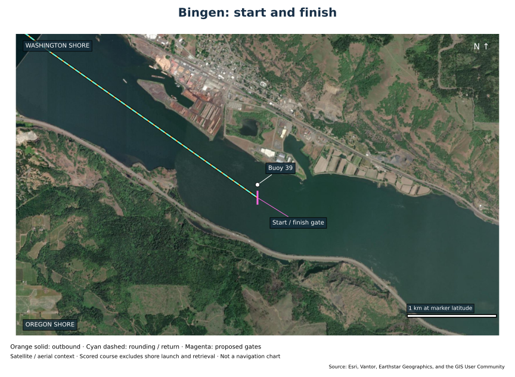
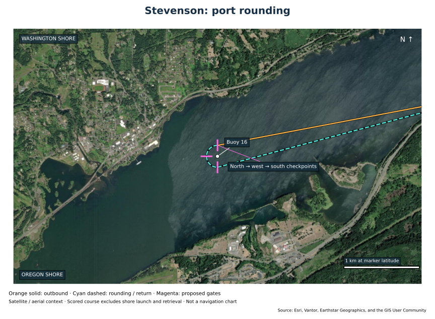

# Mission, context and architecture

**OOSEM:** Mission and context · Logical architecture · [Maturity assessment](development-plan.md)

What does this little boat actually have to do? I start with one finite, independent Gorge challenge, then work through the people, environment and equipment it will interact with. This is [mission definition](development-plan.md#mission-definition): it sets up the responsibilities and scenarios I will use to compare designs.


*Bingen → Stevenson → Bingen. Water extent and course references: NOAA electronic navigational charts.*

### Start, finish and turnaround in shore context

The scored course starts and finishes at the proposed gate south of **Buoy 39 near Bingen**. Launch and retrieval at Bingen Point lie outside the scored circuit. The reference paths retain their geographic coordinates; solid orange and dashed cyan strokes distinguish coincident legs without moving either track away from the river.



The western end is a **port rounding of Buoy 16 near Stevenson**, passing the north, west and south checkpoints in order before returning upstream. It is a turnaround, not a separate finish or a shore landing.



Imagery: [Esri World Imagery](https://services.arcgisonline.com/ArcGIS/rest/services/World_Imagery/MapServer), with provider credits on each image. These close-ups show shore context; mosaic acquisition dates vary and the imagery is not a current navigation chart. The model's gate offsets remain proposed and require field confirmation. The images show reference paths, not a simulated voyage or an approved launch/recovery approach.

The return leg has to make progress over the ground, not just through the water. The representative westerly puts that return downwind against the current, while the outbound leg is windward with it. Easterlies reverse those roles. I will choose a favorable weather window for the challenge and use a separate seasonal profile for winter testing; the [weather analysis](operating-constraints.md#gorge-weather-and-launch-windows) explains the distinction. The challenge is sail-only and unassisted; I want live observation without making a shore connection necessary for control. Year-round operation and Hawai‘i have separate future requirements. For this boat, I want to explore how speed and shorter exposure affect the [chance of completing the round trip](reliability.md#can-a-faster-boat-be-more-likely-to-finish).


The main systems bring together propulsion, steering, power and recovery. The model views below allocate their responsibilities.

The integration candidate, [IC-01](../models/analyses/integrated-candidate.sysml), binds these responsibilities to one provisional mass, energy and performance configuration. Its primary sensing and guidance path sails the mission. A separately powered recovery path has its own observation, navigation, control and thrust allocations, including an inverted operating hypothesis. Primary steering or power loss can therefore permit modeled recovery only when the independent path is explicitly present and powered. This is a fault-isolation assumption to test, not evidence that shared environmental damage cannot defeat both paths.

The [virtual integration milestone](validation-plan.md#exercise-decisions-before-physical-integration) requires the same candidate to support sizing, sensing, maneuver timing, chronological energy and recovery. Hardware interfaces, waterproofing, installed mass distribution, thermal behavior and physical shore retention remain design and evidence work. The retained 440 Wh nominal sizing result is a separate reference configuration; its budget must not be combined with IC-01's capability allocations.

The challenge remains independent of the vehicle so a convenient hardware choice cannot redefine success. Hawaii remains a separate future mission with its own constraints; it does not set acceptance criteria for the Gorge vessel. Traffic, shore support and live monitoring belong in the system context; the vessel must make its own decisions during a qualifying attempt.

We decompose responsibilities before choosing hardware. A satisfy link identifies intended responsibility, while a verification case identifies how that allocation will be tested. Neither means the vessel has passed a physical test.

```sysml-view Page_architecture_0::context direction=TB
package Page_architecture_0 {
    private import StandardViewDefinitions::*;
    private import DiagramLayout::*;
    view context : OOSEM::SystemContextView {
        expose BlueDog::Architecture::MissionContext;
    }
}
```

## From use cases to allocated behavior

I am using OpenSysML's OOSEM library to make the steps between mission intent and equipment explicit. The context identifies the boat, operator, shore support, environment and other vessels. Use cases act on that complete context. Logical scenarios then describe the responsibilities needed to carry out those use cases, before I settle the implementation.

The model refines three use cases with scenario threads. Their actions are allocated to the existing boat architecture; verification cases and the mission simulation are linked to those threads. The [executable mission supervisor](mission-simulation.md#executable-supervisory-logic) implements event responses, sailing permission and abort latching in the conceptual simulator. The scenario sequences describe broader responsibilities: sensing, heading search and physical actuation still need their own implementations and evidence.

### Normal sailing

A sailing cycle carries a typed wind estimate into command selection and a typed command into actuation. The estimate includes its timestamp and validity. The executable supervisor inhibits sailing while wind observations are unavailable and permits it when they return. A safety abort follows a separate, latched recovery path. The scenario describes the full observation-to-actuation responsibility; the simulator exercises the supervisory part alongside conceptual guidance.

```sysml-view Page_architecture_normal::scenario direction=LR
package Page_architecture_normal {
    private import OOSEM::*;
    view scenario : LogicalScenarioView {
        expose BlueDogMethod::Scenarios::NormalSailing;
    }
}
```

### Traffic encounter

Observe, assess, maneuver and reassess. Both AIS and non-AIS vessels matter. The simulator supplies a predicted-conflict observation, and the supervisor identifies traffic-avoidance mode. Geometric maneuver assessment and heading selection remain in the conceptual guidance model. This thread gives the simulation and later sensor testing a common behavioral reference.

```sysml-view Page_architecture_traffic::scenario direction=LR
package Page_architecture_traffic {
    private import OOSEM::*;
    view scenario : LogicalScenarioView {
        expose BlueDogMethod::Scenarios::TrafficEncounter;
    }
}
```

### Abort and recover

An abort ends the attempt. The boat records and signals the event, selects a reachable shore destination and attempts recovery without waiting for an operator or communications acknowledgment. The recovery leg may use the motor.

```sysml-view Page_architecture_recovery::scenario direction=LR
package Page_architecture_recovery {
    private import OOSEM::*;
    view scenario : LogicalScenarioView {
        expose BlueDogMethod::Scenarios::AbortAndRecover;
    }
}
```

The initial physical allocation puts autonomous estimation and decisions on an onboard platform. It leaves processor choice, software partitioning and redundancy open. Wind observation also has a concrete allocation to the challenge's wired sensor installation. Further physical-architecture work must develop these coarse allocations into compatible interfaces and implementations, supported by timing, power and failure evidence. The [method model](../models/vehicle/method.sysml) owns those links; the [development plan](development-plan.md) tracks the maturity and remaining evidence for each layer.

The executable logical responsibilities include event handling, sailing permission, abort latching and the choice between an available recovery attempt and continued drift. Command delivery and maneuver completion are distinct timing events. The [mission simulator](mission-simulation.md#executable-supervisory-logic) records these decisions and their consequences; independent sensing and propulsion after a casualty remain unallocated physical capabilities, not implied backups.

## Sailing hardware

Hull and rig provide the physical platform; actuation trims and steers it. The diagram names the responsibilities before I choose equipment.

```sysml-view Page_architecture_1::sailing direction=TB
package Page_architecture_1 {
    private import StandardViewDefinitions::*;
    view sailing : GeneralView {
        expose BlueDog::Architecture::HullAndRig;
        expose BlueDog::Architecture::SailAndSteeringActuation;
        expose BlueDog::Architecture::EnergySubsystem;
        filter @SysML::PartDefinition;
    }
}
```

## Autonomy and observation

Sensing feeds autonomous decisions; communications let me observe them. Losing a link must not turn shore support into the boat’s controller.

```sysml-view Page_architecture_5::autonomy direction=TB
package Page_architecture_5 {
    private import StandardViewDefinitions::*;
    view autonomy : GeneralView {
        expose BlueDog::Architecture::NavigationAndSensing;
        expose BlueDog::Architecture::GuidanceAndControl;
        expose BlueDog::Architecture::Communications;
        filter @SysML::PartDefinition;
    }
}
```

## Recovery and records

Health and recovery address failures, signaling makes the boat observable to traffic, and recording preserves what happened. The optional observation payload remains a later increment.

```sysml-view Page_architecture_6::support direction=TB
package Page_architecture_6 {
    private import StandardViewDefinitions::*;
    view support : GeneralView {
        expose BlueDog::Architecture::HealthAndRecovery;
        expose BlueDog::Architecture::NavigationSignaling;
        expose BlueDog::Architecture::DataRecording;
        filter @SysML::PartDefinition;
    }
}
```

Use cases connect operator and environmental interactions to the requirements they serve.

## Sail among other vessels

Traffic is an actor in the operating context, not just an environmental number. The sailing and avoidance cases connect that interaction to mission and safety obligations.

```sysml-view Page_architecture_2::operations direction=TB
package Page_architecture_2 {
    private import StandardViewDefinitions::*;
    view operations : GeneralView {
        expose BlueDogUseCases::sailGorge;
        expose BlueDogUseCases::avoidTraffic;
        filter @SysML::UseCaseUsage;
    }
}
```

## Observe and recover

Monitoring supports live observation; recovery is a separate operation that can end a qualifying attempt.

```sysml-view Page_architecture_7::supportOperations direction=TB
package Page_architecture_7 {
    private import StandardViewDefinitions::*;
    view supportOperations : GeneralView {
        expose BlueDogUseCases::monitor;
        expose BlueDogUseCases::recover;
        filter @SysML::UseCaseUsage;
    }
}
```

Launch, service, ocean sailing and navigation signaling remain in the [complete use-case model](../models/vehicle/use-cases.sysml).

## From mission to verification

Read this view from the challenge obligation to its vehicle refinement and planned verification. A satisfy link allocates responsibility; it does not assert a passed test.

```sysml-view Page_architecture_3::MissionSemantics direction=BT
package Page_architecture_3 {
    private import StandardViewDefinitions::*;
    private import DiagramLayout::*;
    view MissionSemantics : GeneralView {
        filter @SysML::RequirementUsage;
        expose GorgeChallenge::transGorgeChallenge;
        expose GorgeChallenge::courseCompletion;
        expose BlueDogRequirements::roundTrip;
        expose BlueDogRequirementVerification::RoundTripVerification;
        expose BlueDog::Architecture::missionContext::boat;
        metadata Layout about GorgeChallenge::transGorgeChallenge { x = 0; y = 0; }
        metadata Layout about GorgeChallenge::courseCompletion { x = 360; y = 0; }
        metadata Layout about BlueDogRequirements::roundTrip { x = 0; y = 200; }
        metadata Layout about BlueDogRequirementVerification::RoundTripVerification { x = 360; y = 200; }
        metadata Layout about BlueDog::Architecture::missionContext::boat { x = 0; y = 400; }
    }
}
```

[Focused requirements](requirements.md) keep each derivation small enough to read. We distinguish mission obligations from independent owner constraints such as transport and manufacture.

```sysml-view Page_architecture_4::ManufacturingSemantics direction=BT
package Page_architecture_4 {
    private import StandardViewDefinitions::*;
    private import DiagramLayout::*;
    view ManufacturingSemantics : GeneralView {
        filter @SysML::RequirementUsage;
        expose BlueDogRequirements::desktopManufacture;
        expose BlueDog::Architecture::missionContext::boat::hullAndRig::printedHull;
        expose BlueDogRequirementVerification::DesktopManufactureVerification;
        metadata Layout about BlueDogRequirements::desktopManufacture { x = 0; y = 0; }
        metadata Layout about BlueDog::Architecture::missionContext::boat::hullAndRig::printedHull { x = 360; y = 0; }
        metadata Layout about BlueDogRequirementVerification::DesktopManufactureVerification { x = 0; y = 200; }
    }
}
```


**Next:** [The development plan](development-plan.md).
