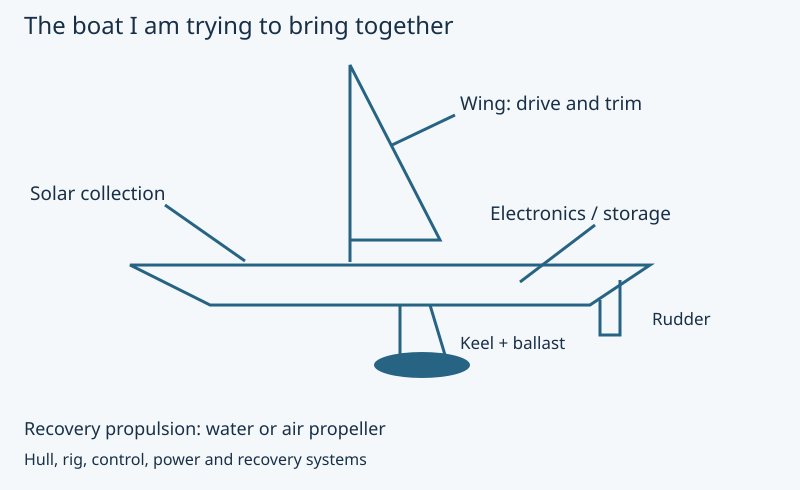

# Mission, context and architecture

What does this little boat actually have to do? I start with the independent Gorge challenge and the longer-term Hawai‘i goal, then work through the people, environment and equipment it will interact with. This is [mission definition](development-plan.md#mission-definition): it sets up the responsibilities and scenarios I will use to compare designs.


*The Dalles → Bonneville → The Dalles. River geometry: [OpenStreetMap contributors](https://www.openstreetmap.org/copyright).*

The return leg has to make progress over the ground, not just through the water. The representative westerly puts that return downwind against the current, while the outbound leg is windward with it. Easterlies reverse those roles. I will choose a favorable weather window for the challenge and use a separate seasonal profile for winter testing; the [weather analysis](operating-constraints.md#gorge-weather-and-launch-windows) explains the distinction. The challenge is sail-only and unassisted; I want live observation without making a shore connection necessary for control. Year-round operation and Hawai‘i require further readiness evidence.



The main systems bring together propulsion, steering, power and recovery. The model views below allocate their responsibilities.

The challenge remains independent of the vehicle so a convenient hardware choice cannot redefine success. The Gorge mission is a proving ground for the eventual ocean voyage. Traffic, shore support and live monitoring belong in the system context; the vessel must make its own decisions during a qualifying attempt.

We decompose responsibilities before choosing hardware. A satisfy link identifies intended responsibility, while a verification case identifies how that allocation will be tested. Neither means the vessel has passed a physical test.

Wind sensing now has an explicit [mission-to-observation requirement thread](requirements/requirements-autonomy.md#wind-observation). The navigation subsystem acquires wind observations; control owns stale-data rejection and the degraded response. The [equipment configurations](energy.md#wind-sensing-configurations) separate the Bluetooth testbed sensor from the wired challenge installation.

```sysml-view Page_architecture_0::context direction=TB
package Page_architecture_0 {
    private import StandardViewDefinitions::*;
    private import DiagramLayout::*;
    view context : GeneralView {
        expose BlueDog::Architecture::missionContext;
        render Views::asInterconnectionDiagram;
    }
}
```

## Sailing hardware

Hull and rig provide the physical platform; actuation trims and steers it. The diagram names the responsibilities before I choose equipment.

```sysml-view Page_architecture_1::sailing direction=TB
package Page_architecture_1 {
    private import StandardViewDefinitions::*;
    view sailing : GeneralView {
        expose BlueDog::Architecture::HullAndRig;
        expose BlueDog::Architecture::SailAndSteeringActuation;
        expose BlueDog::Architecture::EnergySubsystem;
        filter @SysML::PartDefinition;
    }
}
```

## Autonomy and observation

Sensing feeds autonomous decisions; communications let me observe them. Losing a link must not turn shore support into the boat’s controller.

```sysml-view Page_architecture_5::autonomy direction=TB
package Page_architecture_5 {
    private import StandardViewDefinitions::*;
    view autonomy : GeneralView {
        expose BlueDog::Architecture::NavigationAndSensing;
        expose BlueDog::Architecture::GuidanceAndControl;
        expose BlueDog::Architecture::Communications;
        filter @SysML::PartDefinition;
    }
}
```

## Recovery and records

Health and recovery address failures, signaling makes the boat observable to traffic, and recording preserves what happened. The optional observation payload remains a later increment.

```sysml-view Page_architecture_6::support direction=TB
package Page_architecture_6 {
    private import StandardViewDefinitions::*;
    view support : GeneralView {
        expose BlueDog::Architecture::HealthAndRecovery;
        expose BlueDog::Architecture::NavigationSignaling;
        expose BlueDog::Architecture::DataRecording;
        filter @SysML::PartDefinition;
    }
}
```

Use cases connect operator and environmental interactions to the requirements they serve.

## Sail among other vessels

Traffic is an actor in the operating context, not just an environmental number. The sailing and avoidance cases connect that interaction to mission and safety obligations.

```sysml-view Page_architecture_2::operations direction=TB
package Page_architecture_2 {
    private import StandardViewDefinitions::*;
    view operations : GeneralView {
        expose BlueDogUseCases::sailGorge;
        expose BlueDogUseCases::avoidTraffic;
        filter @SysML::UseCaseUsage;
    }
}
```

## Observe and recover

Monitoring supports live observation; recovery is a separate operation that can end a qualifying attempt.

```sysml-view Page_architecture_7::supportOperations direction=TB
package Page_architecture_7 {
    private import StandardViewDefinitions::*;
    view supportOperations : GeneralView {
        expose BlueDogUseCases::monitor;
        expose BlueDogUseCases::recover;
        filter @SysML::UseCaseUsage;
    }
}
```

Launch, service, ocean sailing and navigation signaling remain in the [complete use-case model](../models/vehicle/use-cases.sysml).

## From mission to verification

Read this view from the challenge obligation to its vehicle refinement and planned verification. A satisfy link allocates responsibility; it does not assert a passed test.

```sysml-view Page_architecture_3::MissionSemantics direction=BT
package Page_architecture_3 {
    private import StandardViewDefinitions::*;
    private import DiagramLayout::*;
    view MissionSemantics : GeneralView {
        filter @SysML::RequirementUsage;
        expose GorgeChallenge::transGorgeChallenge;
        expose GorgeChallenge::courseCompletion;
        expose BlueDogRequirements::roundTrip;
        expose BlueDogRequirementVerification::RoundTripVerification;
        expose BlueDog::Architecture::missionContext::boat;
        metadata Layout about GorgeChallenge::transGorgeChallenge { x = 0; y = 0; }
        metadata Layout about GorgeChallenge::courseCompletion { x = 360; y = 0; }
        metadata Layout about BlueDogRequirements::roundTrip { x = 0; y = 200; }
        metadata Layout about BlueDogRequirementVerification::RoundTripVerification { x = 360; y = 200; }
        metadata Layout about BlueDog::Architecture::missionContext::boat { x = 0; y = 400; }
    }
}
```

[Focused requirements](requirements.md) keep each derivation small enough to read. We distinguish mission obligations from independent owner constraints such as transport and manufacture.

```sysml-view Page_architecture_4::ManufacturingSemantics direction=BT
package Page_architecture_4 {
    private import StandardViewDefinitions::*;
    private import DiagramLayout::*;
    view ManufacturingSemantics : GeneralView {
        filter @SysML::RequirementUsage;
        expose BlueDogRequirements::desktopManufacture;
        expose BlueDog::Architecture::missionContext::boat::hullAndRig::printedHull;
        expose BlueDogRequirementVerification::DesktopManufactureVerification;
        metadata Layout about BlueDogRequirements::desktopManufacture { x = 0; y = 0; }
        metadata Layout about BlueDog::Architecture::missionContext::boat::hullAndRig::printedHull { x = 360; y = 0; }
        metadata Layout about BlueDogRequirementVerification::DesktopManufactureVerification { x = 0; y = 200; }
    }
}
```


**Next:** [The development plan](development-plan.md).
