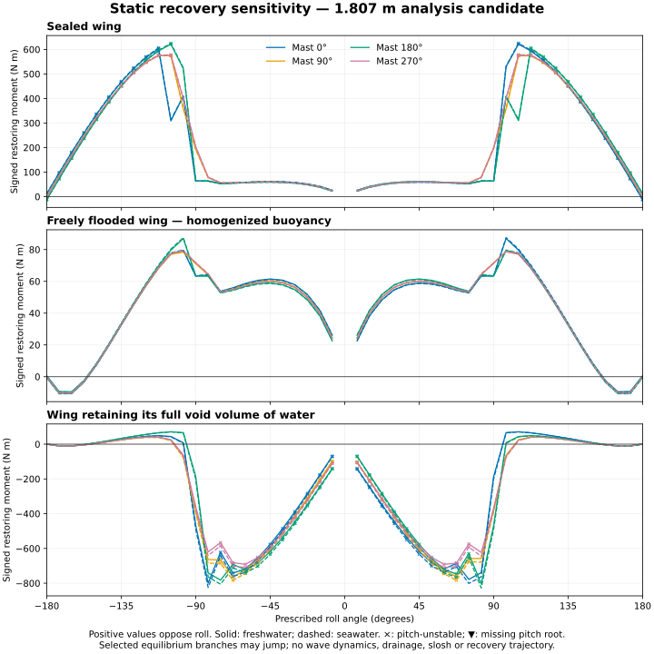

# Coupled sizing results

<!-- Generated by scripts.publish_coupled_results. -->

**Exploratory sizing result, not a selected or qualified boat.** The search uses a hull-form-dependent resistance regression and explicit applicability screens. Numerical feasibility remains conditional on the stated physical models and sensitivity replay.

The shared-design solve returned (coarse screens pass: True): **1.807 m length by 0.654 m beam**, 31.44 kg at the search mesh resolution. Its length/beam ratio is 2.76. The hull fullness exponent is free. Native Delft residuary resistance replaces the former displacement/Froude shortcut; the geometry and speed must pass its declared screening envelope. Bounds alone do not validate every hull inside that envelope.

Search geometry resolution: 12. Optimizer stop: Optimization terminated successfully. Initial constrained feasibility fallback: not needed. Feasibility restoration: not needed. Search maximum scaled equilibrium residual: 8.35e-05; minimum normalized margin: -6.09e-06. Numerical convergence does not establish physical applicability.

Search-only energy reserve: 0.50 Wh/day. The progress search reserve is 0.005 m/s on each leg. These protect against numerical replay drift; adverse physical assumptions are assessed separately. SLSQP stopping tolerance: 0.0001.

Active numerical/domain bounds: wing_thickness_scale: upper bracket 2; rudder_arm_fraction: upper bracket 0.65; rudder_torque_Nm: lower bracket 0.05; foil_rib_pitch_m: upper bracket 0.23; battery_z_fraction: lower bracket 0.05; hull_fullness_exponent: upper bracket 2.

## Candidate dimensions

| Quantity | Search result |
|---|---:|
| Wing area | 1.280 m² |
| Wing span / chord | 2.262 / 0.566 m |
| Wing aspect ratio | 3.998 |
| Camber / thickness scale relative to CAD section | 1.089 / 2.000 |
| Keel area / span | 0.154 m² / 0.734 m |
| Rudder area / span | 0.0065 m² / 0.095 m |
| Ballast | 11.42 kg |
| Battery / solar panel | 202.0 Wh / 0.225 m² |

These continuous variables describe the analysis geometry, not production dimensions or selected commercial hardware. See the linked search data for laminate, rib spacing, placement and drive ratings.

## What the coupled calculation changes

The wing uses its CAD section for skin mass, weak-axis stiffness and displaced volume. Finite-thickness laminate section properties replace the thin-wall approximation, which could overpredict even solid-section stiffness at high material packing. Both chord orientations supply VSPAERO polars; wing moment affects yaw balance and actuator demand. Motor/gearbox moving losses are separate from holding/controller loads. Tack time fractions cancel crosswind displacement before current and route duration are evaluated.

The old reference wing passes its bending-strength screen but fails the declared tip-deflection allocation with the CAD section. Its generic section approximation was insufficient. The free-design search can adjust area, aspect ratio, thickness, laminate, ballast and actuator ratings together.

## Candidate aerodynamic interpolation check

Direct VSPAERO runs at the candidate aspect ratio and camber are compared with the saved grid at all eight incidence nodes. Both use the grid’s reference thickness and mesh 24. The differences below are coefficient errors, not physical validation.

| Chord orientation | Maximum absolute CL difference | Maximum absolute CDi difference | Maximum absolute CMy difference |
|---|---:|---:|---:|
| Original | 0.00125 | 0.00216 | 0.00076 |
| Reversed | 0.00128 | 0.00209 | 0.00087 |

The optimized thickness change is used by mass, stiffness and buoyancy calculations; its viscous aerodynamic effect is not established by this thin-wing calculation. [Direct comparison data](analysis/wing-candidate-check.json).

## Refined replay and sensitivities

Replay uses finer geometry, re-solves both-tack operating states, and evaluates four mast positions through -180 to 180 degrees with hydrostatic heave and pitch equilibrium. Selected screens include signed roll moments along the chosen pitch-equilibrium branch. A positive roll moment on a pitch-unstable branch does not prove a recoverable trajectory. Missing equilibria within the ±85° pitch search range remain unresolved and prevent the recovery screen from passing; they are not proof of physical impossibility. Dynamic recovery remains unverified.

| Scenario | Operating / practical screens pass | Sampled roll screen pass | Lowest operating margin | Lowest structural/practical margin | Route time E / W (h) | Missing pitch equilibria | Pitch-unstable samples |
|---|---|---|---:|---:|---:|---:|---:|
| nominal | True | True | 0.000 | 0.000 | 67.95 / 54.90 | 0 | 86 |
| construction | False | True | 0.000 | -0.375 | 68.96 / 55.91 | 0 | 86 |
| aerodynamic | False | True | 0.000 | 0.000 | 91.88 / 56.87 | 0 | 86 |
| hydrodynamic | False | True | 0.000 | 0.000 | 72.35 / 58.32 | 0 | 86 |
| energy | False | True | -0.595 | 0.000 | 67.94 / 54.73 | 0 | 86 |
| combined | False | True | -0.595 | -0.375 | 3842.05 / 106.52 | 0 | 86 |

Governing failures by scenario (normalized margins):

- **nominal**: No failed operating, structural or route margins.
- **construction**: keelDeflectionMargin: -0.375; rudderDeflectionMargin: -0.343; wingDeflectionMargin: -0.259; keelHandlingMargin: -0.022; easterlyUpstreamProgress: -0.010
- **aerodynamic**: easterlyUpstreamProgress: -0.297; easterlyDuration: -0.276
- **hydrodynamic**: easterlyUpstreamProgress: -0.063; easterlyDuration: -0.005
- **energy**: cycleMargin: -0.595; reserveMarginScaled: -0.237. 8/8 cases use energy-unconstrained diagnostic controls after a failed constrained attempt.
- **combined**: easterlyDuration: -52.362; easterlyUpstreamProgress: -0.985; cycleMargin: -0.595; westerlyDuration: -0.479; westerlyUpstreamProgress: -0.401. 8/8 cases use energy-unconstrained diagnostic controls after a failed constrained attempt.

Normalized margins below -0.0001 fail the selected screen; smaller numerical residuals display as zero. Scenario brackets are engineering sensitivities, not measured distributions or guaranteed worst-case bounds. Operating controls are first optimized with energy constraints enforced. A failed constrained attempt gets a labelled energy-unconstrained diagnostic to expose the remaining performance and energy deficit; all margins are still checked afterward. These local attempts do not prove that every possible control policy is infeasible. Controls are reoptimized for each scenario; local solutions and coupled load changes can produce non-monotonic route times: see [native inputs](../models/coupled-uncertainty.sysml). Route times are shown only when every operating case passes the non-energy operating and model-domain screens. E / W denotes easterly / westerly wind: upstream is windward for an easterly, leeward for a westerly. Both profiles use 100 km per leg, equal-time 5/8 m/s wind cases, and the declared downstream currents. They use synthetic wind/current exposure and rigid geometry; no accepted-weather or ocean qualification is implied.

## Mass and energy at the same geometry

| Scenario | Replay mass (kg) | Average-power range (W) | Minimum cycle balance (Wh) | Minimum overnight reserve margin (Wh) |
|---|---:|---:|---:|---:|
| nominal | 31.45 | 4.78–4.80 | 1.552 | 0.000 |
| construction | 33.11 | 4.78–4.80 | 1.552 | 0.000 |
| aerodynamic | 31.45 | 4.78–4.80 | 1.552 | 0.000 |
| hydrodynamic | 31.45 | 4.78–4.80 | 1.552 | 0.000 |
| energy | 31.45 | 5.92–5.98 | -59.539 | -23.724 |
| combined | 33.11 | 5.92–5.98 | -59.538 | -23.723 |

These are separate minima across eight steady operating cases at the same vessel geometry. Energy-screen acceptance uses a 0.01 Wh numerical tolerance, which is separate from engineering reserve; route-level weather and duty-cycle histories remain a separate validation task. Diagnostic-control cases are identified above.

## Water-ingress recovery sensitivities

| Wing state | Cases with positive sampled roll moments | Worst restoring moment (Nm) | Missing pitch equilibria | Pitch-unstable samples |
|---|---:|---:|---:|---:|
| sealed | 8/8 | 22.49 | 0 | 172 |
| free_flooding_homogenized | 0/8 | -10.77 | 0 | 0 |
| full_water_retention | 0/8 | -827.93 | 0 | 164 |

Each state covers freshwater and seawater at four locked mast positions. Free flooding uses homogenized material buoyancy; full retention fills the estimated void at its volume centroid. These are static loading sensitivities, not predictions of leakage, drainage or slosh. See [recovery data](analysis/coupled-recovery.json).

## Pitch-equilibrium coverage

All recovery samples found a pitch equilibrium within the declared search range. This does not establish pitch stability or a dynamic recovery trajectory. [Diagnostic data](analysis/coupled-pitch-diagnostic.json).

## Decision

Nominal operating/practical screens pass: **True**. Nominal sampled roll screen passes: **True**. These are separate from physical mission verification.

Use the replay verdicts to decide whether further sizing is justified. A failed nominal replay invalidates the coarse candidate; failed adverse cases identify design margins or evidence that still need resolution. Active numerical bounds require investigation before a minimum-size claim.

The [hull-resistance report](hull-resistance.md) documents the regression, geometry screening and verification. The separate hydrodynamic sensitivity increases residuary resistance by 30%; the combined case includes that increase. These brackets do not substitute for hull-specific tow evidence.

Remaining evidence includes viscous/stall and broadside wing behavior, aerodynamic thickness sensitivity, hull-form resistance, environmental/fouling exposure, selected hardware and its packaging/CG, laminate/joint properties, ingress/drainage behavior and dynamic recovery. These are separate from numerical solver convergence.

[Search data](analysis/coupled-sizing-search.json) · [Refined replay](analysis/coupled-sizing-replay.json) · [Reference operating cases](analysis/coupled-fixed-design.json) · [Method and requirement coverage](coupled-sizing.md)
