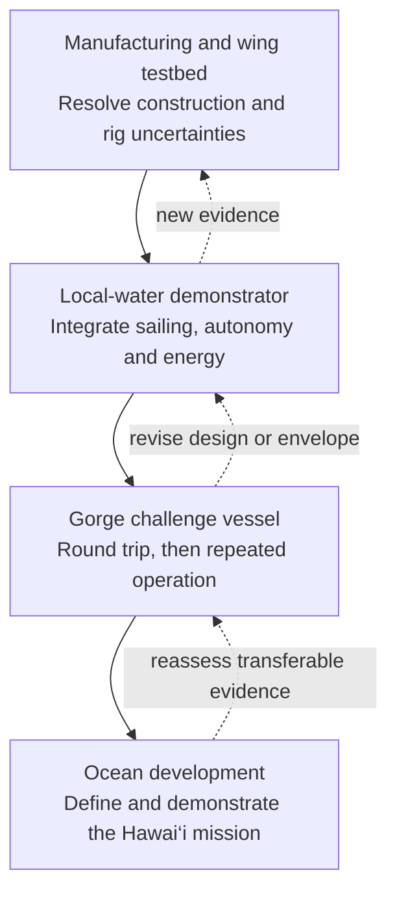
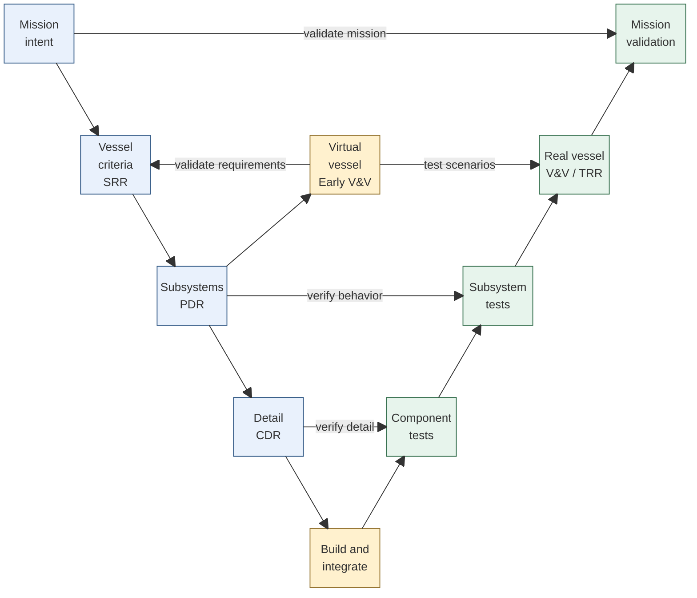
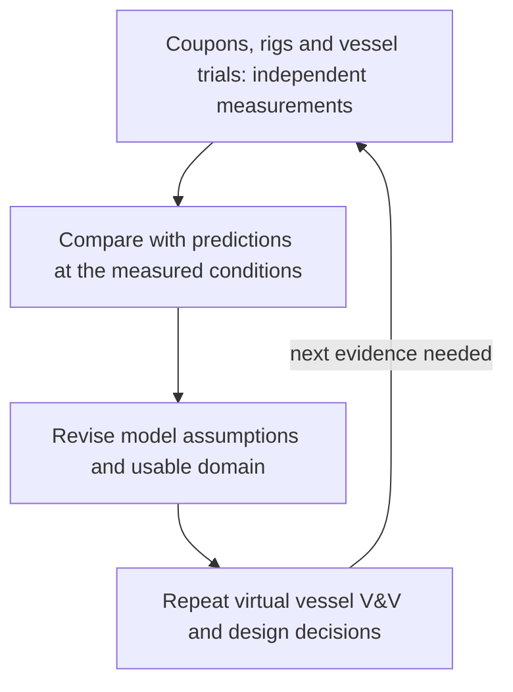

# Developing Blue Dog: a V with room to learn

The current development cycle targets one finite Gorge round trip. Hawaii and indefinite operation belong to future cycles with separately allocated constraints. At the virtual-design gate, compare passage performance and accumulated failure exposure together; physical tests must establish the load, control and reliability assumptions behind that comparison.

I need a way to decide what to work on next without turning a personal boat project into a paperwork exercise. This plan starts with the sailing goals, the testbed and the gaps in current evidence. It connects each design decision to the simulation or experiment that could change it.

Our plan combines a systems engineering V with repeated model-and-experiment loops. The outer V follows a particular vessel configuration from intent to demonstrated behavior. Inside it, we first verify and validate the simulated vessel: does the proposed design meet its criteria, and does its behavior address the intended mission? Later we ask those questions of the physical vessel. Separately, measurements assess whether the simulation models are credible enough for their intended use. We repeat this process for increasingly capable prototypes; the first build does not have to be the challenge vessel.

This page defines the development approach and proposed review criteria. It does not record completed reviews or introduce new vessel acceptance thresholds. Requirements, allocations and engineering criteria remain in the [SysML model](../models/README.md); [recorded results](results.md) distinguish numerical outcomes from accepted physical evidence. The process diagrams below explain the method, rather than claiming to be executable SysML activities.

**Where I am now:** mission definition and virtual preliminary design, with a separate manufacturing/wing/control testbed in CAD. The sizing study has exposed handling, aerodynamic and recovery uncertainties. My next commitment is to focused experiments that can reduce those uncertainties—not to release a challenge vessel for construction.

## The overall trajectory

The manufacturing and wing prototype has its own learning mission. The challenge vessel must eventually complete The Dalles–Bonneville–The Dalles without intervention, while allowing live monitoring. Repeated operation is the next objective. Hawai‘i remains the longer-term driver, with its own mission definition and readiness evidence; success in the Gorge does not establish ocean readiness.

The first qualifying attempt will use a selected weather window, with westerlies as the representative Gorge case. Winter development trials and later year-round operation have separate profiles. The [weather study](operating-constraints.md#gorge-weather-and-launch-windows) belongs in mission definition and virtual validation: it asks which environments deserve performance emphasis and how wind shifts change the outcome. Before a challenge launch, the test-readiness decision must connect the actual forecast, permitted window, reserve, abort/recovery plan and trial purpose. A summer direction frequency cannot qualify a winter test or authorize a launch.



Each box contains its own scoped V and review decisions. Progress depends on evidence, not dates. A subsystem can advance while another iterates, provided shared interfaces and budgets remain compatible. Early coupons and test rigs can precede the vessel's preliminary design review when their purpose is to resolve the uncertainty blocking that review.

## One V for each configuration

Read the solid outer path down through definition and implementation, then up through integration and demonstration. The connections across the V pair design intent with the evidence that will assess it. The central simulation is a reusable collection of mission, physics, control and fault models, not a single all-purpose solver.



The left-side loop is **early virtual verification and validation**. Requirements and operating scenarios drive the simulated vessel; we check both compliance with design criteria and whether the resulting behavior would accomplish the intended mission. Findings can change requirements, architecture or controls before hardware exists. This is more than predicting a test result or checking whether the simulator is numerically correct.

The right side is **physical verification and validation**: component, subsystem and integrated evidence from the built configuration, culminating in mission behavior. We reuse scenarios and acceptance logic where applicable, while recording whether each result came from simulation or the real system. The simulation also develops test cases and expected responses for that right-hand work.

A third connection, **model validation**, compares physical observations with simulation predictions. It establishes the model's usable domain and discrepancy, and feeds the next virtual-design iteration. This feedback is shown separately below so it cannot be mistaken for either virtual or physical product validation.

## Follow one decision across the V

Take the wing actuator. During virtual design I estimate trim moments and duty cycles, then ask whether the proposed drive supports sailing and energy requirements. That can expose an inadequate allocation before I buy hardware. On the bench I will measure a real drive’s movement energy, holding demand and jam behavior. Those tests verify the implementation; comparing them with the predictions also tests the model. Finally, integrated sailing trials ask whether the complete boat trims reliably in the conditions the mission actually needs.

These are different uses of evidence. A correct calculation does not establish real wing loads, and a good actuator bench result does not establish an autonomous voyage.

<details>
<summary>Reference: virtual V&V, physical V&V and model validation</summary>

## Three evidence streams, not one validation label

The outer V and its early simulation loop answer the same design questions at different levels of realization. Model credibility is a separate question.

| Activity | What is being assessed? | Example for Blue Dog | What the result permits |
| --- | --- | --- | --- |
| **Virtual verification** | The modeled design against allocated requirements | Does the simulated boat maintain the required upstream progress and energy reserve in the specified scenarios? | Conditional assessment of the candidate design, within the model's stated credibility |
| **Virtual validation** | Simulated behavior and the proposed requirements against mission intent | Can an unattended boat complete the route under realistic wind shifts and communications loss, or have we omitted a necessary behavior? | Refine the mission, requirements, architecture and operating concept before building |
| **Physical verification** | The built configuration against requirements | Do measured progress, energy use and recovery behavior meet their criteria? | Requirement evidence for the tested configuration and applicable conditions |
| **Physical validation** | The real vessel in its intended use | Does the integrated boat actually accomplish the unattended journey with usable live monitoring? | Evidence that the vessel fulfills the mission, not merely its component specifications |
| **Model validation** | Predictions against independent physical observations | Do measured wing forces, actuator consumption and vessel response agree sufficiently with predictions? | Establish or restrict where the model can support the preceding decisions |



This is a feedback loop, not a requirement to wait for a finished boat before validating any model. Early coupons, wing rigs and actuator experiments also supply physical observations to model validation. A component can already have correlated models while integrated mission simulation still uses provisional assumptions. Hardware-in-the-loop mixes real implementation with a simulated environment: it verifies particular interfaces or controller behavior, not the entire vessel in real weather.

Model validation is also separate from software verification. Unit tests, analytic benchmarks, native/interpreter comparisons and mesh studies check implementation or numerical behavior. They cannot establish real sail lift, drag or durability. Conversely, a useful force measurement does not establish that the complete boat can sail upstream autonomously.

For each model experiment, define the predicted observable, test configuration, applicable conditions, measurement uncertainty and allowable discrepancy before taking data. Keep calibration data distinct from validation data where practical. A model whose error is acceptable for concept comparison may still be inadequate for final sizing. An inconclusive comparison stays inconclusive; it is not converted into a passing requirement.


</details>

<details>
<summary>Reference: work at each layer and major subsystem</summary>

## What happens at each layer

| Layer | Early virtual V&V | Later physical V&V |
| --- | --- | --- |
| Mission | Exercise proposed course and operating scenarios in a mission simulation; challenge unattended behavior, live monitoring, recovery, traffic and environmental assumptions | Scenario reviews, end-to-end mission rehearsal and recorded qualifying operation |
| Vessel | Check the modeled vessel against progress, energy, mass, handling, stability and reliability criteria; challenge the operating concept with adverse scenarios | Integrated sailing, energy and recovery trials; compare predicted and measured vessel behavior |
| Subsystem | Simulate subsystem concepts, interfaces, loads and fault responses; check allocations and expose missing requirements | Bench and subsystem tests; interface checks; software- and hardware-in-the-loop fault scenarios |
| Component | Check component calculations and simulated behavior against allocated criteria before releasing geometry, materials, circuits and firmware | Coupons, dimensional inspection, load and leakage tests, electrical characterization and software checks |

At each layer, test planning starts with the requirement or decision. We identify what must be observed before choosing instrumentation or increasing simulation fidelity.

## Subsystem work and analysis maturity

The rows below group responsibilities from the [current architecture](architecture.md). These are planned activities, not completed verification claims. Supporting analyses are linked rather than copied into a second requirements register.

| Workstream | Mission and preliminary design | Detailed design and component evidence | Integration and mission evidence |
| --- | --- | --- | --- |
| Hull, keel and manufacturing | Couple displacement, resistance, mass, handling and stability; compare construction concepts | Measure printed/laminated coupons, joints, actual mass and center of gravity; inspect watertight assemblies; correlate structural and hydrostatic models | Tow or sailing resistance measurements, loaded trim, leakage and representative structural exposure; revisit [structure and recovery](structures-and-recovery.md) predictions |
| Wing and trim actuation | Compare rig concepts using progress, energy and recovery criteria; use [VSP trends](sail-trade.md) within their stated limits | Measure lift, drag and moment for the actual section and relevant conditions; characterize gearbox movement, holding, backlash and jam behavior | Compare sailing polars, heel, trim effort and electrical consumption with predictions; exercise allowed fault states |
| Rudder and steering | Allocate turning and course-control authority; consider current, heel and weed exposure | Characterize actuator torque, rate, sealing and steering loads; test appendage construction and weed-clearing behavior | Turning and tracking trials in increasingly representative conditions; quantify control authority and loss-of-steerage response |
| Energy and electrical system | Use [energy scenarios](energy.md) to size harvesting, storage and loads; examine dark periods and adverse duty cycles | Measure battery capacity, conversion losses, load profiles and actuator peaks; verify protection and sensing | Replay time histories on the bench, then correlate measured state of charge and consumption during multi-day operation |
| Navigation, sensing and autonomy | Define mission states, environmental assumptions and responses to unavailable or misleading inputs | Sensor characterization; software-in-the-loop scenario tests; real-controller hardware-in-the-loop timing, resets and fault injection | Progressive local-water autonomy trials; log decisions, tracking and traffic interactions without relying on operator corrections |
| Communications, recording and shore monitoring | Allocate coverage, latency, data completeness and communications-loss behavior | Bench link and antenna checks; verify command integrity, timestamps, storage and power demand | Field coverage and interrupted-link tests; demonstrate monitoring and reconstruct the mission from logs without making connectivity necessary for control |
| Health, recovery and conspicuity | Link hazards and [DFMEA](reliability.md) to failure detection, recovery actions and mission boundaries | Test ingress detection, resets and recovery actuation; evaluate sealed and flooded configurations and visible signaling | Controlled recovery/capsize trials and fault campaigns; assess traffic-related behavior and launch/recovery procedures before broader exposure |

Recovery propulsion may support testing and vessel recovery. It cannot contribute to a qualifying challenge run. Observation payloads and station keeping remain later increments so they do not obscure the initial mission's evidence needs.

Detailed analysis follows uncertainty, not a fixed tool ladder. Start with estimates and sensitivity studies; add fidelity when it could change an architecture or sizing decision. Before committing geometry, correlate the dominant physical assumptions. Before the mission, obtain integrated evidence in representative conditions. A more detailed simulation is not automatically more credible.


</details>

## Review gates scaled to one project

Each Systems Engineering Technical Review (SETR) is a short, configuration-specific decision supported by linked evidence. No standing board or slide deck is required. I make the commitment decision; an agent prepares the evidence and another review, when requested, can challenge the reasoning. Different subsystems can hold separate scoped reviews.

In practice I need five questions: **SRR**, is the mission clear enough to design against? **PDR**, does the concept justify detailed work? **CDR**, can I build the defined scope? **TRR**, is the next test ready? **Progression review**, what does its evidence justify doing next? A review can send me back around the loop or release only a limited experiment.

<details>
<summary>Reference: gate entry, exit and permitted commitments</summary>

| Gate | Entry: what is ready to discuss? | Exit: what must support the decision? | Commitment enabled |
| --- | --- | --- | --- |
| **SRR — mission and requirements** | Named increment, mission scenarios, requirement derivation and unresolved questions | Scope and success criteria agreed; scenario review and early simulation challenge requirement completeness; critical obligations are assessable; verification methods identified | Develop the selected concepts and evidence plan |
| **PDR — preliminary design** | Architecture alternatives, interfaces, budgets, sensitivity results and major risks | Virtual V&V supports the concept and intended behavior, with explicit model credibility; critical failures resolved or bounded by a specific experiment; no virtual pass is relabeled as physical verification | Develop detailed design for the reviewed scope |
| **CDR — build readiness** | Released design candidate, interface definitions, parts/material choices and acceptance procedures | Manufacturing and integration information sufficient to build; detailed virtual checks and available component measurements support critical loads/interfaces; configuration and deviations identifiable | Build that configuration, including a limited-purpose test article |
| **TRR — test readiness** | Test objective, linked criteria, article configuration, procedure, instrumentation and predicted results | Measurements can answer the question; operating and abort limits, recovery method and data capture checked; unresolved issues do not defeat the test | Run that bounded test campaign |
| **Results and progression review** | Separately identified virtual and physical results, uncertainty, model comparisons and requirement dispositions | Evidence accepted only for applicable conditions; failures and inconclusive results resolved or explicitly constrain progression; next scope agreed | Repeat, redesign, expand the envelope, or attempt the next mission increment |

A decision is **proceed**, **proceed with limitations**, or **iterate**. A limitation states exactly what work is permitted and what remains blocked. A bench rig's CDR does not release the final vessel. Every on-water envelope expansion gets a scoped TRR; completing one trial does not authorize all later conditions.

The review record needs only a scope/configuration reference, criteria with evidence links, discrepancies, the owner's decision and follow-up actions. Every result identifies its evidence type: virtual, physical or mixed; model credibility is recorded separately from the requirement verdict. A changed interface, critical assumption or requirement reopens the affected decision. Unaffected evidence can be reused only with a documented applicability check. These gates are our engineering decisions, not external certification.


</details>

## Traceability without duplicate paperwork

The engineering chain is mission/use case → requirement → allocated architecture → analysis or verification case → executed configuration → evidence → review decision. A second chain connects each prediction to its assumptions, measurements and validity limits. Tests should reference the model's criterion rather than maintain a separate acceptance threshold in Python.

The existing mission linkage is already model-owned:

```sysml-view Page_development_plan_0::missionEvidence direction=BT
package Page_development_plan_0 {
    private import StandardViewDefinitions::*;
    view missionEvidence : GeneralView {
        expose GorgeChallenge::courseCompletion;
        expose BlueDogRequirements::roundTrip;
        expose BlueDogRequirementVerification::RoundTripVerification;
    }
}
```

We will extend that pattern to experiment applicability, model correlation and scoped review records. Those process records and gate dashboards are planned work; this article does not imply they are already implemented. Native model views will expose the engineering links, while raw measurements and solver outputs retain their configuration and source provenance. Virtual and physical executions of the same verification case remain distinct result records; a simulated pass never closes a planned physical demonstration. GitHub issues can track tasks without becoming a competing source of engineering truth.

Before starting an analysis, an agent should state the decision, linked model elements, needed accuracy and the result that would change the choice. Its output should identify what was learned, what remains uncertain and which next gate it supports. Automatic checks can report missing links, stale evidence or numerical failures; they cannot silently accept physical evidence or approve mission readiness.

## The next useful increment

Our immediate aim is to close the evidence gaps blocking a credible preliminary design. The [current sizing study](results.md) is exploratory and does not establish a minimum feasible boat. The first focused work packages are:

1. Define the initial virtual V&V campaign: mission scenarios, expected behavior, acceptance checks and the requirement/design decisions each scenario can change. Define the manufacturing/wing testbed's learning objectives alongside it.
2. Plan wing-force/moment and actuator measurements, construction coupons, and controlled hydrostatic/recovery experiments. Specify comparators and uncertainty before testing.
3. Correlate the relevant model inputs and validity domains; rerun coupled sizing and adverse-case analysis when the new evidence changes them.
4. Hold a scoped PDR to select the architecture and remaining detailed-design work, then release the next build through CDR and TRR.

In parallel, develop the electrical bench and simulation interfaces for energy, sensing, communications and autonomy. A local-water demonstrator follows when the integrated test questions and recovery arrangements are ready. This keeps progress possible while the rig and hull evidence matures.

The existing steady-state sizing analysis and per-state energy screens are useful inputs to this campaign, but they are not yet a complete closed-loop, time-dependent virtual vessel. We still need a minimal mission simulation that can exercise wind/current changes, navigation decisions, communications loss, faults and chronological energy use. Its first purpose is to expose missing or unsuitable requirements and reject inadequate concepts. Correlated component models and more detailed dynamics follow where those decisions require them.

## Diagrams that informed this plan

The strongest match is [Airbus's Systems Engineering V-Cycle, printed slide 3 (PDF page 2)](https://www.mathworks.com/content/dam/mathworks/mathworks-dot-com/solutions/aerospace-defense/files/2008/Airbus-Model-BasedDesignforFuelControlSystems.pdf#page=2). Its simulation sits inside the V and supports both requirements work and integration testing. We borrow that arrangement, without the supplier/enterprise split.

[EyasSAT's Five V&V Activities, Figure 2 on page 4](https://indico.esa.int/event/94/contributions/3625/attachments/2915/3380/S9_1200_Liefer.pdf#page=4) separates requirements validation, model validation, product verification, product validation and flight certification. We adapt the last activity to a personal-project readiness decision. EyasSAT is a training platform adopted by space organizations, not evidence from a flown mission.

For an industrial account of iteration, [Airbus's 2017 fuel-system presentation, slide 11](https://www.mathworks.com/content/dam/mathworks/mathworks-dot-com/solutions/aerospace-defense/files/2017/expo-uk/model-based-design-for-fuel-system-development.pdf#page=11) shows distinct model, requirements and test-validation loops; the surrounding presentation describes work on aircraft fuel systems, including A350 modeling. These are references for the method, not proof that their tools or level of formality are appropriate for a small sailboat.


## Reading the series through the plan

The [series guide](index.md) groups the articles by the decisions below. These are recurring activities, not claims that a review has passed or that every subsystem has reached the same stage.

<a id="mission-definition"></a>
### Mission definition and SRR

Start with owner intent, the challenge and the operating context. Refine these into requirements and scenarios, using early simulation to challenge omissions. The [journey](restarting-sv-blue-dog.md), [architecture](architecture.md), [operating constraints](operating-constraints.md) and [focused requirements](requirements.md) inform what we intend to build and how success will be judged.

<a id="virtual-design"></a>
### Virtual design and PDR

Use requirements, scenarios and declared model assumptions to assess candidate behavior before hardware commitment. The [sizing method](sizing.md), [results](results.md), [sail trade](sail-trade.md), [energy](energy.md), [recovery propulsion](recovery-propulsion.md) and [reliability](reliability.md) inform architecture and sizing decisions. A conditional simulation result remains distinct from physical evidence.

<a id="detailed-design"></a>
### Detailed design and build readiness

Turn a reviewed concept, interface definitions and supported loads into a buildable configuration. [Manufacturing and recovery](structures-and-recovery.md), subsystem analyses and equipment-level requirement views inform material, geometry, actuator and electrical details. CDR releases a defined scope; unresolved evidence can limit that release to an experiment.

<a id="physical-validation"></a>
### Physical V&V and progression

Take an identified test article, procedures and criteria into component, subsystem and integrated trials. TRR establishes readiness for each campaign; results inform requirement verification, real mission validation and progression. The current articles describe planned evidence and numerical studies, not a completed physical verification campaign.

<a id="model-credibility"></a>
### Model validation and feedback

Compare predictions with independent measurements under recorded conditions. The [wing experiments](sail-trade.md), [structural and recovery work](structures-and-recovery.md) and [energy measurements](energy.md) will establish or restrict model applicability. This feedback can reopen virtual design at any stage; it is separate from validating the proposed or real vessel against its mission.

<a id="engineering-record"></a>
### The engineering record across the V

Use the [modeling method](methods/modeling.md) and [publishing workflow](publishing.md) to preserve requirements, rationale, configurations and evidence links. Their inputs are the engineering work at every stage; their output is a consistent record for review decisions and future iteration.


**Next:** [What the current sizing study tells me](results.md).
