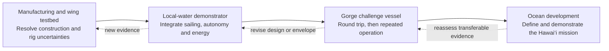
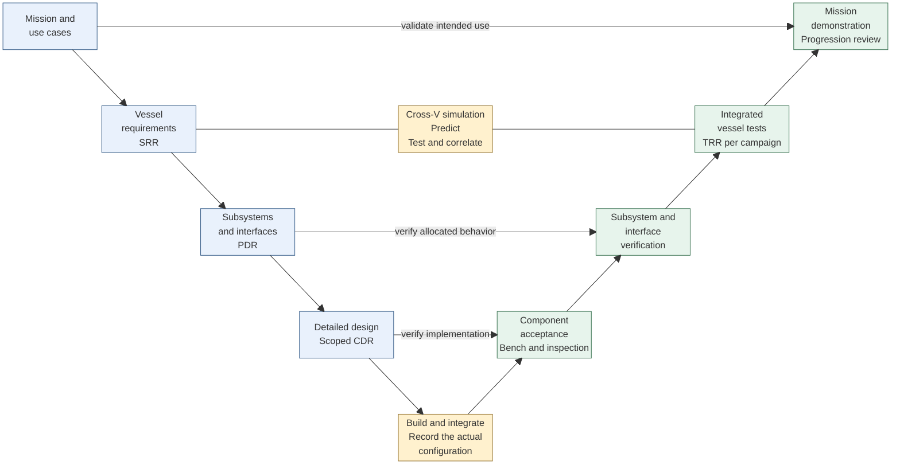
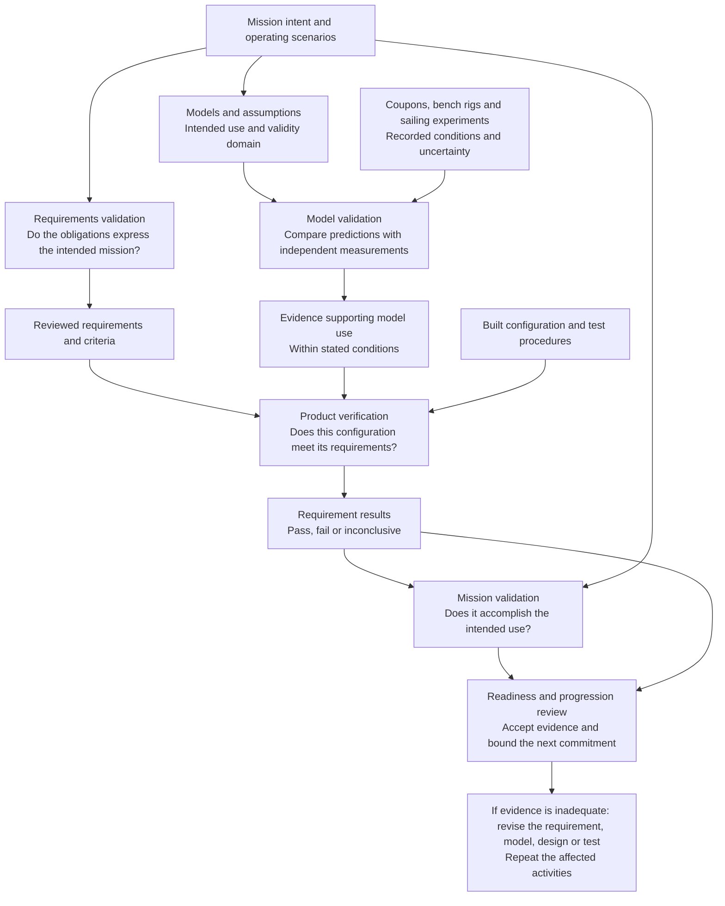

# Developing Blue Dog: a V with room to learn

I want Blue Dog to be both a working autonomous sailboat and a way to learn systems engineering. That calls for a development plan which connects the mission to the experiments, and the experiments back to the design. It should help me and my agents choose the next useful piece of work without creating an enterprise-sized paperwork exercise.

Our plan combines a systems engineering V with repeated model-and-experiment loops. The outer V follows a particular vessel configuration from intent to demonstrated behavior. Inside it, simulation supports requirements, architecture, detailed design and test planning. Measurements then improve or invalidate those simulations. We repeat this process for increasingly capable prototypes; the first build does not have to be the challenge vessel.

This page defines the development approach and proposed review criteria. It does not record completed reviews or introduce new vessel acceptance thresholds. Requirements, allocations and engineering criteria remain in the [SysML model](../models/README.md); [recorded results](results.md) distinguish numerical outcomes from accepted physical evidence. The process diagrams below explain the method, rather than claiming to be executable SysML activities.

## The overall trajectory

The manufacturing and wing prototype has its own learning mission. The challenge vessel must eventually complete The Dalles–Bonneville–The Dalles without intervention, while allowing live monitoring. Repeated operation is the next objective. Hawai‘i remains the longer-term driver, with its own mission definition and readiness evidence; success in the Gorge does not establish ocean readiness.



Each box contains its own scoped V and review decisions. Progress depends on evidence, not dates. A subsystem can advance while another iterates, provided shared interfaces and budgets remain compatible. Early coupons and test rigs can precede the vessel's preliminary design review when their purpose is to resolve the uncertainty blocking that review.

## One V for each configuration

Read the solid outer path down through definition and implementation, then up through integration and demonstration. The connections across the V pair design intent with the evidence that will assess it. The central simulation is a reusable collection of mission, physics, control and fault models, not a single all-purpose solver.



The central links are two-way exchanges: requirements select scenarios, simulation predicts results and helps design tests, and measured results return to the models. All design layers can use that loop. We can test an early software controller against simulated wind and current, then use the same scenarios with the real controller and simulated sensors, and finally with the boat. Similar loops connect predicted wing loads to a force-balance experiment and predicted energy use to logged electrical measurements.

## The inner loop: five different questions

The useful idea in a second, inner V is repeated prediction and comparison. A flowchart makes the dependencies clearer than nesting another full V inside the first. We distinguish requirements validation, model validation, product verification, mission validation and readiness review. None automatically implies the next.



Model validation is separate from software verification. Unit tests, analytic benchmarks, native/interpreter comparisons and mesh studies check implementation or numerical behavior. They cannot establish real sail lift, drag or durability. Conversely, a useful force measurement does not establish that the complete boat can sail upstream autonomously.

For each model experiment, define the predicted observable, test configuration, applicable conditions, measurement uncertainty and allowable discrepancy before taking data. Keep calibration data distinct from validation data where practical. A model whose error is acceptable for concept comparison may still be inadequate for final sizing. An inconclusive comparison stays inconclusive; it is not converted into a passing requirement.

## What happens at each layer

| Layer | Define and analyze | Evidence across the V |
| --- | --- | --- |
| Mission | Course and operating scenarios, unattended behavior, live monitoring, launch and recovery, traffic and environmental context | Scenario reviews, end-to-end mission rehearsal and recorded qualifying operation |
| Vessel | Allocate progress, energy, mass, handling, stability and reliability budgets; evaluate coupled feasibility and adverse conditions | Integrated sailing, energy and recovery trials; compare predicted and measured vessel behavior |
| Subsystem | Select concepts, define mechanical/electrical/data interfaces, allocate loads and failure behavior | Bench and subsystem tests; interface checks; software- and hardware-in-the-loop fault scenarios |
| Component | Release geometry, materials, joints, actuators, circuits, firmware and assembly details for the selected build | Coupons, dimensional inspection, load and leakage tests, electrical characterization and software checks |

At each layer, test planning starts with the requirement or decision. We identify what must be observed before choosing instrumentation or increasing simulation fidelity.

## Subsystem work and analysis maturity

The rows below group responsibilities from the [current architecture](architecture.md). These are planned activities, not completed verification claims. Supporting analyses are linked rather than copied into a second requirements register.

| Workstream | Mission and preliminary design | Detailed design and component evidence | Integration and mission evidence |
| --- | --- | --- | --- |
| Hull, keel and manufacturing | Couple displacement, resistance, mass, handling and stability; compare construction concepts | Measure printed/laminated coupons, joints, actual mass and center of gravity; inspect watertight assemblies; correlate structural and hydrostatic models | Tow or sailing resistance measurements, loaded trim, leakage and representative structural exposure; revisit [structure and recovery](structures-and-recovery.md) predictions |
| Wing and trim actuation | Compare rig concepts using progress, energy and recovery criteria; use [VSP trends](sail-trade.md) within their stated limits | Measure lift, drag and moment for the actual section and relevant conditions; characterize gearbox movement, holding, backlash and jam behavior | Compare sailing polars, heel, trim effort and electrical consumption with predictions; exercise allowed fault states |
| Rudder and steering | Allocate turning and course-control authority; consider current, heel and weed exposure | Characterize actuator torque, rate, sealing and steering loads; test appendage construction and weed-clearing behavior | Turning and tracking trials in increasingly representative conditions; quantify control authority and loss-of-steerage response |
| Energy and electrical system | Use [energy scenarios](energy.md) to size harvesting, storage and loads; examine dark periods and adverse duty cycles | Measure battery capacity, conversion losses, load profiles and actuator peaks; verify protection and sensing | Replay time histories on the bench, then correlate measured state of charge and consumption during multi-day operation |
| Navigation, sensing and autonomy | Define mission states, environmental assumptions and responses to unavailable or misleading inputs | Sensor characterization; software-in-the-loop scenario tests; real-controller hardware-in-the-loop timing, resets and fault injection | Progressive local-water autonomy trials; log decisions, tracking and traffic interactions without relying on operator corrections |
| Communications, recording and shore monitoring | Allocate coverage, latency, data completeness and communications-loss behavior | Bench link and antenna checks; verify command integrity, timestamps, storage and power demand | Field coverage and interrupted-link tests; demonstrate monitoring and reconstruct the mission from logs without making connectivity necessary for control |
| Health, recovery and conspicuity | Link hazards and [DFMEA](reliability.md) to failure detection, recovery actions and mission boundaries | Test ingress detection, resets and recovery actuation; evaluate sealed and flooded configurations and visible signaling | Controlled recovery/capsize trials and fault campaigns; assess traffic-related behavior and launch/recovery procedures before broader exposure |

Recovery propulsion may support testing and vessel recovery. It cannot contribute to a qualifying challenge run. Observation payloads and station keeping remain later increments so they do not obscure the initial mission's evidence needs.

Detailed analysis follows uncertainty, not a fixed tool ladder. Start with estimates and sensitivity studies; add fidelity when it could change an architecture or sizing decision. Before committing geometry, correlate the dominant physical assumptions. Before the mission, obtain integrated evidence in representative conditions. A more detailed simulation is not automatically more credible.

## Review gates scaled to one project

Each Systems Engineering Technical Review (SETR) is a short, configuration-specific decision supported by linked evidence. No standing board or slide deck is required. I make the commitment decision; an agent prepares the evidence and another review, when requested, can challenge the reasoning. Different subsystems can hold separate scoped reviews.

| Gate | Entry: what is ready to discuss? | Exit: what must support the decision? | Commitment enabled |
| --- | --- | --- | --- |
| **SRR — mission and requirements** | Named increment, mission scenarios, requirement derivation and unresolved questions | Scope and success criteria agreed; critical obligations are assessable; verification methods identified; open issues have bounded impact | Develop the selected concepts and evidence plan |
| **PDR — preliminary design** | Architecture alternatives, interfaces, budgets, sensitivity results and major risks | A defensible concept; dominant feasibility uncertainties resolved enough for this increment or bounded by a specific experiment; no hidden assumption substitutes for evidence | Develop detailed design for the reviewed scope |
| **CDR — build readiness** | Released design candidate, interface definitions, parts/material choices and acceptance procedures | Manufacturing and integration information sufficient to build; critical loads and interfaces supported; configuration and deviations identifiable | Build that configuration, including a limited-purpose test article |
| **TRR — test readiness** | Test objective, linked criteria, article configuration, procedure, instrumentation and predicted results | Measurements can answer the question; operating and abort limits, recovery method and data capture checked; unresolved issues do not defeat the test | Run that bounded test campaign |
| **Results and progression review** | Archived results, uncertainty, discrepancies, model comparisons and requirement dispositions | Evidence accepted only for applicable conditions; failures and inconclusive results resolved or explicitly constrain progression; next scope agreed | Repeat, redesign, expand the envelope, or attempt the next mission increment |

A decision is **proceed**, **proceed with limitations**, or **iterate**. A limitation states exactly what work is permitted and what remains blocked. A bench rig's CDR does not release the final vessel. Every on-water envelope expansion gets a scoped TRR; completing one trial does not authorize all later conditions.

The review record needs only a scope/configuration reference, criteria with evidence links, discrepancies, the owner's decision and follow-up actions. A changed interface, critical assumption or requirement reopens the affected decision. Unaffected evidence can be reused only with a documented applicability check. These gates are our engineering decisions, not external certification.

## Traceability without duplicate paperwork

The engineering chain is mission/use case → requirement → allocated architecture → analysis or verification case → executed configuration → evidence → review decision. A second chain connects each prediction to its assumptions, measurements and validity limits. Tests should reference the model's criterion rather than maintain a separate acceptance threshold in Python.

The existing mission linkage is already model-owned:

```sysml-view Page_development_plan_0::missionEvidence direction=BT
package Page_development_plan_0 {
    private import StandardViewDefinitions::*;
    view missionEvidence : GeneralView {
        expose GorgeChallenge::courseCompletion;
        expose BlueDogRequirements::roundTrip;
        expose BlueDogRequirementVerification::RoundTripVerification;
    }
}
```

We will extend that pattern to experiment applicability, model correlation and scoped review records. Those process records and gate dashboards are planned work; this article does not imply they are already implemented. Native model views will expose the engineering links, while raw measurements and solver outputs retain their configuration and source provenance. GitHub issues can track tasks without becoming a competing source of engineering truth.

Before starting an analysis, an agent should state the decision, linked model elements, needed accuracy and the result that would change the choice. Its output should identify what was learned, what remains uncertain and which next gate it supports. Automatic checks can report missing links, stale evidence or numerical failures; they cannot silently accept physical evidence or approve mission readiness.

## The next useful increment

Our immediate aim is to close the evidence gaps blocking a credible preliminary design. The [current sizing study](results.md) is exploratory and does not establish a minimum feasible boat. The first focused work packages are:

1. Define the manufacturing/wing testbed's learning objectives and map each experiment to a challenge-vessel decision.
2. Plan wing-force/moment and actuator measurements, construction coupons, and controlled hydrostatic/recovery experiments. Specify comparators and uncertainty before testing.
3. Correlate the relevant model inputs and validity domains; rerun coupled sizing and adverse-case analysis when the new evidence changes them.
4. Hold a scoped PDR to select the architecture and remaining detailed-design work, then release the next build through CDR and TRR.

In parallel, develop the electrical bench and simulation interfaces for energy, sensing, communications and autonomy. A local-water demonstrator follows when the integrated test questions and recovery arrangements are ready. This keeps progress possible while the rig and hull evidence matures.

## Diagrams that informed this plan

The strongest match is [Airbus's Systems Engineering V-Cycle, printed slide 3 (PDF page 2)](https://www.mathworks.com/content/dam/mathworks/mathworks-dot-com/solutions/aerospace-defense/files/2008/Airbus-Model-BasedDesignforFuelControlSystems.pdf#page=2). Its simulation sits inside the V and supports both requirements work and integration testing. We borrow that arrangement, without the supplier/enterprise split.

[EyasSAT's Five V&V Activities, Figure 2 on page 4](https://indico.esa.int/event/94/contributions/3625/attachments/2915/3380/S9_1200_Liefer.pdf#page=4) separates requirements validation, model validation, product verification, product validation and flight certification. We adapt the last activity to a personal-project readiness decision. EyasSAT is a training platform adopted by space organizations, not evidence from a flown mission.

For an industrial account of iteration, [Airbus's 2017 fuel-system presentation, slide 11](https://www.mathworks.com/content/dam/mathworks/mathworks-dot-com/solutions/aerospace-defense/files/2017/expo-uk/model-based-design-for-fuel-system-development.pdf#page=11) shows distinct model, requirements and test-validation loops; the surrounding presentation describes work on aircraft fuel systems, including A350 modeling. These are references for the method, not proof that their tools or level of formality are appropriate for a small sailboat.
