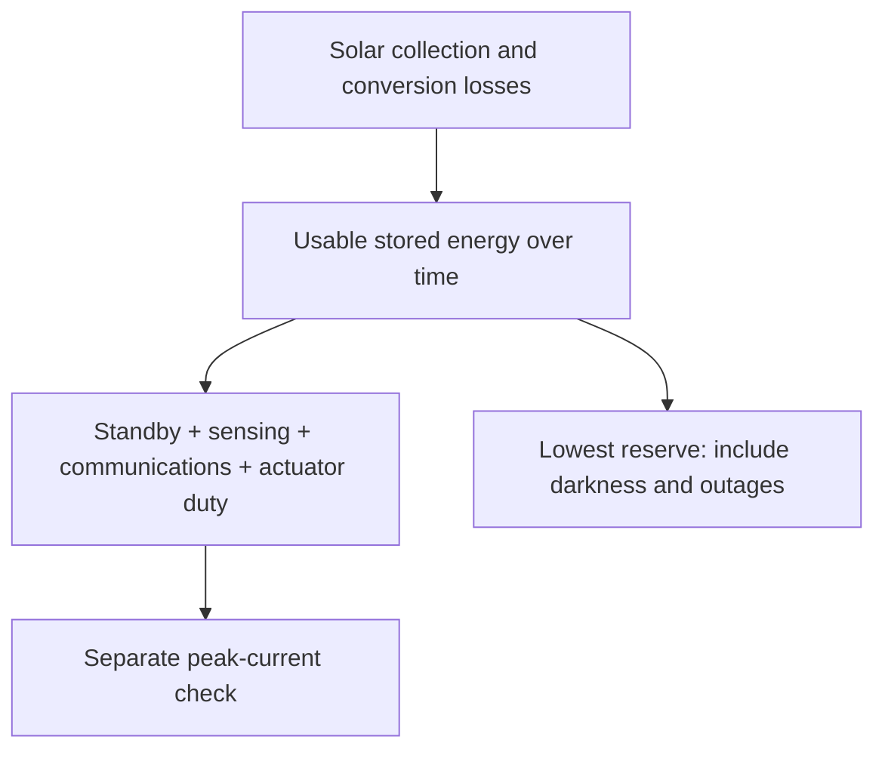

# Power and energy budget for the Gorge candidate

**OOSEM:** Trades, optimization and analysis · [Maturity assessment](development-plan.md)

The budget distinguishes **IC-01, the integration candidate**, from the retained **440 Wh sizing reference**. Each has its own geometry, equipment demand, performance and energy evidence. Equipment allocations remain provisional; neither budget is measured installed consumption or a completed hardware selection.

<a id="installed-load-rollup-and-its-limits"></a>
## Current candidate budget

IC-01 allocates a **1,300 Wh main pack** and a **60 Wh independent recovery pack**. Its electronics include the existing 4.5 W base allocation and 0.07049 W wind installation plus **8 W additional sensing/compute demand**. Actuation comes from its own solved operating states. The model includes **1.2 kg additional equipment**, with recovery-battery mass separately derived from the existing specific-energy assumption. These are simultaneous capability and load targets; no selected installation has demonstrated them.

The independent pack begins with **43.2 Wh**, after the allocated 80% usable and 90% departure fractions. It draws **0.05 W standby** during sailing. Active recovery uses battery-side allocations of **50 W propulsion + 8 W essentials upright**, or **40 W + 8 W inverted**, with a 1.2 route-energy factor and 2 Wh arrival allowance. Allocated water-relative speeds are 1.5 m/s upright and 0.5 m/s inverted. The [native candidate](../models/analyses/integrated-candidate.sysml) and [recovery route model](../models/libraries/marine/recovery.sysml) own those assumptions. The main-pack screen retains its existing protected reserve as additional conservatism; no transfer between packs is credited.

The [integration study](encounter-feasibility.md#close-the-candidate-loop) checks local chronological energy, the main pack's nominal full-passage screen, standby exposure and sampled recovery reachability together. These are distinct scopes: initializing a recovery bank after passage standby does not create a full-course voyage trajectory. Solar harvest is disabled. Primary sailing load shuts down on abort in the allocated architecture, and recovery draws from its independent account. Hardware peaks, conversion, thermal behavior and fault isolation still need installed measurements.

The [IC-01 replay](../evidence/runs/2026-10-15-integrated-candidate/integrated-sizing.json) gives the following budget for that configuration:

| Account | Value | Basis |
| --- | --- | --- |
| Maximum sampled average sailing load | 12.916 W | Electronics, wind installation and candidate actuation at the bus |
| Maximum sampled peak sailing load | 15.633 W | Operating samples; not a measured surge envelope |
| Main usable capacity / departure energy | 1,040.000 / 936.000 Wh | 80% usable capacity, then 90% departure fraction |
| Energy exposure | 54.605 h | 38.884 h nominal passage × 1.25, plus 6 h |
| Required main-pack energy | 833.938 Wh | Sailing withdrawal, discharge losses, self-discharge and 49.2 Wh reserve |
| Remaining main-pack headroom | 102.062 Wh | Departure minus required energy |
| Independent recovery departure | 43.200 Wh | Separate account, unavailable to ordinary sailing |
| Independent recovery after exposure standby | 40.470 Wh | 0.05 W standby over the same 54.605 h |

Capacity, departure and remaining-energy rows are successive account states, not additive loads. Recovery route demand is evaluated against the independent account. The additional 8 W remains a target requiring simultaneous sensing-performance evidence; the nominal margin does not authorize arbitrary extra equipment.

## Retained 440 Wh reference budget

```sysml-report BlueDogCandidateEnergyDocuments::Budget
```

**How to read it:** the energy column covers **48.34 hours**: the predicted 33.87-hour westerly passage, multiplied by 1.25, plus six hours of delay. The screen carries the maximum sampled average load throughout that exposure. Average contributions use the governing energy case; peak contributions use the governing total-peak case. In this replay both are the 8 m/s windward case on tack −1. These are operating samples, not a proven worst-case electrical surge envelope.

The electronics line is **4.5 W** plus a separately counted **0.07049 W wind installation**. Wing and rudder values come from the native drive-power calculation using the archived torque and duty assumptions: 2% moving for the wing, 5% for the rudder, with controller and holding demand included. Wind conversion/margin allowances and actuator motor/gearbox losses are already inside their bus loads. Battery withdrawal then applies the separate 90% discharge efficiency once. The bus and battery energy columns are alternative views of the same consumption; do not add them together.

The energy ledger adds **236.39 Wh delivered to loads**, **26.27 Wh discharge losses**, **0.97 Wh self-discharge** and **49.2 Wh protected recovery reserve**. The result is **312.83 Wh required**, leaving **3.97 Wh** from **316.8 Wh at departure**. Storage capacity rows describe successive limits and are not additive. The reserve is a synthetic comparison allocation—50 W motor for half an hour and 8 W essentials for two hours, with a 1.2 allowance—not demonstrated recovery coverage. Recovery propulsion is not a qualifying sailing load; its installed peak and casualty performance remain open.

This finite-passage screen credits **no solar harvest**. The [chronological simulator](mission-simulation.md) separately follows harvest and battery state, and can add explicit maneuver-energy allowances. Its candidate adapter uses maximum sampled average load as well. A simulation trajectory and this conservative static exposure are different assessments; their energy totals must not be combined.

The [native budget](../models/analyses/candidate-energy.sysml) reconstructs the [retained replay](../evidence/runs/2026-10-13-srr-readiness/srr-readiness.json). Its [generated inputs](../models/evidence/srr-current.sysml) retain the archived parameters, governing cases and source revision. Native assertions reconcile average power, peak power, departure energy and required energy with that replay. Updating hardware assumptions requires a new replay; editing this report cannot silently make an archived candidate feasible.

## Equipment still needing an allocation

```sysml-report BlueDogCandidateEnergyDocuments::MissingAllocations
```

The reference's **4.5 W electronics line is one unresolved allowance**, not a sum of established component budgets. Its function list describes intended coverage, not proof those functions fit. IC-01 adds an explicit 8 W capability target, but camera/sonar acquisition and avoidance inference still have no measured component allocation. Unknown demand is not zero, and none of the proposed sensing capabilities is credited as installed. A selected stack must replace the lump with measured component/mode loads, accounting once for any shared processor, then pass sizing and chronological passage/recovery replay.

## Perception, computing and the avoidance trade

**The present budget does not establish adequate power or computing capacity for vision-based avoidance.** A processor allowance must cover the whole pipeline: camera acquisition, detection, tracking, range/motion estimation, sensor fusion and decision latency, alongside navigation and logging. Camera count, field of view, resolution and frame rate affect both coverage and compute. Include carrier electronics, storage, conversion, thermal management and any lens heating or cleaning hardware in the installation. Measure sustained and burst demand at the battery bus under the intended workload and enclosure temperature; advertised inference throughput is not a detection guarantee.

The scale matters. NVIDIA lists [7–25 W power options for Jetson Orin Nano modules](https://developer.nvidia.com/embedded/jetson-modules/). That is an example of a processor class, not a hardware selection or a complete installed demand. Lower-power accelerators and simpler vision pipelines remain alternatives. The [retained 440 Wh reference](results.md) has only 3.97 Wh beyond its allocated voyage demand, so an unaccounted continuous load can overturn its static feasibility.

For a transparent first sensitivity, hold the published 33.87-hour passage fixed and apply the existing 1.25 duration multiplier plus six hours: **48.34 hours** of exposure. The following are hypothetical *additional battery-withdrawal powers*, not sensor specifications or a resized vessel. Their energy is power times exposure; loads specified at a regulated bus would also need battery discharge losses.

| Additional continuous battery demand | Additional energy over 48.34 h |
| --- | --- |
| 1 W | 48.3 Wh |
| 5 W | 241.7 Wh |
| 10 W | 483.4 Wh |
| 20 W | 966.8 Wh |

This arithmetic identifies sensitivity, not a feasible battery choice. Resizing changes mass, sailing performance, passage time, packaging and recovery energy. IC-01 evaluates those couplings for one allocated hypothesis; measured or alternative pipelines require their own replay. If new compute replaces the existing controller, account for the replacement once rather than adding the full old and new loads. Duty cycling is admissible only when the resulting observation gaps still meet encounter timing needs.

### Coverage requires complementary observations

AIS reports cooperating transmitters. It includes some recreational vessels carrying Class B equipment as well as mandated commercial traffic, but absence of an AIS report does not establish clear water. [USCG carriage requirements](https://www.navcen.uscg.gov/ais-requirements) and [IMO AIS operating guidance](https://www.navcen.uscg.gov/sites/default/files/pdf/ais/references/IMO_A1106_29_Revised_guidelines.pdf) describe that boundary.

| Candidate sensing layer | Useful evidence | What the trade must challenge |
| --- | --- | --- |
| AIS | Reported identity, position and motion of equipped traffic | Non-transmitters, stale or incorrect reports, and the full extent of a tug and tow |
| Visible cameras, with thermal as a separate option | Non-cooperative craft, people, buoys and visible debris | Glare, darkness, fog, spray, fouled lenses, wave occlusion, range ambiguity and low targets from a small boat |
| Passive acoustics: microphones or hydrophones | Audible signals or machinery/propeller sounds that may cue another sensor | Quiet sailboats, paddlers and debris; wind, flow and own-boat noise; localization and ambiguous sources |
| Active acoustic ranging/sonar | Returns from targets within the chosen sensor's beam and propagation domain | Above-water versus submerged coverage, near-surface clutter, range, update rate and installation constraints |
| Radar | Independent ranging and tracking candidate for non-cooperative traffic | Small-target returns, sea clutter, near-field coverage, mounting, mass and power |

Vision and acoustic sensing therefore cannot be credited with capturing everything. [River-watercraft vision experiments](https://publications.ri.cmu.edu/storage/publications/pub_files/2013/5/ARMS2013_VOO.pdf) illustrate both capability and the challenge of water reflections. [NOAA's acoustic work](https://www.fisheries.noaa.gov/new-england-mid-atlantic/science-data/marine-mammal-acoustics) explains how noise masks passive observations; applying passive sensing to Blue Dog would require vessel-specific evidence. Quiet hazards are a reason to investigate complementary sensing, not to assume acoustic detection.

### Hydrophones and forward-looking sonar

A hydrophone is an underwater receiver; a passive sonar system adds acquisition and processing, and potentially an array for bearing estimation. A single receiver detecting a sound does not by itself establish target range or a collision track. Active sonar transmits a pulse and measures returning echoes. [NOAA explains the active/passive distinction](https://oceanservice.noaa.gov/facts/sonar.html). For collision avoidance, evaluate a forward-looking geometry rather than assuming a downward-looking depth sounder observes the path ahead.

For Blue Dog, compare a hydrophone or compact array as a powered-traffic cue, and forward-looking sonar as a candidate for submerged or partly submerged hazards. Neither has selected hardware or a credited detection range. Test quiet targets as well as powered craft, surface/bottom reflections, bubbles and wakes, and masking from water flow, actuators and recovery propulsion. Mounting depth, array aperture, wet connectors, drag and fouling belong in the installation trade. Underwater coverage does not establish coverage of obstacles entirely above water.

Budget receiver preamplifiers, digitizers, continuous processing and data recording for passive sensing; add transmitter peak demand, ping duty and echo processing for active sonar. Passive means no transmitted acoustic pulse, not zero electrical demand. Measure useful range/bearing and update latency alongside average and peak battery-bus demand. Acoustic cues may direct cameras or strengthen a fused track, but any power-saving schedule must preserve the required detection lead time.

### Weed detection and avoidance

Active sonar can detect submerged vegetation: [BioSonics' aquatic-habitat echo sounder](https://www.biosonicsinc.com/products/mx-aquatic-habitat-echosounder/) explicitly supports mapping submerged aquatic vegetation. This supports investigating the sensing principle; it does not establish real-time avoidance performance on Blue Dog. A downward survey image obtained after passing over vegetation is different from a timely forward obstacle observation.

Include dense rooted beds, sparse stems, floating mats and drifting strands as distinct cases. Measure detection distance, missed hazards, false alarms and estimated extent at the depths swept by the keel, rudder and recovery propulsor. Test bottom/surface clutter, turbid water, bubbles, boat motion and different approach angles. A reliable return from a dense bed cannot be generalized to every thin strand. Passive hydrophones do not provide a dependable warning for quiet vegetation; visible cameras may complement sonar for exposed mats.

Avoidance must keep the entire underwater swept volume clear with uncertainty allowance, while respecting current, available sailing directions and turning response. The mission experiment should include weed patches and drifting vegetation as independent ground truth, compare timely avoidance with late/missed observations, and assess loss of propulsion or steering if fouling occurs. Recovery routes must also remain usable. Measure sonar power and processing latency, and check that the transducer mount, cables and any guard do not create new snag points. This remains a testable candidate capability, not credited weed protection.

### Execute a sensing-and-compute trade

The decision is which combination provides timely observations within the boat's mass, energy and operating envelope. Compare AIS plus low-power visible vision; AIS plus visible/thermal vision; and a radar-assisted combination. Evaluate passive acoustics as a cueing supplement and active sonar against a specific near-field or submerged-hazard need. An AIS-only case is a coverage baseline, not an accepted solution.

1. Define encounter cases: tug/tow, fast small powerboat, sailboat, paddler, person in water, floating debris and weed/vegetation hazards, by day/night and adverse visibility. Derive required detection range from closing speed, observation and processing delay, maneuver time and uncertainty margin.
2. Benchmark candidate sensor/processor combinations on recorded and controlled encounters. Record missed detections by target and condition, false alarms, range/bearing error, track continuity and end-to-end latency, together with average/peak bus power, temperature, mass and cost. Retain held-out cases and configuration provenance.
3. Replace perfect traffic observations in the mission experiment with measured or explicitly hypothetical detection, error, delay and dropout models. Keep ground truth separate for collision/consequence scoring. Run paired scenarios and include degraded sensing and recovery behavior.
4. Reconcile the equipment rollup with sizing, reoptimize credible alternatives and replay their chronological energy and encounters. Select only after both coverage and energy evidence support the declared operating scope; restrict that scope or abort when observations are inadequate.

The [encounter-feasibility study](encounter-feasibility.md) executes a paired comparison with imperfect tracks and four hypothetical sensing/power envelopes. Its fixed-candidate energy screen rejects all four added-load hypotheses. The mission simulator retains an explicit perfect-truth baseline, while this study uses range, misses, latency, error and dropout behavior. This trade remains **open**: synthetic envelopes and conceptual maneuvering do not establish installed sensor performance or select equipment. It directly addresses traffic risk R-001 and energy risk R-005 in the [maturity assessment](development-plan.md).

## Illustrative load-accounting example

<details>
<summary>Separate synthetic example: how duty and conversion allowances roll up</summary>

```sysml-report BlueDogDocuments::EnergyBudget
```

This [example configuration](../models/configurations/energy.sysml) demonstrates component accounting. It is **not the retained candidate**: its 2 W computer, 1 W traffic sensor and actuator allocations do not feed the candidate's 4.5 W electronics allowance or torque-based actuation calculations. Its totals must not be substituted for, or added to, the candidate budget above.

</details>

## Wind-sensing configurations

The [wind-observation thread](requirements/requirements-autonomy.md#wind-observation) connects autonomous sailing to the observations needed for trim. I will use my battery-powered Bluetooth Portable Mini on the testbed, then move to a vessel-powered ULP Wired Mini for the challenge.

```sysml-report BlueDogWindDocuments::WindEquipment
```

The testbed sensor carries its own battery and is charged ashore. Its supplier runtime is a planning input for individual tests. The challenge configuration budgets the wired sensor continuously, including conversion losses and an interface allowance. Installed mass includes the mount and cabling; the sizing model accounts for the installation's elevated center of gravity. These allowances and their sources live in the [equipment model](../models/configurations/wind-equipment.sysml), separately from the manufacturer's specifications.

The wired component allocation feeds the current energy and mass calculations, including the finite-passage size study. Each archive retains its own inputs. Bench measurements will replace the interface, mounting and power allowances before hardware qualification.

## Mission energy flow



The diagram separates energy over time from instantaneous power. A positive daily balance can still hide an overnight reserve shortfall or a peak the supply cannot deliver.

The reusable energy framework adds the installed loads once, including standby demand and conversion losses, then propagates stored energy through a chronological mission profile. An explicit timeline prevents declaration order from becoming an accidental mission schedule. Peak supply demand is checked separately from average energy balance.

The framework accounts for usable storage, charge/discharge limits and efficiencies, self-discharge, intermittent harvesting and the recovery reserve. We split intervals where an outage, duty change or burst can change the minimum stored energy; averages alone cannot establish transient capability. The active coupled sizing screen checks instantaneous peak demand and a finite no-harvest passage allowance: the predicted westerly trip, an explicit duration multiplier and delay, and recovery reserve. Daily balance and a fixed overnight duration are not challenge criteria. The [mission simulation](mission-simulation.md) follows weather, solar collection, sailing maneuvers and load through the actual voyage. The simulator can load candidate-specific storage, solved demand and panel area; a hypothetical configuration is also available for controlled comparisons. Candidate load and battery assumptions still need hardware measurements. Archived sizing results retain their original constraints.

The [seasonal weather policy](operating-constraints.md#gorge-weather-and-launch-windows) separates the westerly weather-window challenge from winter testing and later year-round operation. A winter trial cannot inherit a warm-season harvest assumption. The mission trajectory couples wind direction and duration to daylight, cloud, maneuver demand and drift; probability-weighted daily surplus cannot excuse an empty battery on a particular trip. The archived energy stress cases retain their failed status regardless of how often easterlies occur.

```sysml-view Page_energy_0::EnergySemantics direction=BT
package Page_energy_0 {
    private import StandardViewDefinitions::*;
    private import DiagramLayout::*;
    view EnergySemantics : GeneralView {
        filter @SysML::RequirementUsage;
        expose BlueDogRequirements::sustainedEnergyFeasibility;
        expose BlueDogRequirements::sustainedReserveProtection;
        expose BlueDogRequirements::SustainedReserveProtectionCriterion;
        expose BlueDogEnergy::SustainedEnergyVerification;
        expose BlueDog::Architecture::missionContext::boat::energy;
        metadata Layout about BlueDogRequirements::sustainedEnergyFeasibility { x = 0; y = 0; }
        metadata Layout about BlueDogRequirements::sustainedReserveProtection { x = 360; y = 0; }
        metadata Layout about BlueDogRequirements::SustainedReserveProtectionCriterion { x = 0; y = 200; }
        metadata Layout about BlueDogEnergy::SustainedEnergyVerification { x = 360; y = 200; }
        metadata Layout about BlueDog::Architecture::missionContext::boat::energy { x = 0; y = 400; }
    }
}
```

Moving a wing and holding it still are different electrical loads. A non-backdrivable drive may reduce motor holding current but still consumes controller power and incurs moving losses. Its locked failure state also affects recovery. The sizing calculation treats direct aerodynamic moment uncertainty independently of credited lift: lowering the assumed propulsion benefit does not automatically lower the direct pitching-moment load. Both quantities still need measurements.

The current finite-passage search sizes battery capacity with geometry and mass. Solar collection is credited only in chronological replay, not in its conservative no-harvest screen. The [results](results.md) distinguish static sizing allowances, actual simulated durations and performance-model coverage gaps. This is a virtual design study; the energy-evidence decision still requires measurements of the installed configuration before physical acceptance.

[Sizing](sizing.md) couples these loads to geometry and motion, first using the conservative primary aerodynamic assumptions and then re-solving controls under additional energy and combined stresses. [Current results](results.md) report those cases separately. [Reliability](reliability.md) considers how passage time increases unattended exposure.


## Reconcile measured installation loads

A shared-compute installation replaces a declared part of the base electronics load and adds its measured complete stack load. The [native calculation](../models/analyses/encounter-feasibility.sysml) uses **increment = measured bus load − explicitly replaced base load**; the [measurement procedure](validation-plan.md#measure-sensing-and-shared-compute-as-an-installation) retains power, latency, misses and configuration together. This keeps acquisition and processing from being counted twice.

No measured installation has been supplied, so the four sensing stacks remain hypotheses and no resized architecture is selected. The importer supplies a fixed-passage nameplate-capacity lower bound using the retained candidate's demand, usable fraction and departure charge. Added battery mass, propulsion demand, packaging and passage time require a coupled solve before that number can become a candidate budget. Compare measured pipelines on the same held-out encounters, then replay the feasible resized candidates chronologically.


**Next:** [Compare recovery propulsion](recovery-propulsion.md).
