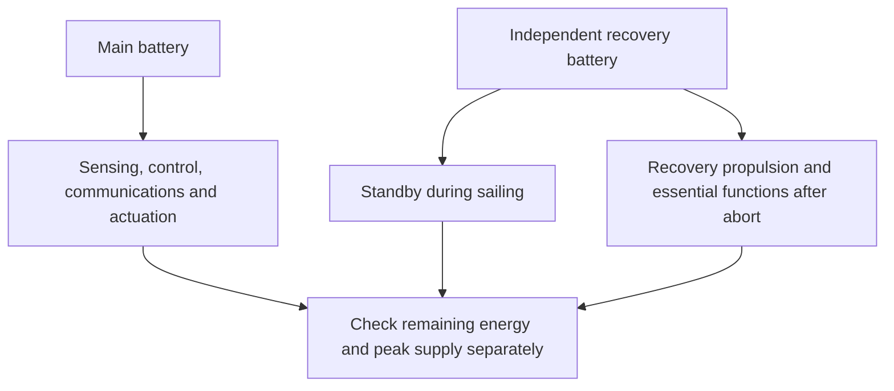

# Power and energy budget for the Gorge candidate

**OOSEM:** Trades, optimization and analysis · [Current assessment](current-assessment.md)

Can IC-01 power its sensors and controls for the passage and still recover after a fault? I budget the main and recovery batteries separately, using the sailing performance of the same candidate. The answer currently depends on allocated equipment loads; measuring the installation is the next test of that budget.

<a id="installed-load-rollup-and-its-limits"></a>
## Current candidate budget

IC-01 allocates a **1,300 Wh main pack** and a **60 Wh independent recovery pack**. Its electronics include the existing 4.5 W base allocation and about 0.07 W wind installation plus **8 W additional sensing/compute demand**. Actuation comes from its own solved operating states. The model includes **1.2 kg additional equipment**, with recovery-battery mass separately derived from the existing specific-energy assumption. These are simultaneous capability and load targets; no selected installation has demonstrated them.

The independent pack begins with **43.2 Wh**, after the allocated 80% usable and 90% departure fractions. It draws **0.05 W standby** during sailing. Active recovery uses battery-side allocations of **50 W propulsion + 8 W essentials upright**, or **40 W + 8 W inverted**, with a 1.2 route-energy factor and 2 Wh arrival allowance. Allocated water-relative speeds are 1.5 m/s upright and 0.5 m/s inverted. The [native candidate](../models/blue-dog.sysml) and [recovery route model](../models/libraries/analysis.sysml) own those assumptions. The main-pack screen retains its existing protected reserve as additional conservatism; no transfer between packs is credited.

The [integration study](encounter-feasibility.md#close-the-candidate-loop) checks local chronological energy, the main pack's nominal full-passage screen, standby exposure and sampled recovery reachability together. These are distinct scopes: initializing a recovery bank after passage standby does not create a full-course voyage trajectory. Solar harvest is disabled. Primary sailing load shuts down on abort in the allocated architecture, and recovery draws from its independent account. Hardware peaks, conversion, thermal behavior and fault isolation still need installed measurements.

The [IC-01 calculation](../evidence/runs/2026-10-15-integrated-candidate/integrated-sizing.json) gives the following budget. Values are rounded here; the linked record retains the numerical precision:

| Account | Value | Basis |
| --- | --- | --- |
| Maximum sampled average sailing load | 12.9 W | Electronics, wind installation and candidate actuation at the bus |
| Maximum sampled peak sailing load | 15.6 W | Operating samples; not a measured surge envelope |
| Main usable capacity / departure energy | 1,040 / 936 Wh | 80% usable capacity, then 90% departure fraction |
| Energy exposure | 54.6 h | 38.9 h nominal passage × 1.25, plus 6 h |
| Required main-pack energy | 834 Wh | Sailing withdrawal, discharge losses, self-discharge and 49.2 Wh reserve |
| Remaining main-pack headroom | 102 Wh | Departure minus required energy |
| Independent recovery departure | 43.2 Wh | Separate account, unavailable to ordinary sailing |
| Independent recovery after exposure standby | 40.5 Wh | 0.05 W standby over the same 54.6 h |

Capacity, departure and remaining-energy rows are successive account states, not additive loads. Recovery route demand is evaluated against the independent account. The additional 8 W remains a target requiring simultaneous sensing-performance evidence; the nominal margin does not authorize arbitrary extra equipment.

## What could change this budget?

The 4.5 W base electronics allocation and additional 8 W sensing/compute target must become a measured installation budget. Acquisition, processing, communications, cooling and conversion all count. If a shared processor replaces an existing controller, I subtract the replaced load once before adding the complete new installation.

The [physical sensing comparison](reference/sensing-configurations.md) gives
that reconciliation specific hardware. Four high-resolution cameras draw a
quoted 10–12 W for streaming alone; three wider global-shutter cameras draw
7.5–9 W. Host processing, AIS, conversion and protective installation remain
additional. A scanning camera reduces the camera count but introduces blind
intervals. None is a demonstrated fit to the present budget, and independent
recovery observation still needs its own installation.

The earlier 440 Wh reference shows why this matters: its nominal headroom is only **4 Wh**. Even a small continuous addition requires more storage. The resulting mass changes sailing performance and passage time, so I must resize the candidate rather than divide the extra energy by a battery’s specific energy and call the design finished. IC-01 is one coupled response to that problem.

At IC-01’s 54.6-hour exposure, an extra watt drawn continuously from the battery costs about **54.6 Wh** before any change to passage time. Duty cycling saves energy only if the observation gaps still permit a timely response to traffic. The [sensing comparison](encounter-feasibility.md#choosing-an-installed-sensing-stack) sets out the performance evidence that must accompany a power measurement.

<details>
<summary>Earlier 440 Wh reference: detailed ledger and fixed-passage sensitivity</summary>

## Retained 440 Wh reference budget

```sysml-report BlueDogCandidateEnergyDocuments::Budget
```

**How to read it:** the energy column covers **48.34 hours**: the predicted 33.87-hour westerly passage, multiplied by 1.25, plus six hours of delay. The screen carries the maximum sampled average load throughout that exposure. Average contributions use the governing energy case; peak contributions use the governing total-peak case. In this replay both are the 8 m/s windward case on tack −1. These are operating samples, not a proven worst-case electrical surge envelope.

The electronics line is **4.5 W** plus a separately counted **0.07049 W wind installation**. Wing and rudder values come from the native drive-power calculation using the archived torque and duty assumptions: 2% moving for the wing, 5% for the rudder, with controller and holding demand included. Wind conversion/margin allowances and actuator motor/gearbox losses are already inside their bus loads. Battery withdrawal then applies the separate 90% discharge efficiency once. The bus and battery energy columns are alternative views of the same consumption; do not add them together.

The energy ledger adds **236.39 Wh delivered to loads**, **26.27 Wh discharge losses**, **0.97 Wh self-discharge** and **49.2 Wh protected recovery reserve**. The result is **312.83 Wh required**, leaving **3.97 Wh** from **316.8 Wh at departure**. Storage capacity rows describe successive limits and are not additive. The reserve is a synthetic comparison allocation—50 W motor for half an hour and 8 W essentials for two hours, with a 1.2 allowance—not demonstrated recovery coverage. Recovery propulsion is not a qualifying sailing load; its installed peak and casualty performance remain open.

This finite-passage screen credits **no solar harvest**. The [chronological simulator](mission-simulation.md) separately follows harvest and battery state, and can add explicit maneuver-energy allowances. Its candidate adapter uses maximum sampled average load as well. A simulation trajectory and this conservative static exposure are different assessments; their energy totals must not be combined.

The [native budget](../models/blue-dog.sysml) reconstructs the [retained replay](../evidence/runs/2026-10-13-srr-readiness/srr-readiness.json). Its [generated inputs](../models/blue-dog.sysml) retain the archived parameters, governing cases and source revision. Native assertions reconcile average power, peak power, departure energy and required energy with that replay. Updating hardware assumptions requires a new replay; editing this report cannot silently make an archived candidate feasible.

<a id="equipment-still-needing-an-allocation"></a>
### Unresolved loads in the earlier reference

```sysml-report BlueDogCandidateEnergyDocuments::MissingAllocations
```

The reference's **4.5 W electronics line is one unresolved allowance**, not a sum of established component budgets. Its function list describes intended coverage, not proof those functions fit. IC-01 adds an explicit 8 W capability target, but camera/sonar acquisition and avoidance inference still have no measured component allocation. Unknown demand is not zero, and none of the proposed sensing capabilities is credited as installed. A selected stack must replace the lump with measured component/mode loads, accounting once for any shared processor, then pass sizing and chronological passage/recovery replay.

<a id="what-an-additional-watt-costs"></a>
### What an additional watt costs in the reference

For a transparent first sensitivity, hold the published 33.87-hour passage fixed and apply the existing 1.25 duration multiplier plus six hours: **48.34 hours** of exposure. The following are hypothetical *additional battery-withdrawal powers*, not sensor specifications or a resized vessel. Their energy is power times exposure; loads specified at a regulated bus would also need battery discharge losses.

| Additional continuous battery demand | Additional energy over 48.34 h |
| --- | --- |
| 1 W | 48.3 Wh |
| 5 W | 241.7 Wh |
| 10 W | 483.4 Wh |
| 20 W | 966.8 Wh |

This arithmetic identifies sensitivity, not a feasible battery choice. Resizing changes mass, sailing performance, passage time, packaging and recovery energy. IC-01 evaluates those couplings for one allocated hypothesis; measured or alternative pipelines require their own replay. If new compute replaces the existing controller, account for the replacement once rather than adding the full old and new loads. Duty cycling is admissible only when the resulting observation gaps still meet encounter timing needs.

The [sensing and encounter comparison](encounter-feasibility.md#choosing-an-installed-sensing-stack) examines the complementary observations and measured performance needed to justify those loads.

</details>

## Illustrative load-accounting example

<details>
<summary>Separate synthetic example: how duty and conversion allowances roll up</summary>

```sysml-report BlueDogDocuments::EnergyBudget
```

This [example configuration](../models/blue-dog.sysml) demonstrates component accounting. It is **not the retained candidate**: its 2 W computer, 1 W traffic sensor and actuator allocations do not feed the candidate's 4.5 W electronics allowance or torque-based actuation calculations. Its totals must not be substituted for, or added to, the candidate budget above.

</details>

## Wind-sensing configurations

The [wind-observation thread](requirements/requirements-autonomy.md#wind-observation) connects autonomous sailing to the observations needed for trim. The vessel-powered ULP Wired Mini is the current sizing allocation. My battery-powered Bluetooth Portable Mini remains available for component experiments; it does not define a separate planned testbed build.

| Installation | Role | Energy accounting |
| --- | --- | --- |
| ULP Wired Mini | Current candidate allocation | Continuous vessel power, including interface and conversion allowances |
| Bluetooth Portable Mini | Component experiments | Its own battery, charged ashore |

The [native equipment record](../models/blue-dog.sysml) retains supplier specifications and installation allowances.

The portable sensor carries its own battery and is charged ashore. Its supplier runtime is a planning input for individual tests. The sizing allocation budgets the wired sensor continuously, including conversion losses and an interface allowance. Installed mass includes the mount and cabling; the sizing model accounts for the installation's elevated center of gravity. These allowances and their sources live in the [equipment model](../models/blue-dog.sysml), separately from the manufacturer's specifications.

The wired component allocation feeds the current energy and mass calculations, including the finite-passage size study. Each archive retains its own inputs. Bench measurements will replace the interface, mounting and power allowances before hardware qualification.

## Mission energy flow



IC-01 credits no solar harvest in either its static passage screen or its local integration record. The static screen carries the maximum sampled average load through a conservative passage allowance. The [chronological simulation](mission-simulation.md#two-batteries-through-the-voyage) follows the actual sequence of sailing, standby, abort and recovery. Their totals answer different questions and must not be added together.

Peak supply capability is a separate question from stored energy. Moving a wing, holding it still and powering its controller create different loads. A non-backdrivable drive may reduce holding current while introducing a locked failure state. The sampled peak is therefore a design input to test against measured start, stall and simultaneous-load behavior.

The reusable framework can model harvest, charge limits, losses, outages and duty changes. For a future solar-assisted scenario, I would use the same weather trajectory for sailing progress, daylight, cloud and energy. An average daily surplus cannot excuse an empty battery during a particular night or recovery.

<details>
<summary>Future sustained operation: repeating-energy requirements</summary>

These requirements address sustained repeated operation, beyond the finite Gorge mission. They are retained here as a reference for the reusable energy framework.

```sysml-view Page_energy_0::EnergySemantics direction=BT
package Page_energy_0 {
    private import StandardViewDefinitions::*;
    private import DiagramLayout::*;
    view EnergySemantics : GeneralView {
        filter @SysML::RequirementUsage;
        expose BlueDog::Requirements::sustainedEnergyFeasibility;
        expose BlueDog::Requirements::sustainedReserveProtection;
        expose BlueDog::Requirements::SustainedReserveProtectionCriterion;
        expose BlueDog::Analyses::Energy::SustainedEnergyVerification;
        expose BlueDog::Architecture::missionContext::boat::energy;
        metadata Layout about BlueDog::Requirements::sustainedEnergyFeasibility { x = 0; y = 0; }
        metadata Layout about BlueDog::Requirements::sustainedReserveProtection { x = 360; y = 0; }
        metadata Layout about BlueDog::Requirements::SustainedReserveProtectionCriterion { x = 0; y = 200; }
        metadata Layout about BlueDog::Analyses::Energy::SustainedEnergyVerification { x = 360; y = 200; }
        metadata Layout about BlueDog::Architecture::missionContext::boat::energy { x = 0; y = 400; }
    }
}
```

</details>

## Reconcile measured installation loads

A shared-compute installation replaces a declared part of the base electronics load and adds its measured complete stack load. The [native calculation](../models/blue-dog.sysml) uses **increment = measured bus load − explicitly replaced base load**; the [measurement procedure](validation-plan.md#measure-sensing-and-shared-compute-as-an-installation) retains power, latency, misses and configuration together. This keeps acquisition and processing from being counted twice.

No measured installation has been supplied. The four earlier sensing stacks remain hypotheses; IC-01 is a resized working candidate with an allocated capability target, rather than a selected hardware stack. The [measurement workflow](reference/sensing-measurements.md) also provides a fixed-passage capacity bound using the earlier reference’s demand, usable fraction and departure charge. Added battery mass, propulsion demand, packaging and passage time require a coupled solve before that number can become a candidate budget. Compare measured pipelines on the same held-out encounters, then replay the feasible resized candidates chronologically.

## Scope the current accounting before adding loads

IC-01's fixed-equipment allowance already includes the additional equipment and
recovery battery mass. Its electronics allowance already includes the additional
8 W target and provisioned wired wind installation. Adding those contributions a
second time would change the answer without changing the boat. A measured shared
installation must identify what it replaces before its demand is added.

<details>
<summary>IC-01 accounting boundaries, owners and allocated quantities</summary>

```sysml-report BlueDogConfigurationDocuments::BudgetRegister
```

</details>

The seven scopes distinguish whole-vessel and fixed-equipment mass, sailing
electronics, recovery essentials, main and recovery storage, and response timing. They bind the current owned
values without creating a complete bill of materials or measured budget. Empty
peak bounds remain unknown; setting review flags cannot make those power scopes
ready while the required bounds are absent. Nameplate and departure energy are
successive states, not additive capacity. Recovery demand retains its existing
battery-withdrawal boundary, and storage/telemetry supply assignments remain open.

The whole-vessel mass estimate remains unset in this register until a new,
identified coupled mass and center-of-gravity result is connected to it. The
fixed-equipment allowance cannot fill that field. The main bank's existing
allocations are 1,300 Wh nameplate and 936 Wh at departure, while the independent
recovery bank has its own account. Neither pair is additive capacity.
I need installed measurements and non-overlapping coverage before comparing
estimates, uncertainty allowances and remaining margin. The [PSM/INCOSE Technical
Measurement report, sections 6.3–6.4](https://www.incose.org/docs/default-source/ProductsPublications/technical-measurement-guide---dec-2005.pdf?sfvrsn=4&sfvrsn=4)
provides historical guidance on useful measures and aggregation; [NASA technical
assessment](https://www.nasa.gov/reference/6-7-technical-assessment/) connects their
status to decisions. I have not adopted a standard contingency percentage.
Individual response-stage allowances also need scheduling, occupied-actuator and
achieved-motion evidence before they establish a whole-path timing bound.

**Next:** [Sailing the challenge before building the boat](mission-simulation.md) · [Series guide](index.md)
