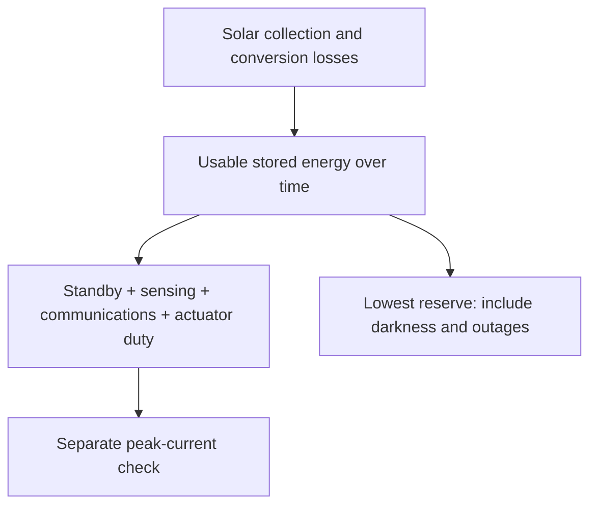

# Power and energy budget for the Gorge candidate

**OOSEM:** Trades, optimization and analysis · [Maturity assessment](current-assessment.md)

The budget distinguishes **IC-01, the integration candidate**, from the retained **440 Wh sizing reference**. Each has its own geometry, equipment demand, performance and energy evidence. Equipment allocations remain provisional; neither budget is measured installed consumption or a completed hardware selection.

<a id="installed-load-rollup-and-its-limits"></a>
## Current candidate budget

IC-01 allocates a **1,300 Wh main pack** and a **60 Wh independent recovery pack**. Its electronics include the existing 4.5 W base allocation and 0.07049 W wind installation plus **8 W additional sensing/compute demand**. Actuation comes from its own solved operating states. The model includes **1.2 kg additional equipment**, with recovery-battery mass separately derived from the existing specific-energy assumption. These are simultaneous capability and load targets; no selected installation has demonstrated them.

The independent pack begins with **43.2 Wh**, after the allocated 80% usable and 90% departure fractions. It draws **0.05 W standby** during sailing. Active recovery uses battery-side allocations of **50 W propulsion + 8 W essentials upright**, or **40 W + 8 W inverted**, with a 1.2 route-energy factor and 2 Wh arrival allowance. Allocated water-relative speeds are 1.5 m/s upright and 0.5 m/s inverted. The [native candidate](../models/analyses/integrated-candidate.sysml) and [recovery route model](../models/libraries/marine/recovery.sysml) own those assumptions. The main-pack screen retains its existing protected reserve as additional conservatism; no transfer between packs is credited.

The [integration study](encounter-feasibility.md#close-the-candidate-loop) checks local chronological energy, the main pack's nominal full-passage screen, standby exposure and sampled recovery reachability together. These are distinct scopes: initializing a recovery bank after passage standby does not create a full-course voyage trajectory. Solar harvest is disabled. Primary sailing load shuts down on abort in the allocated architecture, and recovery draws from its independent account. Hardware peaks, conversion, thermal behavior and fault isolation still need installed measurements.

The [IC-01 replay](../evidence/runs/2026-10-15-integrated-candidate/integrated-sizing.json) gives the following budget for that configuration:

| Account | Value | Basis |
| --- | --- | --- |
| Maximum sampled average sailing load | 12.916 W | Electronics, wind installation and candidate actuation at the bus |
| Maximum sampled peak sailing load | 15.633 W | Operating samples; not a measured surge envelope |
| Main usable capacity / departure energy | 1,040.000 / 936.000 Wh | 80% usable capacity, then 90% departure fraction |
| Energy exposure | 54.605 h | 38.884 h nominal passage × 1.25, plus 6 h |
| Required main-pack energy | 833.938 Wh | Sailing withdrawal, discharge losses, self-discharge and 49.2 Wh reserve |
| Remaining main-pack headroom | 102.062 Wh | Departure minus required energy |
| Independent recovery departure | 43.200 Wh | Separate account, unavailable to ordinary sailing |
| Independent recovery after exposure standby | 40.470 Wh | 0.05 W standby over the same 54.605 h |

Capacity, departure and remaining-energy rows are successive account states, not additive loads. Recovery route demand is evaluated against the independent account. The additional 8 W remains a target requiring simultaneous sensing-performance evidence; the nominal margin does not authorize arbitrary extra equipment.

## Retained 440 Wh reference budget

```sysml-report BlueDogCandidateEnergyDocuments::Budget
```

**How to read it:** the energy column covers **48.34 hours**: the predicted 33.87-hour westerly passage, multiplied by 1.25, plus six hours of delay. The screen carries the maximum sampled average load throughout that exposure. Average contributions use the governing energy case; peak contributions use the governing total-peak case. In this replay both are the 8 m/s windward case on tack −1. These are operating samples, not a proven worst-case electrical surge envelope.

The electronics line is **4.5 W** plus a separately counted **0.07049 W wind installation**. Wing and rudder values come from the native drive-power calculation using the archived torque and duty assumptions: 2% moving for the wing, 5% for the rudder, with controller and holding demand included. Wind conversion/margin allowances and actuator motor/gearbox losses are already inside their bus loads. Battery withdrawal then applies the separate 90% discharge efficiency once. The bus and battery energy columns are alternative views of the same consumption; do not add them together.

The energy ledger adds **236.39 Wh delivered to loads**, **26.27 Wh discharge losses**, **0.97 Wh self-discharge** and **49.2 Wh protected recovery reserve**. The result is **312.83 Wh required**, leaving **3.97 Wh** from **316.8 Wh at departure**. Storage capacity rows describe successive limits and are not additive. The reserve is a synthetic comparison allocation—50 W motor for half an hour and 8 W essentials for two hours, with a 1.2 allowance—not demonstrated recovery coverage. Recovery propulsion is not a qualifying sailing load; its installed peak and casualty performance remain open.

This finite-passage screen credits **no solar harvest**. The [chronological simulator](mission-simulation.md) separately follows harvest and battery state, and can add explicit maneuver-energy allowances. Its candidate adapter uses maximum sampled average load as well. A simulation trajectory and this conservative static exposure are different assessments; their energy totals must not be combined.

The [native budget](../models/analyses/candidate-energy.sysml) reconstructs the [retained replay](../evidence/runs/2026-10-13-srr-readiness/srr-readiness.json). Its [generated inputs](../models/evidence/srr-current.sysml) retain the archived parameters, governing cases and source revision. Native assertions reconcile average power, peak power, departure energy and required energy with that replay. Updating hardware assumptions requires a new replay; editing this report cannot silently make an archived candidate feasible.

## Equipment still needing an allocation

```sysml-report BlueDogCandidateEnergyDocuments::MissingAllocations
```

The reference's **4.5 W electronics line is one unresolved allowance**, not a sum of established component budgets. Its function list describes intended coverage, not proof those functions fit. IC-01 adds an explicit 8 W capability target, but camera/sonar acquisition and avoidance inference still have no measured component allocation. Unknown demand is not zero, and none of the proposed sensing capabilities is credited as installed. A selected stack must replace the lump with measured component/mode loads, accounting once for any shared processor, then pass sizing and chronological passage/recovery replay.

## What an additional watt costs

For a transparent first sensitivity, hold the published 33.87-hour passage fixed and apply the existing 1.25 duration multiplier plus six hours: **48.34 hours** of exposure. The following are hypothetical *additional battery-withdrawal powers*, not sensor specifications or a resized vessel. Their energy is power times exposure; loads specified at a regulated bus would also need battery discharge losses.

| Additional continuous battery demand | Additional energy over 48.34 h |
| --- | --- |
| 1 W | 48.3 Wh |
| 5 W | 241.7 Wh |
| 10 W | 483.4 Wh |
| 20 W | 966.8 Wh |

This arithmetic identifies sensitivity, not a feasible battery choice. Resizing changes mass, sailing performance, passage time, packaging and recovery energy. IC-01 evaluates those couplings for one allocated hypothesis; measured or alternative pipelines require their own replay. If new compute replaces the existing controller, account for the replacement once rather than adding the full old and new loads. Duty cycling is admissible only when the resulting observation gaps still meet encounter timing needs.

The [sensing and encounter comparison](encounter-feasibility.md#choosing-an-installed-sensing-stack) examines the complementary observations and measured performance needed to justify those loads.

## Illustrative load-accounting example

<details>
<summary>Separate synthetic example: how duty and conversion allowances roll up</summary>

```sysml-report BlueDogDocuments::EnergyBudget
```

This [example configuration](../models/configurations/energy.sysml) demonstrates component accounting. It is **not the retained candidate**: its 2 W computer, 1 W traffic sensor and actuator allocations do not feed the candidate's 4.5 W electronics allowance or torque-based actuation calculations. Its totals must not be substituted for, or added to, the candidate budget above.

</details>

## Wind-sensing configurations

The [wind-observation thread](requirements/requirements-autonomy.md#wind-observation) connects autonomous sailing to the observations needed for trim. The vessel-powered ULP Wired Mini is the current sizing allocation. My battery-powered Bluetooth Portable Mini remains available for component experiments; it does not define a separate planned testbed build.

```sysml-report BlueDogWindDocuments::WindEquipment
```

The portable sensor carries its own battery and is charged ashore. Its supplier runtime is a planning input for individual tests. The sizing allocation budgets the wired sensor continuously, including conversion losses and an interface allowance. Installed mass includes the mount and cabling; the sizing model accounts for the installation's elevated center of gravity. These allowances and their sources live in the [equipment model](../models/configurations/wind-equipment.sysml), separately from the manufacturer's specifications.

The wired component allocation feeds the current energy and mass calculations, including the finite-passage size study. Each archive retains its own inputs. Bench measurements will replace the interface, mounting and power allowances before hardware qualification.

## Mission energy flow



This diagram describes the general energy framework; IC-01 takes no solar credit. It separates energy over time from instantaneous power. A positive daily balance can still hide an overnight reserve shortfall or a peak the supply cannot deliver.

The reusable energy framework adds the installed loads once, including standby demand and conversion losses, then propagates stored energy through a chronological mission profile. An explicit timeline prevents declaration order from becoming an accidental mission schedule. Peak supply demand is checked separately from average energy balance.

The framework accounts for usable storage, charge/discharge limits and efficiencies, self-discharge, intermittent harvesting and the recovery reserve. The calculation splits intervals where an outage, duty change or burst can change the minimum stored energy; averages alone cannot establish transient capability. The active coupled sizing screen checks instantaneous peak demand and a finite no-harvest passage allowance: the predicted westerly trip, an explicit duration multiplier and delay, and recovery reserve. Daily balance and a fixed overnight duration are not challenge criteria. The [mission simulation](mission-simulation.md) follows weather, solar collection, sailing maneuvers and load through the actual voyage. The simulator can load candidate-specific storage, solved demand and panel area; a hypothetical configuration is also available for controlled comparisons. Candidate load and battery assumptions still need hardware measurements. Archived sizing results retain their original constraints.

The [seasonal weather policy](operating-constraints.md#gorge-weather-and-launch-windows) separates the westerly weather-window challenge from winter testing and later year-round operation. A winter trial cannot inherit a warm-season harvest assumption. The mission trajectory couples wind direction and duration to daylight, cloud, maneuver demand and drift; probability-weighted daily surplus cannot excuse an empty battery on a particular trip. The archived energy stress cases retain their failed status regardless of how often easterlies occur.

```sysml-view Page_energy_0::EnergySemantics direction=BT
package Page_energy_0 {
    private import StandardViewDefinitions::*;
    private import DiagramLayout::*;
    view EnergySemantics : GeneralView {
        filter @SysML::RequirementUsage;
        expose BlueDogRequirements::sustainedEnergyFeasibility;
        expose BlueDogRequirements::sustainedReserveProtection;
        expose BlueDogRequirements::SustainedReserveProtectionCriterion;
        expose BlueDogEnergy::SustainedEnergyVerification;
        expose BlueDog::Architecture::missionContext::boat::energy;
        metadata Layout about BlueDogRequirements::sustainedEnergyFeasibility { x = 0; y = 0; }
        metadata Layout about BlueDogRequirements::sustainedReserveProtection { x = 360; y = 0; }
        metadata Layout about BlueDogRequirements::SustainedReserveProtectionCriterion { x = 0; y = 200; }
        metadata Layout about BlueDogEnergy::SustainedEnergyVerification { x = 360; y = 200; }
        metadata Layout about BlueDog::Architecture::missionContext::boat::energy { x = 0; y = 400; }
    }
}
```

Moving a wing and holding it still are different electrical loads. A non-backdrivable drive may reduce motor holding current but still consumes controller power and incurs moving losses. Its locked failure state also affects recovery. The sizing calculation treats direct aerodynamic moment uncertainty independently of credited lift: lowering the assumed propulsion benefit does not automatically lower the direct pitching-moment load. Both quantities still need measurements.

The current finite-passage search sizes battery capacity with geometry and mass. Solar collection can be credited in a separately declared chronological scenario; neither IC-01's static screen nor its local integration record credits it. The [results](results.md) distinguish static sizing allowances, actual simulated durations and performance-model coverage gaps. This is a virtual design study; the energy-evidence decision still requires measurements of the installed configuration before physical acceptance.

[Sizing](sizing.md) couples these loads to geometry and motion using conservative aerodynamic assumptions. The selected installation will also need replay under adverse energy and combined loading assumptions. [Reliability](reliability.md) considers how passage time increases unattended exposure.


## Reconcile measured installation loads

A shared-compute installation replaces a declared part of the base electronics load and adds its measured complete stack load. The [native calculation](../models/analyses/encounter-feasibility.sysml) uses **increment = measured bus load − explicitly replaced base load**; the [measurement procedure](validation-plan.md#measure-sensing-and-shared-compute-as-an-installation) retains power, latency, misses and configuration together. This keeps acquisition and processing from being counted twice.

No measured installation has been supplied. The four earlier sensing stacks remain hypotheses; IC-01 is a resized working candidate with an allocated capability target, rather than a selected hardware stack. The importer supplies a fixed-passage nameplate-capacity lower bound using the retained candidate's demand, usable fraction and departure charge. Added battery mass, propulsion demand, packaging and passage time require a coupled solve before that number can become a candidate budget. Compare measured pipelines on the same held-out encounters, then replay the feasible resized candidates chronologically.

**Next:** [Sailing the challenge before building the boat](mission-simulation.md) · [Series guide](index.md)
