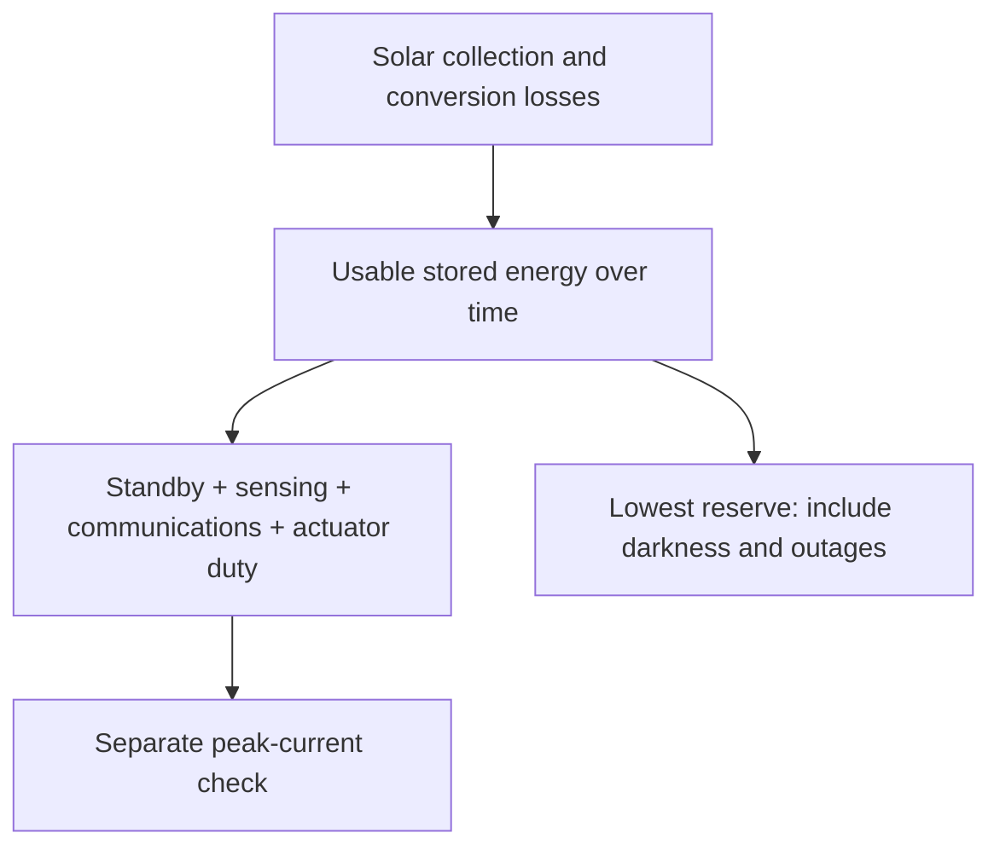

# Sustained operation: follow energy through the mission

**Design phase:** Concept and preliminary design · PDR · [Development plan](development-plan.md)

For the finite Gorge mission, storage must support the complete voyage while preserving recovery reserve and peak capability. There is no 72-hour acceptance limit. Finishing below the initial battery charge is permitted. Native analysis reports `finiteCampaignFeasible` separately from `modeledEnergyFeasible`, which additionally requires repeatable cycle balance for future sustained operation. Evidence acceptance gates both supported results.

Can the boat get through the night and keep sailing the next day? I combine the mission profile, equipment loads, solar assumptions and usable storage to answer that question. This [virtual-design work](development-plan.md#virtual-design) guides battery and solar sizing; later [bench and water tests](development-plan.md#physical-validation) will check the predicted consumption.

## Wind-sensing configurations

The [wind-observation thread](requirements/requirements-autonomy.md#wind-observation) connects autonomous sailing to the observations needed for trim. I will use my battery-powered Bluetooth Portable Mini on the testbed, then move to a vessel-powered ULP Wired Mini for the challenge.

```sysml-report BlueDogWindDocuments::WindEquipment
```

The testbed sensor carries its own battery and is charged ashore. Its supplier runtime is a planning input for individual tests. The challenge configuration budgets the wired sensor continuously, including conversion losses and an interface allowance. Installed mass includes the mount and cabling; the sizing model accounts for the installation's elevated center of gravity. These allowances and their sources live in the [equipment model](../models/configurations/wind-equipment.sysml), separately from the manufacturer's specifications.

The wired component allocation feeds the current energy and mass calculations, including the finite-passage size study. Each archive retains its own inputs. Bench measurements will replace the interface, mounting and power allowances before hardware qualification.

## Mission energy flow



The diagram separates energy over time from instantaneous power. A positive daily balance can still hide an overnight reserve shortfall or a peak the supply cannot deliver.

The reusable energy framework adds the installed loads once, including standby demand and conversion losses, then propagates stored energy through a chronological mission profile. An explicit timeline prevents declaration order from becoming an accidental mission schedule. Peak supply demand is checked separately from average energy balance.

The framework accounts for usable storage, charge/discharge limits and efficiencies, self-discharge, intermittent harvesting and the recovery reserve. We split intervals where an outage, duty change or burst can change the minimum stored energy; averages alone cannot establish transient capability. The active coupled sizing screen checks instantaneous peak demand and a finite no-harvest passage allowance: the predicted westerly trip, an explicit duration multiplier and delay, and recovery reserve. Daily balance and a fixed overnight duration are not challenge criteria. The [mission simulation](mission-simulation.md) follows weather, solar collection, sailing maneuvers and load through the actual voyage. The simulator can now load candidate-specific storage, solved demand and panel area; its original hypothetical configuration remains available for comparison. Candidate load and battery assumptions still need hardware measurements. Archived sizing results retain their original constraints.

The [seasonal weather policy](operating-constraints.md#gorge-weather-and-launch-windows) now separates the westerly weather-window challenge from winter testing and later year-round operation. A winter trial cannot inherit a warm-season harvest assumption. The mission trajectory couples wind direction and duration to daylight, cloud, maneuver demand and drift; probability-weighted daily surplus cannot excuse an empty battery on a particular trip. The archived energy stress cases retain their failed status regardless of how often easterlies occur.

```sysml-view Page_energy_0::EnergySemantics direction=BT
package Page_energy_0 {
    private import StandardViewDefinitions::*;
    private import DiagramLayout::*;
    view EnergySemantics : GeneralView {
        filter @SysML::RequirementUsage;
        expose BlueDogRequirements::sustainedEnergyFeasibility;
        expose BlueDogRequirements::sustainedReserveProtection;
        expose BlueDogRequirements::SustainedReserveProtectionCriterion;
        expose BlueDogEnergy::SustainedEnergyVerification;
        expose BlueDog::Architecture::missionContext::boat::energy;
        metadata Layout about BlueDogRequirements::sustainedEnergyFeasibility { x = 0; y = 0; }
        metadata Layout about BlueDogRequirements::sustainedReserveProtection { x = 360; y = 0; }
        metadata Layout about BlueDogRequirements::SustainedReserveProtectionCriterion { x = 0; y = 200; }
        metadata Layout about BlueDogEnergy::SustainedEnergyVerification { x = 360; y = 200; }
        metadata Layout about BlueDog::Architecture::missionContext::boat::energy { x = 0; y = 400; }
    }
}
```

Moving a wing and holding it still are different electrical loads. A non-backdrivable drive may reduce motor holding current but still consumes controller power and incurs moving losses. Its locked failure state also affects recovery. The sizing calculation treats direct aerodynamic moment uncertainty independently of credited lift: lowering the assumed propulsion benefit does not automatically lower the direct pitching-moment load. Both quantities still need measurements.

The current finite-passage search sizes battery capacity with geometry and mass. Solar collection is credited only in chronological replay, not in its conservative no-harvest screen. The [results](results.md) distinguish static sizing allowances, actual simulated durations and performance-model coverage gaps. This is a virtual design study; the energy-evidence decision still requires measurements of the installed configuration before physical acceptance.

[Sizing](sizing.md) couples these loads to geometry and motion, first using the conservative primary aerodynamic assumptions and then re-solving controls under additional energy and combined stresses. [Current results](results.md) report those cases separately. [Reliability](reliability.md) considers how passage time increases unattended exposure.


**Next:** [Compare recovery propulsion](recovery-propulsion.md).
