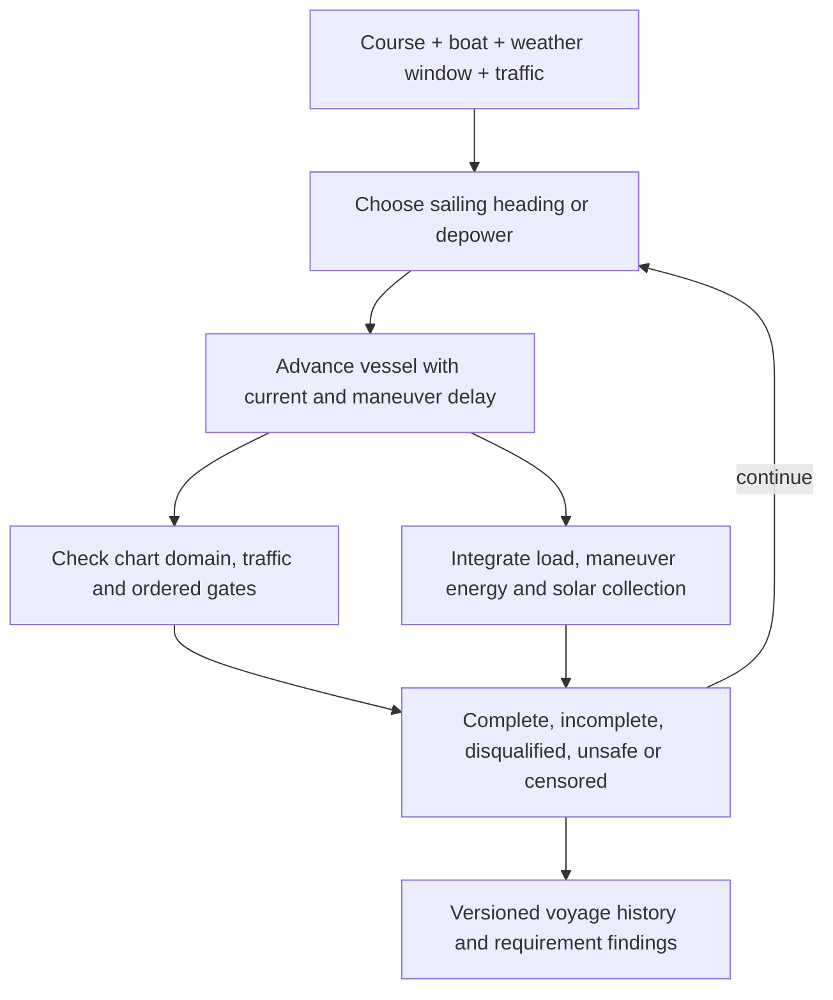

# Sailing the challenge before building the boat

[Previous: development plan](development-plan.md) · [Next: sizing results](results.md)

This is the mission-level loop at the top of our [development V](development-plan.md#mission-definition). Its inputs are the challenge course, a candidate boat, weather histories and traffic scenarios. Its output is a voyage history: where the boat went, what it encountered, how its battery changed, and why the attempt finished or stopped. I use it to discover missing requirements and compare design choices before committing to hardware.

The first boat is deliberately a conceptual configuration. Its polar and equipment budget are declared in the model; they are not the result of our detailed sizing study. Keeping the mission simulation separate lets us replace those assumptions with solved and measured performance later while rerunning the same scenarios.

## A course tied to charted markers

The challenge stays in Bonneville Pool, without passing either dam. The start/finish references Bonneville Pool Lighted Buoy 69 near The Dalles. The western turnaround references Bonneville Pool Light 7. Each is a virtual segment offset from the marker, not a requirement to round or touch it. The model defines the offsets and crossing order.

The course geometry comes from current NOAA electronic charts. The former raster chart 18532 was canceled in 2024. The [source record](../evidence/course/2026-10-11/sources.json) identifies the chart catalog, Light List, Coast Pilot and regulatory sources; the extracted features retain their chart-cell identities and attributes.

The reference-route planner uses charted depth areas, land, obstructions and exclusions. It finds a connected route with the model's planning clearances and checks every shortcut against that domain. The resulting line guides the simulation; sailing and traffic maneuvers produce a different track. The gates overlap the navigation fairway, so a crossing is a traffic decision. Chart clearance alone does not establish maneuvering room or launch readiness. In particular, the reference line crosses an unnamed fixed-span polygon at the Hood River bridge without encoded vertical clearance; the adjacent lift span’s published clearance cannot be assigned to it. Selecting and validating the actual bridge passage is an open course-release item.

The October 7 navigation notice adds a stationary construction hazard near the White Salmon confluence: a derrick barge supporting railroad bridge work through December 2026. This scenario excludes an allocated 250 m buffer around the published location until the actual work footprint is confirmed. The same notice lists three discrepant aids elsewhere in Bonneville Pool. The chart and notice snapshot must travel with each experiment.

## One timeline connects the decisions

SysML owns the ordered gates and outcome calculation. Python supplies the observed crossing, intervention, collision and reserve facts to that native calculation. A simulated completion remains separate from physical qualification or proof of full navigation-rule compliance.

The controller evaluates sailing headings and a depowered option. Depowering still allows the boat to drift with the current; it does not create free station keeping. Maneuvers cost time and energy. The controller updates on its own clock; a smaller integration step does not increase its update rate or shorten a maneuver. Motion steps end at control updates, maneuver completion, weather changes and injected events. Both pieces of the drift-then-sail maneuver must remain in the chart domain. A communications outage does not stop autonomous execution. Operator intervention or motor use ends qualification for that attempt.

There is no 72-hour challenge deadline and no daily energy-balance requirement. A finite trip can finish with less stored energy than it started with. It must still retain the configured recovery reserve. The simulation horizon is a computational setting: reaching it produces a censored result, not a failed challenge deadline.

## Weather and traffic ensembles

Each realization has reproducible weather and traffic random streams. Weather retains persistent regimes and correlated perturbations rather than drawing an independent wind at every step. Solar input follows a day/night cycle with a cloud factor. These are initial sensitivity hypotheses, not a forecast model or calibrated local probability distribution.

Commercial scenarios use charted recommended-track fragments and represent the complete tow footprint. Small-craft scenarios include local crossings and reversing tracks for fishing and powered recreation, alongside sailing traffic. Passenger vessels are included because the accessible The Dalles AIS-derived port record shows that traffic class too. The model owns the rates, dimensions, speeds and separation allocations.

VesselFinder's accessible record does not provide a complete traffic census or an accepted arrival-rate estimate. Small craft may not transmit AIS, and a tug position does not describe the entire tow. The simulator initially has perfect knowledge of scripted traffic; sensor range, occlusion, latency and uncertain intentions need additional cases before these results can support traffic-system acceptance. Geometric separation checks do not establish full Navigation Rules compliance.

The useful early outputs are failure mechanisms and sensitivity to assumptions. The fraction of synthetic scenarios completed must not be presented as the probability that the real boat will complete the Gorge challenge.

## First experiment

The [archived campaign](../evidence/runs/2026-10-11-mission/mission-campaign.json) records the source hashes, scenario seeds and voyage histories. Of 32 seeded voyages, 15 completed the simulated gate sequence and 17 stopped because the simple controller could not find a chart-contained maneuver. This is a route-following limitation to investigate, not a conclusion that a sailing vessel cannot complete the course.

Completed voyages took 21.5 to 149.7 hours. In the longest realization, the synthetic wind switched easterly at hour 10 and remained there until hour 140; the upstream finish came after the westerly returned. The controller considered 17 potentially conflicting traffic encounters across the ensemble. Its geometric screens and stops do not establish full Navigation Rules compliance. The allocated electrical budget protected recovery reserve in these cases; it does not demonstrate the installed boat's endurance.

A numerical check caught an important distinction: the integration step must not determine how often the controller changes commands. With separate clocks and persistent maneuver delays, the short deterministic test finishes at 1,230, 1,225 and 1,222.5 seconds for 10-, 5- and 2.5-second integration steps. That checks the basic implementation; it does not establish convergence of every full-course encounter. Treat the ensemble times as exploratory until broader sensitivity checks and performance correlation support design comparisons.

The next useful step is to inspect the stopped cases, plan tacks with adequate maneuver room, and rerun the same scenarios. These counts describe this controller and these declared assumptions, not the real boat's mission-success probability.

## Increasing fidelity without changing the question

| Current representation | Evidence or implementation that should replace it |
| --- | --- |
| Hypothetical speed polar | Named sizing candidate, then measured speed and maneuver performance |
| Point-mass guidance | Control-software replay and maneuver dynamics |
| Synthetic weather regimes | Forecast-conditioned, correlated along-route weather/current histories |
| Scripted traffic with perfect visibility | Time-stamped observations and sensing/intent uncertainty |
| Allocated electrical budget | Measured installed loads and battery behavior |
| Chart planning clearances | Configuration-specific maneuver, draft, pool-stage and notice review |

The course and scenario contracts stay identifiable through these changes. Virtual results remain separate from physical verification. For SRR, this simulation should expose unsuitable or missing mission criteria; for PDR, its vessel models need enough credibility to justify design decisions.

Run the campaign with `uv run python -m tools.boat_analysis.mission.campaign --count 32`. It records the model inputs, source hashes, seeds, generated traffic counts, gate events and chronological histories. The numerical horizon can be extended without turning incomplete observations into failures.

**Next:** [What the sizing study tells us](results.md).
