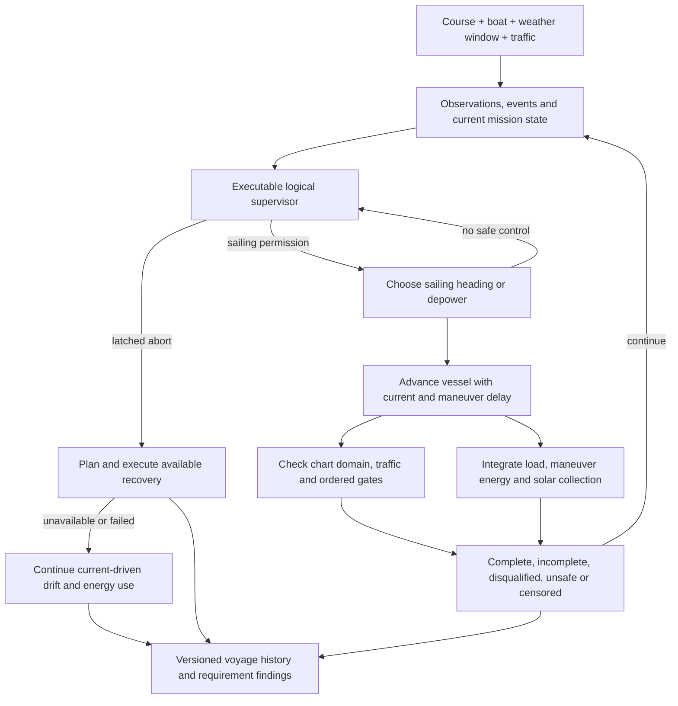

# Sailing the challenge before building the boat

**OOSEM:** System requirements and scenarios · [Current assessment](current-assessment.md)

What happens when the boat meets changing wind, traffic or a fault? The simulation combines the challenge course, a candidate boat, weather histories and traffic scenarios. The executable supervisor governs event responses, sailing permission and abort decisions as that voyage unfolds. The simulation records a voyage history: where the boat went, what it encountered, how its battery changed, and why the attempt finished or stopped. I use it to discover missing requirements and compare design choices before committing to hardware.

The simulator supports conceptual configurations and named sizing candidates. The integration candidate IC-01 supplies its own solved sailing states, electrical demand, battery capacity and swept dimensions. Its sensing load and recovery equipment mass enter that same sizing calculation. Keeping the course and scenario logic separate lets me increase vessel fidelity while rerunning the same seeds.

The [development spirals](simulation-spirals.md) explain how these capabilities grow together and how each experiment guides the next addition to fidelity.

The [encounter-feasibility study](encounter-feasibility.md) supplies explicit detection range, misses, latency, position error, track expiry and dropout behavior to guidance, while independent truth scores collisions and clearance. It compares sensing hypotheses with energy and casualty outcomes. Perfect observations remain an explicit baseline for older campaigns. These virtual results do not qualify a camera, AIS, acoustic or radar implementation.

## Executable supervisory logic

The [mission supervisor](../models/vehicle/mission-logic.sysml) decides whether sailing is permitted, how events change the attempt, and whether an available recovery path can be used. I keep those decisions in the model so I can trace a simulated action back to the mission policy. Heading selection and motion remain simplified guidance calculations, rather than a complete autopilot.

A wind observation outage inhibits sailing while the vessel drifts with the current. Restoring the observation permits sailing again. Communications loss alone does not end the attempt. A safety abort latches: restoring inputs does not resume qualification. Capsize itself is not a disqualifying event. Unassisted righting may preserve the attempt if safety capabilities remain available while inverted and upright control returns; motor use, outside intervention or loss of those safety capabilities ends qualification. The archived IC-01 casualty case exercises inverted powered recovery, not an unassisted self-righting demonstration. Alert delivery does not block autonomous recovery. A held forecast remains usable during a service outage; a declared invalid forecast triggers abort and recovery.

The capsize case has two distinct observations: safety functions remain available while inverted, then unassisted righting restores upright control. In between, the boat drifts, consumes energy and remains exposed to chart and traffic hazards. It cannot sail, score gate crossings or collect solar energy. Missing safety evidence triggers abort. This exercises the qualification policy; the righting motion itself still needs a physical model and measurements.

A decision trace records the facts presented to the supervisor and what it decided. The [runtime reference](reference/model-runtime.md#mission-actions-and-records) explains how those records are generated.

## A course tied to charted markers

The challenge stays in Bonneville Pool. Launch and retrieval use Bingen Point boat ramp outside the scored course. The start/finish gate references green Lighted Buoy 39. At Stevenson, the vessel rounds red Lighted Buoy 16 to port through north, west and south checkpoints in order, maintaining an 80 m nominal marker exclusion. Gate segments extend 80–220 m from each reference. The model owns the geometry and order; current notices and actual buoy positions must be checked before launch.

The course geometry comes from current NOAA electronic charts. The former raster chart 18532 was canceled in 2024. The [source record](../evidence/course/2026-10-11/sources.json) identifies the chart catalog, Light List, Coast Pilot and regulatory sources; the extracted features retain their chart-cell identities and attributes.

The reference-route planner uses charted depth areas, land, obstructions and exclusions. It finds a connected route with the model's planning clearances and checks every shortcut against that domain. The resulting line guides the simulation; sailing and traffic maneuvers produce a different track. The gates overlap the navigation fairway, so a crossing is a traffic decision. Chart clearance alone does not establish maneuvering room or launch readiness. Both legs use the selected closed Hood River lift span; unassessed adjacent spans are excluded. Actual air draft, motion, pool stage and notices still determine whether the modeled passage is applicable to a trial. The [course and recovery assessment](site-and-environment-evidence.md#course-and-recovery-decision) records that basis.

The October 7 navigation notice adds a stationary construction hazard near the White Salmon confluence: a derrick barge supporting railroad bridge work through December 2026. This scenario excludes an allocated 250 m buffer around the published location until the actual work footprint is confirmed. The same notice lists three discrepant aids elsewhere in Bonneville Pool. The chart and notice snapshot must travel with each experiment.

The solid outbound and dashed return lines share their actual geographic coordinates. [Focused satellite views](architecture.md#start-finish-and-turnaround-in-shore-context) show the Bingen start/finish and Stevenson turnaround with both shorelines. These are reference paths; simulated tacking and avoidance can depart from them within the permitted water domain.

## One timeline connects the decisions

The loop keeps the boat’s decisions and their consequences on the same timeline. A command changes motion only after its delivery delay; motion changes clearance and progress; electrical loads change the recovery options available at the next decision.

### A maneuver has several clocks

Consider a heading selected at time zero. With the allocated two-second command delay, the boat keeps its previous heading until second two. The 15-second maneuver then occupies the controller until second seventeen. A one-second assessment period supplies more frequent checks, but it does not shorten either delay.

| Clock | What it controls |
| --- | --- |
| Assessment | When the controller reassesses the situation |
| Command delivery | When a selected command reaches actuation |
| Maneuver | How long the selected action occupies the controller |
| Numerical integration | How finely motion and energy are calculated |

**A new heading cannot pre-empt a pending command or active maneuver.** Margin checks can request abort during that interval, but the next heading selection waits. A hazard first observed then may therefore need more lead time than the fresh-response distance calculation allows. Passing the declared one-second/two-second schedule does not establish the complete avoidance deadline.

IC-01’s prediction horizon is fixed independently of the assessment clock. Guidance ranks forward progress and distance from the reference route, aims toward the next gate and rejects zero-speed sailing headings. Depowering remains an explicit option, but it allows current-driven drift rather than holding position.

The calculation ends motion steps at command delivery, maneuver completion, weather changes and other events. A finer step therefore tests the same controller rather than making it react faster. Both the drifting and sailing portions of a maneuver must remain inside the chart domain. The averaged sailing envelope still omits resolved tack excursions, which matter near hazards.

### Two batteries through the voyage

Normal sailing draws from the main pack, while the independent recovery pack supplies its standby load. In IC-01’s abort hypothesis, primary sailing demand shuts down and recovery propulsion plus essential functions draw from the recovery pack. Energy remaining in the main pack cannot conceal an exhausted recovery bank.

The finite passage may finish with less energy than it started with. It must preserve its recovery option throughout the trip. There is no 72-hour challenge deadline: the simulation horizon is a computational limit, and reaching it leaves the outcome censored—unfinished within the recorded observation period.

### Abort, recover or continue drifting

Recovery begins with the capabilities actually available after the fault. IC-01 allocates separate power, observation and control, including an inverted propulsion hypothesis. Backup observations start at activation and incur their own latency; they do not inherit tracks that were never observed. A 10 m relative-position allowance provides a handoff buffer in primary guidance.

The planner checks complete routes to candidate approaches against delivered observations and remaining energy. It retains a clear destination or selects another reachable one. Current compensation and powered speed determine transit time and energy. Upright and inverted propulsion capabilities are separate inputs. Recovery steering remains a point-mass approximation; finite turns, startup and actual thrust need measurements.

If no supported route remains, propulsion stops and drift continues. Essential loads consume the remaining energy, but battery exhaustion does not stop physical motion. Independent truth scores collision and clearance; it cannot secretly prevent a command. A clearance violation remains recorded while the trajectory continues. Contact ends modeled motion, and shore contact is an adverse outcome. If the horizon arrives first, the consequence remains unresolved.

The drift model includes current only, including when inverted. Windage and wave-driven drift remain missing. Reaching a synthetic water approach also does not establish capture, retention or retrieval at a real shore. The [integration evidence plan](validation-plan.md#exercise-decisions-before-physical-integration) identifies the site and casualty tests needed to extend those results.

## Connecting a sizing candidate

The candidate provider forms an averaged-tack velocity envelope from the four solved operating states at each modeled wind speed. Intermediate directions represent time-sharing between those sailing states; they are not independently solved or measured polar points, and their small-scale tack excursions are not resolved by the point-mass track. Wind interpolation stays inside the solved interval. Outside that interval the simulation credits only drift and reports the unsupported time instead of extrapolating performance. Full polars and explicit tack dynamics are still needed before accepting navigation performance near hazards.

The electrical configuration uses candidate storage, usable fraction, departure charge, panel area and maximum solved operating bus load. It integrates net bus power with charge/discharge efficiency, charge-rate limitation and self-discharge. Maneuver energy remains an explicit additional scenario allowance. The no-harvest passage screen and a chronological replay answer different questions. Solar collection is configuration-specific; IC-01's integration record disables it.

## Weather and traffic ensembles

Each realization has reproducible weather and traffic random streams. Weather retains persistent regimes and correlated perturbations rather than drawing an independent wind at every step. Solar input follows a day/night cycle with a cloud factor. These are initial sensitivity hypotheses, not a forecast model or calibrated local probability distribution.

Commercial scenarios use charted recommended-track fragments and represent the complete tow footprint. Small-craft scenarios include local crossings and reversing tracks for fishing and powered recreation, alongside sailing traffic. Passenger vessels are included because the regional AIS-derived port record shows that traffic class too. The model owns the rates, dimensions, speeds and separation allocations.

VesselFinder's accessible record does not provide a complete traffic census or an accepted arrival-rate estimate. Small craft may not transmit AIS, and a tug position does not describe the entire tow. The perfect-truth baseline knows the scripted traffic; the encounter study supplies range-limited, delayed and uncertain observations instead. Occlusion, uncertain intent and measured detection performance still need additional cases before these results can support traffic-system acceptance. Geometric separation checks do not establish full Navigation Rules compliance.

The useful early outputs are failure mechanisms and sensitivity to assumptions. The fraction of synthetic scenarios completed must not be presented as the probability that the real boat will complete the Gorge challenge.

## Wind at wing height and waves along the route

A small boat's wing operates near the water, where wind speed changes with height. Waves also move the wing through the wind and change underwater inflow. The environmental model resolves height-dependent wind, wave direction and current, and checks deck and appendage clearance through sampled motion. Its parameters are provisional; a calculated clearance or resistance penalty is not an observed failure.

The [archived environmental studies](reference/environmental-replays.md) hold their 1.4 m and approximately 2 m hulls fixed to isolate these effects. They reduced predicted pointwise sailing progress and exposed conditions outside the available performance evidence. Those results motivate extending and checking IC-01's environmental model; they do not establish IC-01 passage times.

## Wave-averaged sailing performance

The wave solver calculates heave, roll and pitch response, then averages sailing forces over a wave cycle while solving for mean speed and controls. A response amplitude operator describes the magnitude and phase of a motion relative to the incident wave. Linear response, assumed damping and limited aerodynamic coverage restrict which states can be accepted.

The archived 1.4 m study accepted 32 operating cases in 0.04 m, 3 s regular waves. Its four voyage replays requested much larger waves and stopped at departure outside the saved coverage. No passage time was obtained for those cases. The [wave study and records](reference/environmental-replays.md#wave-averaged-sailing-performance) retain the solver assumptions, numerical checks and evidence needed to extend that calculation responsibly.

## What the earlier voyages established

The original 32-run conceptual-vessel campaign completed 28 courses, with three numerical-horizon stops and one unresolved maneuver. It exposed a local rounding limitation, but its load and sailing assumptions did not represent IC-01. The [original campaign record](reference/original-mission-campaign.md) preserves those counts and its 65.786 km course revision. The [development history](simulation-spirals.md) connects it to later experiments; counts from different vessels and course revisions are separate evidence.

## Increasing fidelity without changing the question

| Current representation | Evidence or implementation that should replace it |
| --- | --- |
| Candidate averaged-tack envelope (or original conceptual polar) | Full candidate polars, explicit tack excursions and measured maneuver performance |
| Point-mass guidance | Control-software replay and maneuver dynamics |
| Synthetic weather regimes | Forecast-conditioned, correlated along-route weather/current histories |
| Scripted truth and hypothetical observation errors | Time-stamped sensor replay, calibrated detection and intent uncertainty |
| Allocated electrical budget | Measured installed loads and battery behavior |
| Chart planning clearances | Configuration-specific maneuver, draft, pool-stage and notice review |

The course and scenario contracts stay identifiable through these changes. Virtual results remain separate from physical verification. At the requirements layer, this simulation should expose unsuitable or missing mission criteria. At the architecture and analysis layers, its vessel models need enough credibility to support the design decisions being made.

Reproduction commands, source records and campaign settings are in the [runtime reference](reference/model-runtime.md#reproducing-mission-campaigns). I use the recorded failures and coverage gaps to decide which behavior needs better evidence next.

**Next:** [Passage time, reliability and failure analysis](reliability.md) · [Series guide](index.md)
