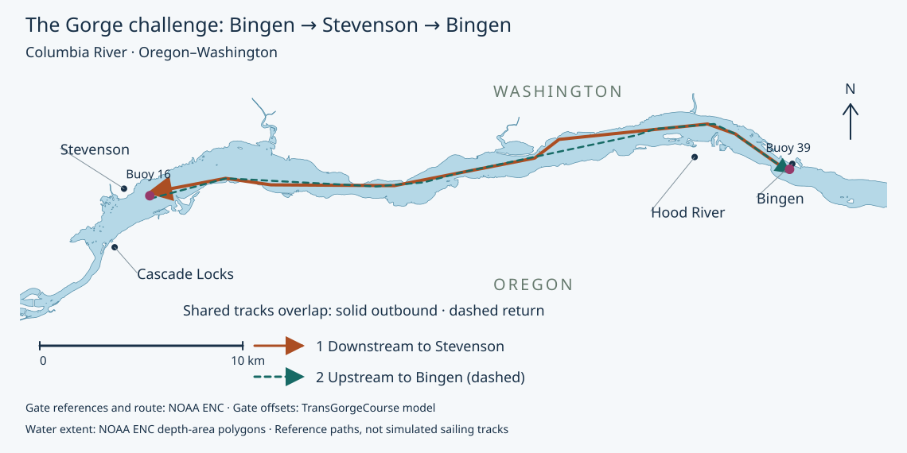
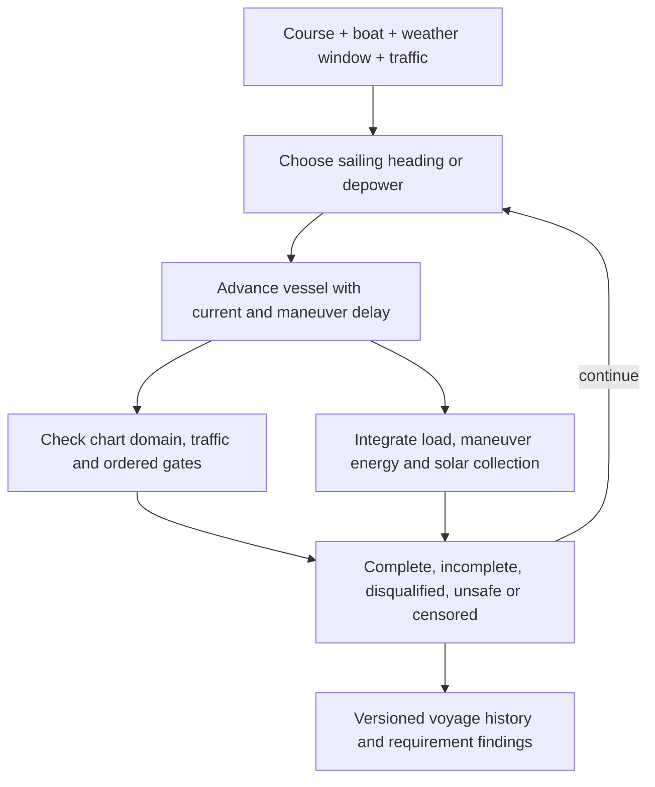
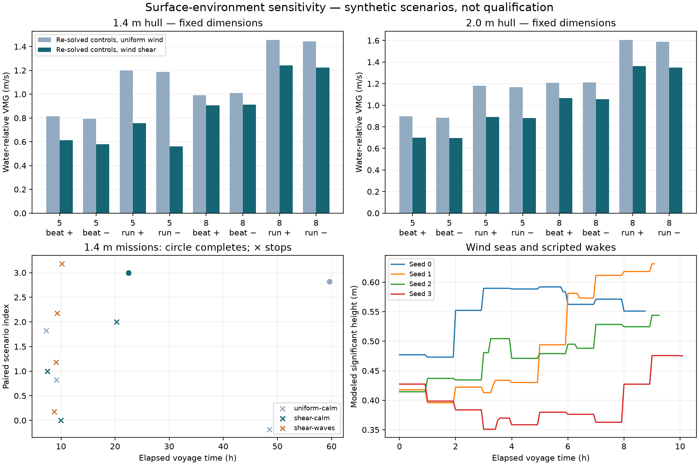
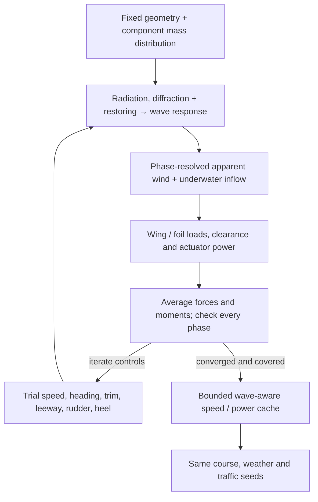
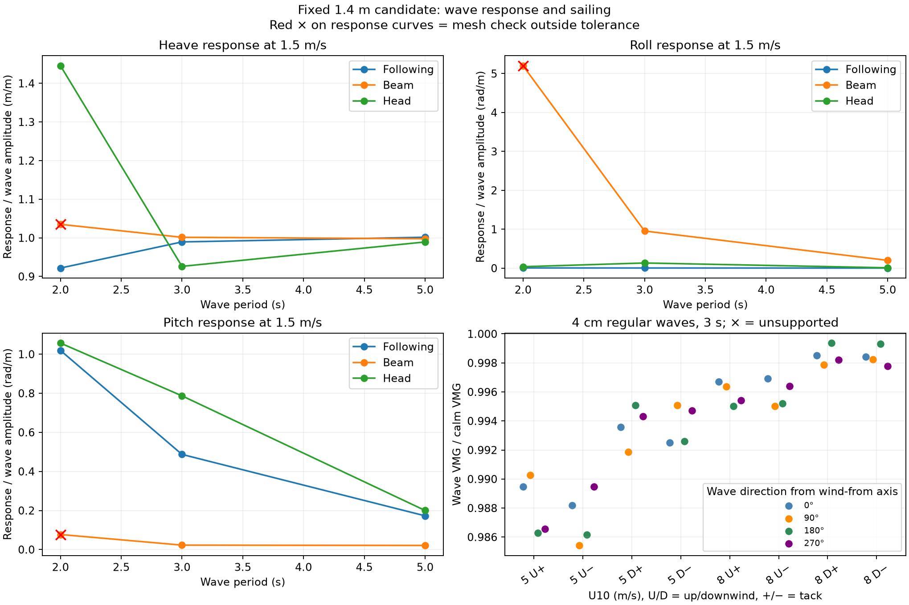
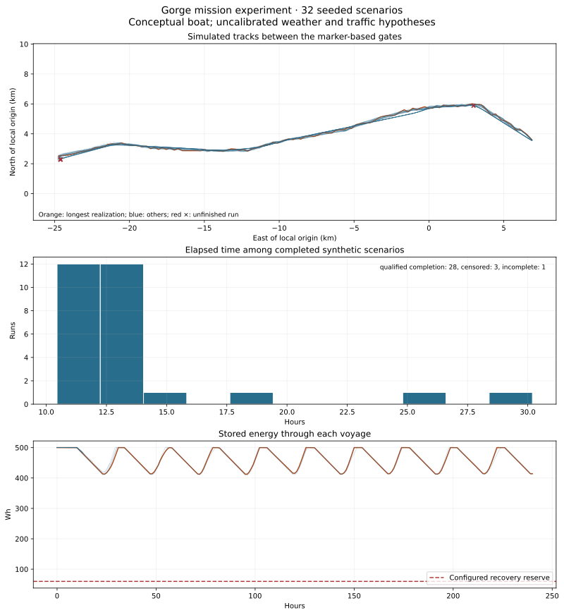

# Sailing the challenge before building the boat

**Design phase:** Mission and requirements · SRR · [Development plan](development-plan.md)

[Previous: development plan](development-plan.md) · [Next: sizing results](results.md)

This is the mission-level loop at the top of our [development V](development-plan.md#mission-definition). Its inputs are the challenge course, a candidate boat, weather histories and traffic scenarios. Its output is a voyage history: where the boat went, what it encountered, how its battery changed, and why the attempt finished or stopped. I use it to discover missing requirements and compare design choices before committing to hardware.

The simulator supports both the original conceptual configuration and a named sizing candidate. The candidate supplies solved sailing states, electrical demand, battery capacity, panel area and swept dimensions. Keeping the course and scenario logic separate lets us increase vessel fidelity while rerunning the same seeds.

## A course tied to charted markers

The challenge stays in Bonneville Pool. Launch and retrieval use Bingen Point boat ramp outside the scored course. The start/finish gate references green Lighted Buoy 39. At Stevenson, the vessel rounds red Lighted Buoy 16 to port through north, west and south checkpoints in order, maintaining an 80 m nominal marker exclusion. Gate segments extend 80–220 m from each reference. The model owns the geometry and order; current notices and actual buoy positions must be checked before launch.

The course geometry comes from current NOAA electronic charts. The former raster chart 18532 was canceled in 2024. The [source record](../evidence/course/2026-10-11/sources.json) identifies the chart catalog, Light List, Coast Pilot and regulatory sources; the extracted features retain their chart-cell identities and attributes.

The reference-route planner uses charted depth areas, land, obstructions and exclusions. It finds a connected route with the model's planning clearances and checks every shortcut against that domain. The resulting line guides the simulation; sailing and traffic maneuvers produce a different track. The gates overlap the navigation fairway, so a crossing is a traffic decision. Chart clearance alone does not establish maneuvering room or launch readiness. In particular, the reference line crosses an unnamed fixed-span polygon at the Hood River bridge without encoded vertical clearance; the adjacent lift span’s published clearance cannot be assigned to it. Selecting and validating the actual bridge passage is an open course-release item.

The October 7 navigation notice adds a stationary construction hazard near the White Salmon confluence: a derrick barge supporting railroad bridge work through December 2026. This scenario excludes an allocated 250 m buffer around the published location until the actual work footprint is confirmed. The same notice lists three discrepant aids elsewhere in Bonneville Pool. The chart and notice snapshot must travel with each experiment.



## One timeline connects the decisions



SysML owns the ordered gates and outcome calculation. Python supplies the observed crossing, intervention, collision and reserve facts to that native calculation. A simulated completion remains separate from physical qualification or proof of full navigation-rule compliance.

The controller evaluates sailing headings and a depowered option. Depowering still allows the boat to drift with the current; it does not create free station keeping. Maneuvers cost time and energy. The controller updates on its own clock; a smaller integration step does not increase its update rate or shorten a maneuver. Motion steps end at control updates, maneuver completion, weather changes and injected events. Both pieces of the drift-then-sail maneuver must remain in the chart domain. A communications outage does not stop autonomous execution. Operator intervention or motor use ends qualification for that attempt.

There is no 72-hour challenge deadline and no daily energy-balance requirement. A finite trip can finish with less stored energy than it started with. It must still protect the energy needed to reach a suitable shore retrieval location from its current position. The simulation horizon is a computational setting: reaching it produces a censored result, not a failed challenge deadline.

Recovery now has an explicit route-planning and execution interface. The [native recovery calculation](../models/libraries/marine/recovery.sysml) resolves along-track and cross-current effects on powered transit; the [Python planner](../tools/boat_analysis/mission/recovery.py) searches chart-clear approaches and accumulates energy with an explicit uncertainty allowance. Capsized performance must be supplied separately. The mission engine can trigger recovery before continued sailing would consume its reserve, terminate qualification, and record the powered transit independently of challenge completion.

The recovery regression scenarios use synthetic pickup locations and propulsion capabilities. They demonstrate the implementation, not suitable real-world refuges. The published historical campaigns have not yet been rerun with assessed shore locations. Reaching a modeled water approach also does not prove final grounding, shore access or vessel retention. Those need their own evidence. During recovery, traffic truth remains in the consequence calculation even when onboard traffic sensing is unavailable; we do not credit an independent backup detector that has not been designed.

## Connecting a sizing candidate

The candidate provider forms an averaged-tack velocity envelope from the four solved operating states at each modeled wind speed. Intermediate directions represent time-sharing between those sailing states; they are not independently solved or measured polar points, and their small-scale tack excursions are not resolved by the point-mass track. Wind interpolation stays inside the solved interval. Outside that interval the simulation credits only drift and reports the unsupported time instead of extrapolating performance. Full polars and explicit tack dynamics are still needed before accepting navigation performance near hazards.

The electrical configuration uses candidate storage, usable fraction, departure charge, panel area and maximum solved operating bus load. It integrates net bus power with charge/discharge efficiency, charge-rate limitation and self-discharge. Maneuver energy remains an explicit additional scenario allowance. The optimizer's no-harvest passage screen and this solar-enabled replay answer different questions; neither is a daily-energy-balance requirement.

## Wind at wing height and waves along the route

The environmental replay starts from the archived boat dimensions and re-solves its sailing controls. Wind is explicitly referenced to 10 m above mean water. Eight strips along the wing use a neutral logarithmic profile; each strip samples its own apparent wind, incidence, polar coefficients, force and moment. Local incidence outside the saved aerodynamic grid makes the operating state unsupported. This is a first shear approximation using finite-wing coefficients locally, not a new lifting-line solution or a measured Gorge wind profile.

The [surface-environment model](../models/analyses/surface-environment.sysml) owns roughness, reference height, effective fetch and wake assumptions. Its dependencies link the calculation to progress, wind, wave, current and recovery requirements. The [reusable library](../models/libraries/marine/surface.sysml) owns the executable wind and wave arithmetic. The neutral profile follows the [NREL wind-height discussion](https://www.nrel.gov/docs/fy21osti/78412.pdf); fetch growth uses the [SMB deep-water equations](https://cosefm.cee.wisc.edu/CEE514_Coastal_Engineering/Online_Solver/Wind_Waves.html).

Wind seas retain energy after a wind reversal, so opposing wave trains can coexist. Effective fetch is a declared scenario input, not a chart-derived distance or an observed wave forecast. Nearby powered traffic triggers a short wake encounter. The wave-current screen applies deep-water dispersion and action-flux transport as an entry-from-still-water sensitivity; it does not claim that a spatially uniform current causes shoaling. The directional resistance coefficient remains uncalibrated. The mission provider translates added resistance into a speed sensitivity using a local quadratic resistance approximation and no surfing credit.

The replay reports sea height, added resistance, retained speed, wave-model coverage, and possible deck/wing contact or appendage exposure. A phase-resolved motion screen now moves the vessel in heave, pitch and roll and compares its points with the local water surface. The wing samples wind at its changing height above **mean water**. Translation and rotational point velocity change apparent wind; rotation also changes incidence and force direction. This avoids subtracting a crest from the clearance of a boat that rises with it.

We compare three prescribed responses: fixed vertical position, heave following, and heave plus wave-slope following. The model defines the response gains, phase resolution and angular coverage limit. These are sensitivity cases, not measured response amplitude operators or bounds on resonance. The [RAO convention](https://www.orcina.com/webhelp/OrcaFlex/Content/html/Vesseltheory,RAOsandphases.htm) relates response amplitude and phase to the local wave. Our initial gains have zero lag; they need replacement with frequency- and direction-dependent hydrodynamic or measured responses.

Clearance checks use a regular equivalent wave of height 2Hs, a bounding deck footprint, and the wing, keel and rudder stations. Mixed trains have deterministic sampled phases rather than a resolved random spectrum. Wing loads use strip polars in the moving plane. Unsupported incidence, profile height or motion angles are reported; clipped coefficients do not establish supported performance. The neutral profile does not describe airflow around individual crests, shielding or breaking waves.

The prescribed-motion replay uses moving clearances as diagnostics and preserves its original speed model. The newer wave-averaged solver below closes mean sailing balance using calculated wave response. Neither calculation establishes survival: large motion, slamming, wave-resolved steering and dynamic capsize recovery remain outside the current model. Unsupported breaking/blocking cases stop the replay as model-coverage limits.

Run a paired campaign with identical weather and traffic seeds:

```sh
uv run python -m tools.boat_analysis.cli prepare
uv run python -m tools.boat_analysis.mission.surface_campaign --count 4 --budget 25
```

The four arms isolate uniform wind/calm water, wind shear/calm water, wind shear/waves, and a paired moving-clearance replay. The last two use identical speed predictions. Fixed-design operating checks also include the 2 m reference. Outputs go to `build/analysis/surface-campaign`; `--reuse` accepts saved operating results only while their source hashes match. This is an environmental sensitivity replay, not a new size optimization.

## Weather and traffic ensembles

Each realization has reproducible weather and traffic random streams. Weather retains persistent regimes and correlated perturbations rather than drawing an independent wind at every step. Solar input follows a day/night cycle with a cloud factor. These are initial sensitivity hypotheses, not a forecast model or calibrated local probability distribution.

Commercial scenarios use charted recommended-track fragments and represent the complete tow footprint. Small-craft scenarios include local crossings and reversing tracks for fishing and powered recreation, alongside sailing traffic. Passenger vessels are included because the regional AIS-derived port record shows that traffic class too. The model owns the rates, dimensions, speeds and separation allocations.

VesselFinder's accessible record does not provide a complete traffic census or an accepted arrival-rate estimate. Small craft may not transmit AIS, and a tug position does not describe the entire tow. The simulator initially has perfect knowledge of scripted traffic; sensor range, occlusion, latency and uncertain intentions need additional cases before these results can support traffic-system acceptance. Geometric separation checks do not establish full Navigation Rules compliance.

The useful early outputs are failure mechanisms and sensitivity to assumptions. The fraction of synthetic scenarios completed must not be presented as the probability that the real boat will complete the Gorge challenge.

## Current sizing-candidate replay

The new environmental replay holds the 1.4 m and 2 m geometries fixed and re-solves controls for uniform and sheared wind. All eight operating cases for each boat found supported force-balance solutions. For the 1.4 m boat, average water-relative VMG across the two tacks changed as follows:

| Reference wind at 10 m | Sailing mode | Uniform wind | Sheared wind |
| --- | --- | --- | --- |
| 5 m/s | Upwind | 0.80 m/s | 0.60 m/s |
| 5 m/s | Downwind | 1.19 m/s | 0.66 m/s |
| 8 m/s | Upwind | 1.00 m/s | 0.91 m/s |
| 8 m/s | Downwind | 1.45 m/s | 1.23 m/s |

Four paired 1.4 m voyages used identical weather and traffic seeds. Each calm-water arm completed one voyage and stopped three outside the available wind-performance range. With wind shear and the provisional wave resistance, none completed: three stopped when the controller found no safe move, and one stopped outside wind-performance coverage. The wave-inclusive prefixes lasted 8.76–10.17 hours and reached modeled significant heights of 0.48–0.63 m. One prefix encountered a scripted powerboat wake.



The completed calm-water voyages took 59.59 hours with uniform wind and 22.48 hours with shear. That reversal does not show a benefit from losing wind: the trajectories encounter different weather and rounding conditions at different times, and the coarse controller and averaged-tack envelope are path-dependent. The pointwise operating results show reduced VMG. Four voyages cannot establish either a monotonic time penalty or a real completion probability.

The wave screen predicts added resistance large enough to consume all available speed margin in some evaluated directions. Its coefficient is not calibrated, so these stops are not proof that the boat cannot complete the challenge. The original static wave-clearance screen flagged possible contact or appendage exposure throughout these prefixes. The phase-response replay below revisits those flags; neither screen treats contact as a demonstrated failure. I would improve the wave-force evidence, low-wind polar coverage and local guidance before reducing hull length further.

[Archived environmental replay](../evidence/runs/2026-10-13-surface-environment/summary.json) · [Run provenance](../evidence/runs/2026-10-13-surface-environment/manifest.json) · [Sizing results](results.md)

## Wave motion and wing loads

The initial [prescribed-motion experiment](../evidence/runs/2026-10-13-wave-motion/summary.json) showed why subtracting wave height from static clearance was inadequate: the boat moves with the water, and the wing moves through the wind profile. It motivated the calculated response below. That archive preserves the earlier sensitivity model; it is not the current sailing-performance provider.

The current adapter explicitly distinguishes the steady solver's stored crosswind sign from Cartesian point velocity and force. A transverse-motion regression and the vanishing-wave limit check that conversion before accepting a wave-averaged result.

## Wave-averaged sailing performance

The 1.4 m boat now has a coupled mean-performance calculation. Capytaine supplies radiation added mass, damping and total wave excitation, including both incident and scattered-wave forces. A mesh-derived mass-inertia tensor and native hydrostatic restoring matrix complete the heave, roll and pitch response. The response changes with wave period, direction and forward speed. Mesh comparison is checked locally around each operating condition; unsupported cells cannot earn accepted sailing performance.

At each wave phase, the wing samples its changing height and point velocity. Keel and rudder forces use wave orbital flow, vessel motion and immersion. Native SysML calculations supply the foil forces, force-balance corrections and actuator power. SciPy adjusts mean speed, heading, incidence, leeway, rudder and heel until cycle-averaged surge, sway, yaw and roll balance, while maximizing progress. Controls stay fixed within a wave cycle. A doubled phase grid checks the result before it enters the performance cache.



The [wave-performance policy](../models/analyses/wave-performance.sysml) owns the test waves and acceptance screens. The [reusable equations](../models/libraries/marine/wave-performance.sysml) have no project-specific requirement dependencies. Capytaine's [problem setup](https://capytaine.org/stable/user_manual/problem_setup.html) and [response inputs](https://capytaine.org/stable/user_manual/hydrostatics.html) define the external solver boundary.

This is a linear-response engineering model. Equipment is represented by allocated point masses; structural skin and ribs have distributed inertia. Additional viscous damping is a declared 5% hypothesis. The reference wetted geometry is upright, and the wing inertia uses reference trim. Mean pitch remains constrained as in the preceding operating model; its hydrostatic bias is recorded rather than treated as a solved sailing-pitch equilibrium. The existing uncalibrated mean wave-resistance allowance is applied once inside the sailing balance; first-order radiation/diffraction does not replace it with a validated second-order drift calculation. The mission engine does not apply a second speed penalty.

Near-surface wind and attached-flow polar limits remain enforced. We have not extended a polar merely to make an operating point pass. Mixed seas, wave periods or heights outside the saved sailing cache produce a coverage stop rather than an extrapolated voyage prediction.

The initial run accepted **32 of 32 operating cases**: 5 and 8 m/s reference winds, both tacks and sailing modes, and four wave directions relative to the wind. The regular waves were **0.04 m high with a 3 s period**. VMG was 0.06–1.46% below the archived calm-control reference. These are engineering-model sensitivities, not measured losses or a proof of globally optimal controls. Doubling from 16 to 32 phases changed the checked force/power outputs by at most 0.00070%; all selected points retained the balance and coverage checks.

The four paired Gorge replays stopped **at departure** with `wave_performance_outside_coverage`. Their requested equivalent regular-wave heights were 0.83–0.95 m, with current-adjusted periods of 2.05–2.20 s. The sea generator and its 2Hs regular-wave interpretation remain scenario hypotheses. The small-wave cache cannot answer those conditions, and we do not report new passage times. The next step is to check the sea assumptions against observations and extend the response/performance evidence toward those conditions, using nonlinear motion where the linear model loses coverage.



[Run summary and source hashes](../evidence/runs/2026-10-13-wave-performance/summary.json) · [Operating cases](../evidence/runs/2026-10-13-wave-performance/operating.json) · [Mission coverage records](../evidence/runs/2026-10-13-wave-performance/missions.json)

Reproduce the study with the package-free uv environment:

```sh
uv sync
uv run python -m tools.boat_analysis.cli prepare
OPENBLAS_NUM_THREADS=1 uv run python -m tools.boat_analysis.hydrodynamics.bem --mesh 7 --output build/analysis/wave-performance/bem.json
OPENBLAS_NUM_THREADS=1 uv run python -m tools.boat_analysis.hydrodynamics.bem --mesh 9 --output build/analysis/wave-performance/bem-refined.json
uv run python -m tools.boat_analysis.mission.wave_campaign --budget 8
uv run python -m tools.publishing.wave_performance build/analysis/wave-performance
```

## Original conceptual-vessel course experiment

The [recorded Bingen–Stevenson campaign](../evidence/runs/2026-10-12-bingen-mission/mission-campaign.json) preserves the model inputs, source hashes, seeds and voyage histories. The chart-clear reference circuit is **65.786 km**, including the port rounding of buoy 16. The outbound reference path is 32.648 km; the return path and rounding make the two halves slightly different. Sailing tracks include additional tacks and avoidance.

Of 32 seeded voyages, **28 completed**, **three reached the 240-hour numerical horizon**, and **one stopped when the controller could not find a safe maneuver**. Completed voyages took **10.45–30.19 hours**. The horizon is an analysis setting, not a challenge deadline. All three censored cases passed the north and west checkpoints at buoy 16 but did not cross the south checkpoint: the rounding exposes a local guidance limitation worth investigating.

The controller considered **41 potentially conflicting traffic encounters** across the ensemble. Commercial appearances are restricted to charted recommended-track fragments inside the active route's bounding area; archived chart coverage beyond the course does not dilute those arrivals. These are synthetic scenarios, not AIS replay or proof of Navigation Rules compliance. Stored energy stayed above the conceptual boat's allocated reserve; that does not establish endurance for the optimized candidate.



A numerical check separates the integration step from how often the controller changes commands. The deterministic test checks that refinement of time integration does not shorten maneuver delays. The rounding test separately requires the north, west and south checkpoints in order while excluding the buoy's clearance disk.

The next useful step is to improve local tack planning around the rounding mark and replay the same seeds, and compare the candidate provider against fuller polars and measured electrical loads. These counts describe the controller and declared assumptions, not the real boat's mission-success probability.

## Increasing fidelity without changing the question

| Current representation | Evidence or implementation that should replace it |
| --- | --- |
| Candidate averaged-tack envelope (or original conceptual polar) | Full candidate polars, explicit tack excursions and measured maneuver performance |
| Point-mass guidance | Control-software replay and maneuver dynamics |
| Synthetic weather regimes | Forecast-conditioned, correlated along-route weather/current histories |
| Scripted traffic with perfect visibility | Time-stamped observations and sensing/intent uncertainty |
| Allocated electrical budget | Measured installed loads and battery behavior |
| Chart planning clearances | Configuration-specific maneuver, draft, pool-stage and notice review |

The course and scenario contracts stay identifiable through these changes. Virtual results remain separate from physical verification. For SRR, this simulation should expose unsuitable or missing mission criteria; for PDR, its vessel models need enough credibility to justify design decisions.

Run the original conceptual campaign with `uv run python -m tools.boat_analysis.mission.campaign --count 32`, or add `--candidate build/analysis/sizing-continuation.json` for a freshly checked sizing result. It records the model inputs, source hashes, seeds, generated traffic counts, gate events and chronological histories. The numerical horizon can be extended without turning incomplete observations into failures.

Forecast-service loss and forecast invalidity are separate scenario events. A service outage alone preserves the qualifying attempt; a forecast declared no longer applicable triggers autonomous recovery. A manually supplied weather update disqualifies the attempt. These cases exercise mission policy; they do not yet validate a forecast-applicability estimator or an operational weather-service integration.

**Next:** [What the sizing study tells us](results.md).
