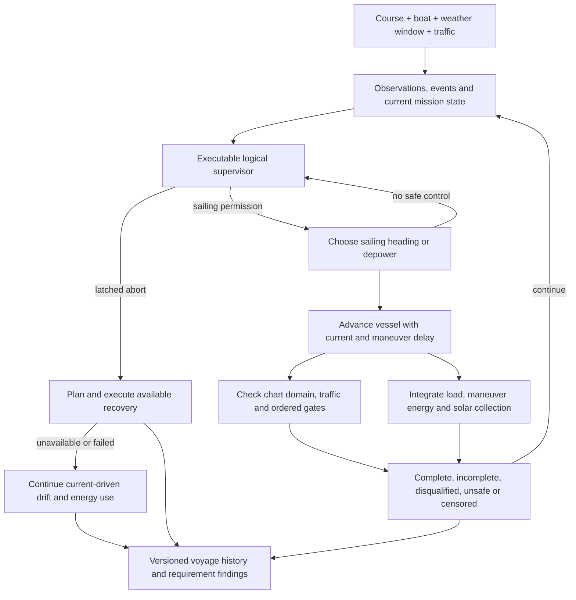

# Sailing the challenge before building the boat

**OOSEM:** System requirements and scenarios · [Maturity assessment](current-assessment.md)

What happens when the boat meets changing wind, traffic or a fault? The simulation combines the challenge course, a candidate boat, weather histories and traffic scenarios. The executable supervisor governs event responses, sailing permission and abort decisions as that voyage unfolds. The simulation records a voyage history: where the boat went, what it encountered, how its battery changed, and why the attempt finished or stopped. I use it to discover missing requirements and compare design choices before committing to hardware.

The simulator supports conceptual configurations and named sizing candidates. The integration candidate IC-01 supplies its own solved sailing states, electrical demand, battery capacity and swept dimensions. Its sensing load and recovery equipment mass enter that same sizing calculation. Keeping the course and scenario logic separate lets me increase vessel fidelity while rerunning the same seeds.

The [development spirals](simulation-spirals.md) explain how these capabilities grow together and how each experiment guides the next addition to fidelity.

The [encounter-feasibility study](encounter-feasibility.md) supplies explicit detection range, misses, latency, position error, track expiry and dropout behavior to guidance, while independent truth scores collisions and clearance. It compares sensing hypotheses with energy and casualty outcomes. Perfect observations remain an explicit baseline for older campaigns. These virtual results do not qualify a camera, AIS, acoustic or radar implementation.

## Executable supervisory logic

The [mission supervisor](../models/vehicle/mission-logic.sysml) executes through OpenSysML's native action API. `HandleEvent` determines the response to an observation or intervention. `SupervisoryCycle` determines sailing permission, operating mode, abort latching and whether an abort alert is attempted or queued. `RecoveryAuthority` permits recovery after primary steering or power loss only when an explicitly independent, powered path is supplied. `FallbackPolicy` decides whether the available, permitted recovery path can be attempted or the vessel must continue drifting. Dependencies connect these actions to the normal-sailing, traffic-encounter and abort/recovery scenarios; the supervisor is allocated to the onboard mission manager.

A wind observation outage inhibits sailing while the vessel drifts with the current. Restoring the observation permits sailing again. Communications loss alone does not end the attempt. A safety abort latches: restoring inputs does not resume qualification. Capsize itself is not a disqualifying event. Unassisted recovery may preserve the attempt if it restores the required safety capabilities; motor use, outside intervention or loss of those capabilities ends qualification. The archived IC-01 casualty case exercises inverted powered recovery, not an unassisted self-righting demonstration. Alert delivery does not block autonomous recovery. A held forecast remains usable during a service outage; a declared invalid forecast triggers abort and recovery.

Python supplies observations, computes chart and traffic geometry, ranks feasible headings and integrates motion and energy. It dispatches the action outputs to those mechanisms. The supervisor's traffic mode identifies a predicted encounter; avoidance geometry and maneuver selection remain conceptual Python calculations. This is a partial executable logical architecture, not a complete autopilot or a verified sensing system.

The capsize path requires explicit observations: safety functions remain available
while inverted, then unassisted righting restores upright operation. Between
those observations the simulated boat drifts with the current, consumes energy
and remains exposed to chart and traffic hazards. It cannot sail, score gate
crossings or collect solar energy. Missing safety evidence triggers abort. This
tests the qualification policy; it does not predict righting dynamics or supply
evidence that the physical boat can recover.

Each result includes `logic_trace`, with the action name, simulation time, input facts and output decisions for events and changed supervisory decisions. The abort latch and memoized pure action results are scoped to one simulation. Execution sessions check model provenance, and campaign records include the source hashes. These records support explaining a simulated decision; they do not establish physical capability.

## A course tied to charted markers

The challenge stays in Bonneville Pool. Launch and retrieval use Bingen Point boat ramp outside the scored course. The start/finish gate references green Lighted Buoy 39. At Stevenson, the vessel rounds red Lighted Buoy 16 to port through north, west and south checkpoints in order, maintaining an 80 m nominal marker exclusion. Gate segments extend 80–220 m from each reference. The model owns the geometry and order; current notices and actual buoy positions must be checked before launch.

The course geometry comes from current NOAA electronic charts. The former raster chart 18532 was canceled in 2024. The [source record](../evidence/course/2026-10-11/sources.json) identifies the chart catalog, Light List, Coast Pilot and regulatory sources; the extracted features retain their chart-cell identities and attributes.

The reference-route planner uses charted depth areas, land, obstructions and exclusions. It finds a connected route with the model's planning clearances and checks every shortcut against that domain. The resulting line guides the simulation; sailing and traffic maneuvers produce a different track. The gates overlap the navigation fairway, so a crossing is a traffic decision. Chart clearance alone does not establish maneuvering room or launch readiness. Both legs use the selected closed Hood River lift span; unassessed adjacent spans are excluded. Actual air draft, motion, pool stage and notices still determine whether the modeled passage is applicable to a trial. The [course and recovery assessment](site-and-environment-evidence.md#course-and-recovery-decision) records that basis.

The October 7 navigation notice adds a stationary construction hazard near the White Salmon confluence: a derrick barge supporting railroad bridge work through December 2026. This scenario excludes an allocated 250 m buffer around the published location until the actual work footprint is confirmed. The same notice lists three discrepant aids elsewhere in Bonneville Pool. The chart and notice snapshot must travel with each experiment.

The solid outbound and dashed return lines share their actual geographic coordinates. [Focused satellite views](architecture.md#start-finish-and-turnaround-in-shore-context) show the Bingen start/finish and Stevenson turnaround with both shorelines. These are reference paths; simulated tacking and avoidance can depart from them within the permitted water domain.

## One timeline connects the decisions

The model owns both the supervisory decisions during a voyage and the outcome criteria used to assess it. The simulator supplies observations to the supervisor and applies its decisions. Ordered crossings, intervention, collision, reserve and abort facts determine the final mission classification. A simulated completion remains separate from physical qualification or proof of full navigation-rule compliance.

The controller evaluates sailing headings and a depowered option. Depowering still allows the boat to drift with the current; it does not create free station keeping. Maneuvers cost time and energy. The controller updates on its own clock; a smaller integration step does not increase its update rate or shorten a maneuver. Command delivery and maneuver completion have separate clocks. A pending command holds the previous heading until delivery; an active maneuver cannot be restarted by a faster assessment update. Margin checks continue during that interval, but new heading selection waits for the in-flight command and maneuver to finish. This non-preemptive policy leaves an additional timing question for hazards first observed during an occupied interval. The timing trace records selection, application and maneuver completion. Motion steps end at control updates, command delivery, maneuver completion, weather changes and injected events. Saved tracks retain velocity-change points so rendering does not cut across a turn. Both pieces of the drift-then-sail maneuver must remain in the chart domain. A communications outage does not stop autonomous execution. Operator intervention or motor use ends qualification for that attempt.

There is no 72-hour challenge deadline and no daily energy-balance requirement. A finite trip can finish with less stored energy than it started with. It must still protect the energy needed to reach a suitable shore retrieval location from its current position. The simulation horizon is a computational setting: reaching it produces a censored result, not a failed challenge deadline.

IC-01 uses a fixed prediction horizon independently of the one-second assessment clock. Its guidance ranks forward progress and cross-track displacement, aims at the next gate center near a crossing and excludes zero-speed sailing headings. Depowering remains an explicit current-driven option. These choices make the guidance policy testable without treating a faster assessment cycle as faster physical maneuvering. The performance envelope is an averaged combination of the candidate's solved sailing states, not resolved tack trajectories or a measured polar.

The candidate carries separate main and recovery energy accounts. Normal sailing draws its modeled bus load from the main pack and standby demand from the recovery pack. Abort shuts down the primary sailing load in this hypothesis; powered recovery draws its propulsion and essential loads from the independent pack. Primary guidance adds the native 10 m relative-position allowance as an explicit handoff buffer. Backup observations begin at activation, including observation latency, rather than acquiring retrospective tracks. Recovery checks complete routes against delivered tracks, retains its destination while the predicted route remains clear, and otherwise selects an available alternative approach within its energy budget. If none is supported, propulsion stops and drift consequences continue. Main-battery energy cannot conceal exhaustion of the recovery bank. Recovery steering is still point-mass current compensation; measured finite-turn and startup behavior are evidence needs.

Recovery has an explicit route-planning and execution interface. The [native recovery calculation](../models/libraries/marine/recovery.sysml) resolves along-track and cross-current effects on powered transit; the [Python planner](../tools/boat_analysis/mission/recovery.py) searches chart-clear approaches and accumulates energy with an explicit uncertainty allowance. Capsized performance must be supplied separately. The mission engine can trigger recovery before continued sailing would consume its reserve, terminate qualification, and record the powered transit independently of challenge completion.

An unavailable or failed recovery continues as current-driven drift until physical contact or the declared horizon. Essential loads consume the remaining battery, and drift continues after exhaustion. Clearance violations remain latched in the result without feeding truth back to guidance or ending the trajectory. Actual collision ends the modeled motion; shore contact is an adverse terminal event, not successful retrieval. Horizon expiry leaves the consequence censored. Inversion uses the same current-only drift approximation; attitude-dependent windage and wave-driven drift are not modeled. Reaching a recovery approach does not establish retention there. Legacy stopped-baseline runs explicitly disable continuation.

Recovery scenarios use synthetic pickup locations and allocated propulsion capabilities. They demonstrate the implementation, not suitable real-world refuges. Reaching a modeled water approach does not prove final grounding, shore access or vessel retention. Those need their own evidence. Traffic truth remains separate for consequence scoring. IC-01's backup observation path is an explicit unmeasured allocation; legacy cases without it receive no backup detector credit. The [integration acceptance and physical evidence needs](validation-plan.md#exercise-decisions-before-physical-integration) keep these limits attached to the candidate.

## Connecting a sizing candidate

The candidate provider forms an averaged-tack velocity envelope from the four solved operating states at each modeled wind speed. Intermediate directions represent time-sharing between those sailing states; they are not independently solved or measured polar points, and their small-scale tack excursions are not resolved by the point-mass track. Wind interpolation stays inside the solved interval. Outside that interval the simulation credits only drift and reports the unsupported time instead of extrapolating performance. Full polars and explicit tack dynamics are still needed before accepting navigation performance near hazards.

The electrical configuration uses candidate storage, usable fraction, departure charge, panel area and maximum solved operating bus load. It integrates net bus power with charge/discharge efficiency, charge-rate limitation and self-discharge. Maneuver energy remains an explicit additional scenario allowance. The no-harvest passage screen and a chronological replay answer different questions. Solar collection is configuration-specific; IC-01's integration record disables it.

## Weather and traffic ensembles

Each realization has reproducible weather and traffic random streams. Weather retains persistent regimes and correlated perturbations rather than drawing an independent wind at every step. Solar input follows a day/night cycle with a cloud factor. These are initial sensitivity hypotheses, not a forecast model or calibrated local probability distribution.

Commercial scenarios use charted recommended-track fragments and represent the complete tow footprint. Small-craft scenarios include local crossings and reversing tracks for fishing and powered recreation, alongside sailing traffic. Passenger vessels are included because the regional AIS-derived port record shows that traffic class too. The model owns the rates, dimensions, speeds and separation allocations.

VesselFinder's accessible record does not provide a complete traffic census or an accepted arrival-rate estimate. Small craft may not transmit AIS, and a tug position does not describe the entire tow. The perfect-truth baseline knows the scripted traffic; the encounter study supplies range-limited, delayed and uncertain observations instead. Occlusion, uncertain intent and measured detection performance still need additional cases before these results can support traffic-system acceptance. Geometric separation checks do not establish full Navigation Rules compliance.

The useful early outputs are failure mechanisms and sensitivity to assumptions. The fraction of synthetic scenarios completed must not be presented as the probability that the real boat will complete the Gorge challenge.

## Wind at wing height and waves along the route

A small boat's wing operates near the water, where wind speed changes with height. Waves also move the wing through the wind and change underwater inflow. The environmental model resolves height-dependent wind, wave direction and current, and checks deck and appendage clearance through sampled motion. Its parameters are provisional; a calculated clearance or resistance penalty is not an observed failure.

The [archived environmental studies](reference/environmental-replays.md) hold their 1.4 m and approximately 2 m hulls fixed to isolate these effects. They reduced predicted pointwise sailing progress and exposed conditions outside the available performance evidence. Those results motivate extending and checking IC-01's environmental model; they do not establish IC-01 passage times.

## Wave-averaged sailing performance

The wave solver calculates heave, roll and pitch response, then averages sailing forces over a wave cycle while solving for mean speed and controls. A response amplitude operator describes the magnitude and phase of a motion relative to the incident wave. Linear response, assumed damping and limited aerodynamic coverage restrict which states can be accepted.

The archived 1.4 m study accepted 32 operating cases in 0.04 m, 3 s regular waves. Its four voyage replays requested much larger waves and stopped at departure outside the saved coverage. No passage time was obtained for those cases. The [wave study and records](reference/environmental-replays.md#wave-averaged-sailing-performance) retain the solver assumptions, numerical checks and evidence needed to extend that calculation responsibly.

## What the earlier voyages established

The original 32-run conceptual-vessel campaign completed 28 courses, with three numerical-horizon stops and one unresolved maneuver. It exposed a local rounding limitation, but its load and sailing assumptions did not represent IC-01. The [original campaign record](reference/original-mission-campaign.md) preserves those counts and its 65.786 km course revision. The [development history](simulation-spirals.md) connects it to later experiments; counts from different vessels and course revisions are separate evidence.

## Increasing fidelity without changing the question

| Current representation | Evidence or implementation that should replace it |
| --- | --- |
| Candidate averaged-tack envelope (or original conceptual polar) | Full candidate polars, explicit tack excursions and measured maneuver performance |
| Point-mass guidance | Control-software replay and maneuver dynamics |
| Synthetic weather regimes | Forecast-conditioned, correlated along-route weather/current histories |
| Scripted truth and hypothetical observation errors | Time-stamped sensor replay, calibrated detection and intent uncertainty |
| Allocated electrical budget | Measured installed loads and battery behavior |
| Chart planning clearances | Configuration-specific maneuver, draft, pool-stage and notice review |

The course and scenario contracts stay identifiable through these changes. Virtual results remain separate from physical verification. At the requirements layer, this simulation should expose unsuitable or missing mission criteria. At the architecture and analysis layers, its vessel models need enough credibility to support the design decisions being made.

Run the original conceptual campaign with `uv run python -m tools.boat_analysis.mission.campaign --count 32`, or add `--candidate build/analysis/sizing-continuation.json` for a freshly checked sizing result. It records the model inputs, source hashes, seeds, generated traffic counts, gate events and chronological histories. The numerical horizon can be extended without turning incomplete observations into failures.

Forecast-service loss and forecast invalidity are separate scenario events. A service outage alone preserves the qualifying attempt; a forecast declared no longer applicable triggers autonomous recovery. A manually supplied weather update disqualifies the attempt. These cases exercise mission policy; they do not yet validate a forecast-applicability estimator or an operational weather-service integration.

**Next:** [Passage time, reliability and failure analysis](reliability.md) · [Series guide](index.md)
