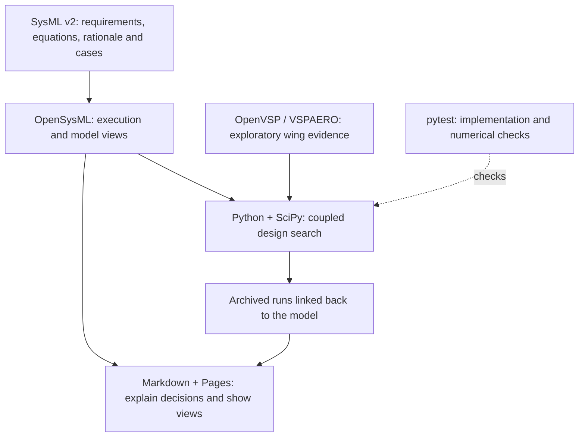

# Authoring and publishing

**Design phase:** Appendix · [Development plan](development-plan.md)

How can I explain the project without maintaining a second, drifting copy of the design? I write the story in Markdown and import small views of the real SysML model. This supports the [engineering record across the V](development-plan.md#engineering-record): readers and agents can follow a decision back to its requirements, assumptions and evidence.



The arrows follow information from the model and analyses into the engineering record and published articles.

The seasonal weather views follow the same rule: NOAA observations are frozen with hashes, model policy defines the bins and profile scope, and native calculations supply the passage-probability sensitivity. CI regenerates these views and rejects drift from the committed projection and plots. The testbed illustration is exported from the actual read-only SolidWorks assembly with `tools/boat_analysis/cad/export_testbed.ps1`; it is separate from simulated candidate geometry.

The current SRR candidate table is projected from its immutable replay with `python -m tools.publishing.srr --run 2026-10-13-srr-readiness`. CI regenerates the SysML evidence and rejects drift; the Markdown imports that model view.

Our Markdown describes methods and design reasoning. Engineering definitions, assumptions and rationale belong in `models/`. Each page imports those definitions into a small native view; the publisher resolves the view with OpenSysML and inserts its diagram and requirement statements.

## Inline views

The geographic course map uses an archived OpenStreetMap river centerline in `tools/publishing/data/gorge-river.json`. Regenerate it with `uv run python -m tools.publishing.course_map`. The map provides geographic context; the [challenge model](../models/missions/transgorge.sysml) defines the mission and tracks the operational gate decisions.

Use a fenced `sysml-view Package::viewName direction=BT` block containing a uniquely named package, imports, and a scoped view. Expose existing model elements and provide layout metadata to keep the diagram focused. Do not declare requirements or calculations in a documentation fence. For a view exposing requirement usages, add `statements=true` to include their authoritative statements below the diagram. Omit that option for mixed architecture/verification views. See [the modeling method](methods/modeling.md) for a working example.

The native requirement diagram currently omits plain design-basis dependencies. The publisher adds those edges between visible nodes from the native RelationshipRegister query, retaining their `dependency` label. It does not reinterpret them as derivations.

The direction follows the semantic arrows. Derivation arrows point from derived requirements toward their source, so `BT` places source requirements above their children. Keep one engineering question per diagram.

Use an empty `sysml-report Package::Document` fence to include a native document query. Reports should support a specific discussion rather than repeat the entire model.

## Local build

From the repository root:

```sh
uv sync --locked
uv run python -m tools.boat_analysis.cli install
uv run python -m tools.publishing.build
```

The generated site is written to `build/site`; rendered Markdown for the blog is under `build/site/imports/docs`. Generated files are build artifacts. Author the source pages and models, then rebuild them together. Raw GitHub Markdown displays the view source; the published site displays the resolved diagrams.

A documentation build never runs optimization or VSP. Recorded analysis evidence is retained with its original provenance, and current results must identify their inputs and source revision. The current conservative run and the earlier exploratory run use separate model packages, so updating a report never relabels historical evidence. See [the sizing method](sizing.md) and [recorded outcomes](results.md).

## GitHub Actions

The model-and-documentation workflow validates and prepares native calculations, checks recorded provenance, runs pytest and builds the site. Pull requests produce a Pages artifact; a successful main-branch run deploys it. Action revisions, uv and the native tool are pinned. Full history is fetched because archived evidence is checked against its original source revision.

The personal blog keeps its existing article identifiers and reads rendered Markdown from the project site's `imports/` directory. Authored pages stay in this repository. Legacy page paths redirect to current methods; superseded numerical studies remain available through Git history rather than masquerading as current results.

Aerodynamic plots are regenerated from hash-checked archived JSON by `tools.boat_analysis.evidence.aerodynamics` and published under `assets/vsp`. Native geometry screenshots and the corresponding VSP model are retained as evidence. Mesh/wake comparisons and sizing outcomes are projected into SysML for native report queries. The plot build does not launch OpenVSP.


**Next:** [Return to the series guide](index.md).

The passage-exposure figure is regenerated with `python -m tools.publishing.passage_exposure`. Its contour and example values execute in `BlueDogPassageExposure::Contours`; Python only draws the native results. CI checks the committed figure against that model. Requirement view scopes distinguish current Gorge applicability from deferred missions using `BlueDogMissionScope::Applicability` metadata; shared criteria need not import the deferred mission into a current view.

The introduction embeds a `design-explorer` fence. During the normal site build, `tools.publishing.design_explorer` exports the native sizing input contract, search brackets, wing section and retained candidate to `assets/design-explorer/design.json`. The existing blog reader renders that data as a local geometry editor. The browser uses dimensional geometry only; downloaded configurations are proposals for a subsequent native analysis, not solver evidence.


### Python records from the model

`MarineDesign` definitions generate frozen records in the ignored
`tools/boat_analysis/generated` package, alongside the callable calculation APIs.
The export declarations in `pyproject.toml` select the model definitions; the same
pinned compiler supplies type facts and executable calculations. Preparation and
pytest run in the publishing workflow. There is no separate record-generator
checkout or committed copy of the types.

```sh
uv run python -m tools.boat_analysis.cli prepare
```

Generated records provide `as_array()` and `from_array()` at numerical boundaries;
vessel and wind calculations use named fields. The generated execution boundary
performs named packing, shape validation and model-declared physical checks.
The sizing model declares equilibrium and constraint output groups explicitly,
so solver roles do not depend on positions in the calculation's output vector.

These snapshots cover design variables, physical assumptions, operating state,
aerodynamic coefficients, hydrostatic inputs, appendage loads, mass properties
and passage conditions. Geometry arrays and route-case matrices remain numerical
interfaces. Scalar and batch callers can supply named records; packing follows
the model declaration order, independently of Python dictionary or dataclass order. Physical constraints remain native calculations; dataclass construction
checks data representation, not vessel feasibility.
