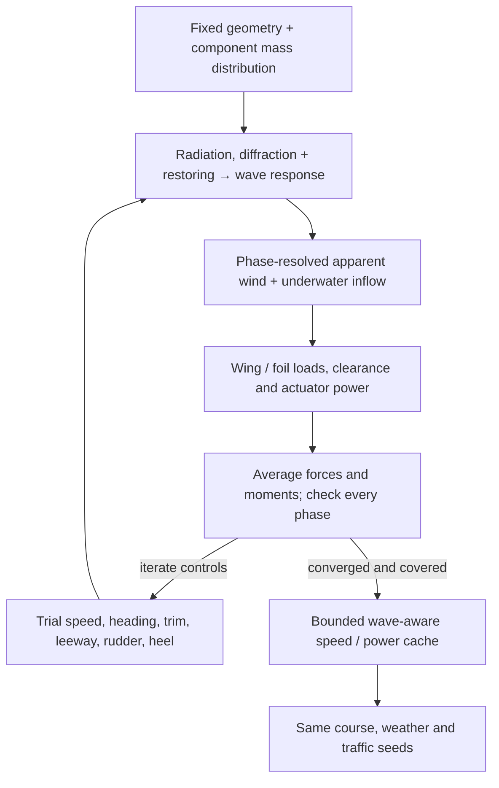

# Wind and wave studies on archived boats

These studies use the archived 1.4 m and approximately 2 m configurations, not IC-01. They explain model sensitivity and coverage limits. Their passage times and acceptance outcomes do not transfer to a different hull.

## Wind at wing height and waves along the route

The environmental replay starts from the archived boat dimensions and re-solves its sailing controls. Wind is explicitly referenced to 10 m above mean water. Eight strips along the wing use a neutral logarithmic profile; each strip samples its own apparent wind, incidence, polar coefficients, force and moment. Local incidence outside the saved aerodynamic grid makes the operating state unsupported. This is a first shear approximation using finite-wing coefficients locally, not a new lifting-line solution or a measured Gorge wind profile.

The [surface-environment model](../../models/analyses/surface-environment.sysml) owns roughness, reference height, effective fetch and wake assumptions. Its dependencies link the calculation to progress, wind, wave, current and recovery requirements. The [reusable library](../../models/libraries/marine/surface.sysml) owns the executable wind and wave arithmetic. The neutral profile follows the [NREL wind-height discussion](https://www.nrel.gov/docs/fy21osti/78412.pdf); fetch growth uses the [SMB deep-water equations](https://cosefm.cee.wisc.edu/CEE514_Coastal_Engineering/Online_Solver/Wind_Waves.html).

Wind seas retain energy after a wind reversal, so opposing wave trains can coexist. Effective fetch is a declared scenario input, not a chart-derived distance or an observed wave forecast. Nearby powered traffic triggers a short wake encounter. The wave-current screen applies deep-water dispersion and action-flux transport as an entry-from-still-water sensitivity; it does not claim that a spatially uniform current causes shoaling. The directional resistance coefficient remains uncalibrated. The mission provider translates added resistance into a speed sensitivity using a local quadratic resistance approximation and no surfing credit.

The replay reports sea height, added resistance, retained speed, wave-model coverage, and possible deck/wing contact or appendage exposure. A phase-resolved motion screen moves the vessel in heave, pitch and roll and compares its points with the local water surface. The wing samples wind at its changing height above **mean water**. Translation and rotational point velocity change apparent wind; rotation also changes incidence and force direction. This avoids subtracting a crest from the clearance of a boat that rises with it.

The study compares three prescribed responses: fixed vertical position, heave following, and heave plus wave-slope following. The model defines the response gains, phase resolution and angular coverage limit. These are sensitivity cases, not measured response amplitude operators or bounds on resonance. The [response amplitude operator (RAO) convention](https://www.orcina.com/webhelp/OrcaFlex/Content/html/Vesseltheory,RAOsandphases.htm) relates response amplitude and phase to the local wave. The initial gains have zero lag; they need replacement with frequency- and direction-dependent hydrodynamic or measured responses.

Clearance checks use a regular equivalent wave of height 2Hs, a bounding deck footprint, and the wing, keel and rudder stations. Mixed trains have deterministic sampled phases rather than a resolved random spectrum. Wing loads use strip polars in the moving plane. Unsupported incidence, profile height or motion angles are reported; clipped coefficients do not establish supported performance. The neutral profile does not describe airflow around individual crests, shielding or breaking waves.

The prescribed-motion replay uses moving clearances as diagnostics and preserves its original speed model. The newer wave-averaged solver below closes mean sailing balance using calculated wave response. Neither calculation establishes survival: large motion, slamming, wave-resolved steering and dynamic capsize recovery remain outside the current model. Unsupported breaking/blocking cases stop the replay as model-coverage limits.

Run a paired campaign with identical weather and traffic seeds:

```sh
uv run python -m tools.boat_analysis.cli prepare
uv run python -m tools.boat_analysis.mission.surface_campaign --count 4 --budget 25
```

The four arms isolate uniform wind/calm water, wind shear/calm water, wind shear/waves, and a paired moving-clearance replay. The last two use identical speed predictions. Fixed-design operating checks also include the 2 m reference. Outputs go to `build/analysis/surface-campaign`; `--reuse` accepts saved operating results only while their source hashes match. This is an environmental sensitivity replay, not a new size optimization.

<a id="current-sizing-candidate-replay"></a>
## Archived sizing candidate environmental replay

The archived environmental replay holds the 1.4 m and 2 m geometries fixed and re-solves controls for uniform and sheared wind. All eight operating cases for each boat found supported force-balance solutions. For the 1.4 m boat, average water-relative velocity made good (VMG, progress in the intended direction) across the two tacks changed as follows:

| Reference wind at 10 m | Sailing mode | Uniform wind | Sheared wind |
| --- | --- | --- | --- |
| 5 m/s | Upwind | 0.80 m/s | 0.60 m/s |
| 5 m/s | Downwind | 1.19 m/s | 0.66 m/s |
| 8 m/s | Upwind | 1.00 m/s | 0.91 m/s |
| 8 m/s | Downwind | 1.45 m/s | 1.23 m/s |

Four paired 1.4 m voyages used identical weather and traffic seeds. Each calm-water arm completed one voyage and stopped three outside the available wind-performance range. With wind shear and the provisional wave resistance, none completed: three stopped when the controller found no safe move, and one stopped outside wind-performance coverage. The wave-inclusive prefixes lasted 8.76–10.17 hours and reached modeled significant heights of 0.48–0.63 m. One prefix encountered a scripted powerboat wake.


The completed calm-water voyages took 59.59 hours with uniform wind and 22.48 hours with shear. That reversal does not show a benefit from losing wind: the trajectories encounter different weather and rounding conditions at different times, and the coarse controller and averaged-tack envelope are path-dependent. The pointwise operating results show reduced VMG. Four voyages cannot establish either a monotonic time penalty or a real completion probability.

The wave screen predicts added resistance large enough to consume all available speed margin in some evaluated directions. Its coefficient is not calibrated, so these stops are not proof that the boat cannot complete the challenge. The original static wave-clearance screen flagged possible contact or appendage exposure throughout these prefixes. The phase-response replay below revisits those flags; neither screen treats contact as a demonstrated failure. I would improve the wave-force evidence, low-wind polar coverage and local guidance before reducing hull length further.

[Archived environmental replay](../../evidence/runs/2026-10-13-surface-environment/summary.json) · [Run provenance](../../evidence/runs/2026-10-13-surface-environment/manifest.json) · [Sizing results](../results.md)

## Wave motion and wing loads

The [prescribed-motion experiment](../../evidence/runs/2026-10-13-wave-motion/summary.json) illustrates the importance of coupled motion: the boat moves with the water, and the wing moves through the wind profile. Its prescribed motion supports sensitivity analysis; the sailing-performance provider below calculates vessel response.

The current adapter explicitly distinguishes the steady solver's stored crosswind sign from Cartesian point velocity and force. A transverse-motion regression and the vanishing-wave limit check that conversion before accepting a wave-averaged result.

## Wave-averaged sailing performance

The 1.4 m boat has a coupled mean-performance calculation. Capytaine supplies radiation added mass, damping and total wave excitation, including both incident and scattered-wave forces. A mesh-derived mass-inertia tensor and native hydrostatic restoring matrix complete the heave, roll and pitch response. The response changes with wave period, direction and forward speed. Mesh comparison is checked locally around each operating condition; unsupported cells cannot earn accepted sailing performance.

At each wave phase, the wing samples its changing height and point velocity. Keel and rudder forces use wave orbital flow, vessel motion and immersion. Native SysML calculations supply the foil forces, force-balance corrections and actuator power. SciPy adjusts mean speed, heading, incidence, leeway, rudder and heel until cycle-averaged surge, sway, yaw and roll balance, while maximizing progress. Controls stay fixed within a wave cycle. A doubled phase grid checks the result before it enters the performance cache.



The [wave-performance policy](../../models/analyses/wave-performance.sysml) owns the test waves and acceptance screens. The [reusable equations](../../models/libraries/marine/wave-performance.sysml) have no project-specific requirement dependencies. Capytaine's [problem setup](https://capytaine.org/stable/user_manual/problem_setup.html) and [response inputs](https://capytaine.org/stable/user_manual/hydrostatics.html) define the external solver boundary.

This is a linear-response engineering model. Equipment is represented by allocated point masses; structural skin and ribs have distributed inertia. Additional viscous damping is a declared 5% hypothesis. The reference wetted geometry is upright, and the wing inertia uses reference trim. Mean pitch remains constrained as in the preceding operating model; its hydrostatic bias is recorded rather than treated as a solved sailing-pitch equilibrium. The existing uncalibrated mean wave-resistance allowance is applied once inside the sailing balance; first-order radiation/diffraction does not replace it with a validated second-order drift calculation. The mission engine does not apply a second speed penalty.

Near-surface wind and attached-flow polar limits remain enforced. Mixed seas, wave periods or heights outside the saved sailing cache produce a coverage stop rather than an extrapolated voyage prediction.

The initial run accepted **32 of 32 operating cases**: 5 and 8 m/s reference winds, both tacks and sailing modes, and four wave directions relative to the wind. The regular waves were **0.04 m high with a 3 s period**. VMG was 0.06–1.46% below the archived calm-control reference. These are engineering-model sensitivities, not measured losses or a proof of globally optimal controls. Doubling from 16 to 32 phases changed the checked force/power outputs by at most 0.00070%; all selected points retained the balance and coverage checks.

The four paired Gorge replays stopped **at departure** with `wave_performance_outside_coverage`. Their requested equivalent regular-wave heights were 0.83–0.95 m, with current-adjusted periods of 2.05–2.20 s. The sea generator and its 2Hs regular-wave interpretation remain scenario hypotheses. The small-wave cache cannot answer those conditions, so these runs supply no passage times. The next step is to check the sea assumptions against observations and extend the response/performance evidence toward those conditions, using nonlinear motion where the linear model loses coverage.


[Run summary and source hashes](../../evidence/runs/2026-10-13-wave-performance/summary.json) · [Operating cases](../../evidence/runs/2026-10-13-wave-performance/operating.json) · [Mission coverage records](../../evidence/runs/2026-10-13-wave-performance/missions.json)

Reproduce the study with the package-free uv environment:

```sh
uv sync
uv run python -m tools.boat_analysis.cli prepare
OPENBLAS_NUM_THREADS=1 uv run python -m tools.boat_analysis.hydrodynamics.bem --mesh 7 --output build/analysis/wave-performance/bem.json
OPENBLAS_NUM_THREADS=1 uv run python -m tools.boat_analysis.hydrodynamics.bem --mesh 9 --output build/analysis/wave-performance/bem-refined.json
uv run python -m tools.boat_analysis.mission.wave_campaign --budget 8
uv run python -m tools.publishing.wave_performance build/analysis/wave-performance
```

