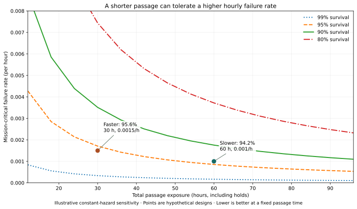

# Passage time, reliability and failure analysis

**OOSEM:** Trades, optimization and analysis · [Maturity assessment](current-assessment.md)

A slower voyage demands more hours of successful unattended operation. I use passage estimates and the architecture to ask what can fail during that exposure, and how the boat should respond. This connects [preliminary design](current-assessment.md#virtual-design) to the fault and endurance tests needed for [physical verification](current-assessment.md#physical-validation).

The finite Gorge round trip is the current design objective. I connect sailing progress, passage duration and reliability exposure to compare the chance of completing that mission. The sizing study uses conservative aerodynamic assumptions for its primary case. Its passage times are conditional estimates, not measured endurance or demonstrated reliability; the [candidate results](results.md) identify the configurations behind them.

## Can a faster boat be more likely to finish?

Could a faster boat be more likely to finish, even if it is more failure-prone per hour?

A slow boat has to keep everything working for longer. Under a constant critical-failure rate, survival is `exp(−failure rate × exposure time)`. Halving the passage time permits twice the hourly rate at the same survival probability. The [NIST exponential reliability model](https://itl.nist.gov/div898/handbook/apr/section1/apr161.htm) gives a simple starting point for that trade.



*Each curve connects equal survival probabilities. The faster example has a 50% higher hourly failure rate but lower total exposure. The two points illustrate the arithmetic; they are not estimates for the candidate hulls.*

The Gorge makes useful speed especially valuable. Against a 1 m/s current, increasing water-relative progress from 1.5 to 2 m/s doubles ground progress from 0.5 to 1 m/s. Those are illustrative values, but the relationship matters: a little extra drive near the current threshold can save a lot of time. A shorter passage may also fit more comfortably inside a favorable weather window.

In the representative westerly, the upstream leg is downwind. That gives me a reason to investigate a faster hull, potentially one that planes. It still has to make the windward outbound leg, carry its equipment and recover from a capsize. Peak speed alone will not answer the mission question.

I also need to distinguish speed from nimbleness. A faster boat can have more control authority in one condition and greater control demands in another. Planing is a hypothesis to evaluate, not evidence of either better maneuverability or worse reliability. [Experimental work on planing-hull slamming](https://www.sciencedirect.com/science/article/pii/S0141118719303906) illustrates why wave impacts and structural loading need their own analysis.

The failure mechanisms matter. Electronics faults may accumulate with running time. Weed encounters may depend more on the route traveled. Actuator wear depends on duty and load, while slamming and capsize risk depend on the conditions and how the boat is sailed. I cannot assign all of those a fixed hourly penalty and assume that speed pays for it.

The design comparison I want is therefore **probability of completing the round trip**, evaluated jointly over weather, current, holds, energy use and failures. Each candidate should have an operating policy: sail faster when conditions permit, reduce speed or hold when the accumulated risk would otherwise rise. Unsuccessful routes must remain in that comparison. Traffic safety and accepted critical-failure dispositions remain launch gates.

The native [passage-exposure analysis](../models/analyses/passage-exposure.sysml) generates the curves and example points. It shares its constant-hazard calculation with the cruise reliability model. The current force-balance solver does not model dynamic planing or speed-dependent failure rates; the contour is a sensitivity study, not a planing-boat selection. A hull comparison with actual performance and loading evidence will deserve its own story.

## Finite endurance and future missions

The current mission has no completion deadline and retains protected recovery reserve. Its battery may finish below its starting charge if reserve and peak-power requirements remain satisfied throughout the voyage. Repeating the same energy cycle indefinitely is a separate future objective.

The chronological energy model reports finite-campaign feasibility separately from repeatable-cycle feasibility. The current sizing search retains peak-power checks without imposing daily energy balance. IC-01 already supplies candidate-specific performance and electrical loads to local chronological encounters and recovery cases. Extending that evidence to complete charted-course histories and condition-dependent failure exposure remains necessary before comparing mission-success probability. A static mass or passage-time optimum does not answer that question.

Hawaii will require its own route, season, passage duration, communications, saltwater exposure and recovery allocations. The model keeps the candidate ocean requirements for that future work, without making them prerequisites for the Gorge boat.

```sysml-view Page_reliability_0::CruiseSemantics direction=BT
package Page_reliability_0 {
    private import StandardViewDefinitions::*;
    private import DiagramLayout::*;
    view CruiseSemantics : GeneralView {
        filter @SysML::RequirementUsage;
        expose BlueDogRequirements::cruisePerformance;
        expose BlueDogRequirements::legProgress;
        expose BlueDogReliability::VoyageReliabilityVerification;
        expose BlueDog::Architecture::missionContext::boat;
        metadata Layout about BlueDogRequirements::cruisePerformance { x = 0; y = 0; }
        metadata Layout about BlueDogRequirements::legProgress { x = 360; y = 0; }
        metadata Layout about BlueDogReliability::VoyageReliabilityVerification { x = 360; y = 200; }
        metadata Layout about BlueDog::Architecture::missionContext::boat { x = 0; y = 400; }
    }
}
```

```sysml-view Page_reliability_1::ReliabilitySemantics direction=BT
package Page_reliability_1 {
    private import StandardViewDefinitions::*;
    private import DiagramLayout::*;
    view ReliabilitySemantics : GeneralView {
        filter @SysML::RequirementUsage;
        expose BlueDogRequirements::missionReliability;
        expose BlueDogRequirements::missionSuccessProbability;
        expose BlueDogReliability::VoyageReliabilityVerification;
        expose BlueDog::Architecture::missionContext::boat;
        metadata Layout about BlueDogRequirements::missionReliability { x = 0; y = 0; }
        metadata Layout about BlueDogRequirements::missionSuccessProbability { x = 360; y = 0; }
        metadata Layout about BlueDogReliability::VoyageReliabilityVerification { x = 360; y = 200; }
        metadata Layout about BlueDog::Architecture::missionContext::boat { x = 0; y = 400; }
    }
}
```

The native weather analysis named `primary` refers to the archived 2.009 m boat. Its current evaluation passes the westerly route screen and fails the easterly screen. It must not be read as a current IC-01 result. IC-01's nominal westerly pass likewise does not establish all-season easterly capability. The [weather-window study](operating-constraints.md#gorge-weather-and-launch-windows) separates selected westerly conditions from easterly exposure.

Weather-route success and hardware survival are different quantities. A useful comparison must combine them over complete trajectories, including failed routes and holds. Applying a hazard rate only to the average successful passage would omit important risk. No weather probability has been accepted as an allocation of the mission reliability target.

The design failure mode and effects analysis (DFMEA) links functional failure modes to architecture responsibilities, requirements and needed evidence. Its concerns guide design and tests; they are not fabricated failure probabilities. Numerical rate-budget examples remain conditional on their assumptions and evidence disposition.

Weed contact is a concrete operating interaction. It affects both the sailing appendages and recovery propulsion, so loss of speed, steering and recovery capability are assessed separately.

```sysml-view Page_reliability_2::WeedSemantics direction=BT
package Page_reliability_2 {
    private import StandardViewDefinitions::*;
    private import DiagramLayout::*;
    view WeedSemantics : GeneralView {
        filter @SysML::RequirementUsage;
        expose BlueDogRequirements::submergedWeedPassage;
        expose BlueDogRequirements::weedPassageSpeed;
        expose BlueDogRequirements::weedPassageSteering;
        expose BlueDog::Architecture::missionContext::boat;
        expose BlueDogRequirementVerification::SubmergedWeedPassageVerification;
        metadata Layout about BlueDogRequirements::submergedWeedPassage { x = 0; y = 0; }
        metadata Layout about BlueDogRequirements::weedPassageSpeed { x = 360; y = 0; }
        metadata Layout about BlueDogRequirements::weedPassageSteering { x = 0; y = 200; }
        metadata Layout about BlueDog::Architecture::missionContext::boat { x = 360; y = 200; }
        metadata Layout about BlueDogRequirementVerification::SubmergedWeedPassageVerification { x = 0; y = 400; }
    }
}
```

The [DFMEA model](../models/analyses/dfmea.sysml) owns the failure hypotheses, effects, proposed actions and architecture/requirement dependencies. The [reliability analysis](../models/analyses/reliability.sysml) owns the exposure calculation and evidence gates. Neither an open DFMEA action nor a synthetic rate estimate establishes achieved reliability.

**Next:** [From virtual evidence to water trials](validation-plan.md) · [Series guide](index.md)
