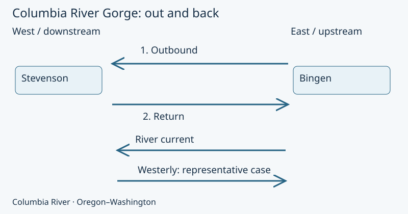

# SV Blue Dog: learning through an autonomous sailboat

SV Blue Dog is my personal project to design and build a small autonomous sailboat that can travel from The Dalles to Bonneville and back without intervention, while I monitor it from shore. Longer term, I’d love to develop something capable of reaching Hawai‘i. It brings together things I want to learn—sailing, desktop manufacturing and digital engineering—with the fun of building a complete robot that can look after itself on the water. The name comes from my blue heeler, Ozzy: another small, independent creature with plenty of energy and ideas of his own.

I started this project because I wanted to explore the limits of autonomous sailing and desktop manufacturing. I wanted to learn about sailing, build something cool, and develop a complete system. Microtransat—the challenge of sending an autonomous sailing boat across the Atlantic—gave me an idea for something closer to home: an even more micro “trans-gorge” boat.

My initial inspiration was the Gorge Blowout course. Adding a return journey made it a much more demanding challenge: the boat would have to sail both ways and make progress against the river current. The Gorge would be a proving ground for the longer-term ocean ambition.

The picture in my head is the classic westerly Gorge day. With wind from the west, the outbound leg toward Bonneville is windward with the current; the return is downwind against it. I plan to choose a favorable weather window for the qualifying attempt, even though I also want to test in winter. Easterlies reverse that sailing problem and deserve much more attention in winter. The [seasonal weather study](operating-constraints.md#gorge-weather-and-launch-windows) now gives those cases an observed context, rather than treating every wind direction as equally representative. Year-round unattended operation remains a later goal.

*This is a route-orientation sketch, not a navigation chart. A westerly helps the return sail downwind, but the boat still has to overcome the river current. An easterly makes that same return windward. The model defines the challenge gates; launch locations and operational permissions need their own planning.*

## A testbed, then a maze of decisions

I began sketching a testbed in SolidWorks to reduce risk around manufacturing techniques, wing-sail design and ArduSail control systems. The [existing CAD](../cad/) comes from that work. It was supposed to help me learn how to print and assemble the boat, explore the rig and get the control system working. It was never intended to be the final challenge vessel.

*The original testbed, exported directly from [SV Bluedog.SLDASM](../cad/SV%20Bluedog.SLDASM) in SolidWorks. This is the manufacturing, wing and control experiment that preceded the coupled sizing model; it is not the optimized challenge design.*

Then I got lost in the configuration decisions. A larger wing could provide more drive, but it also changed the loads, ballast, actuator and recovery problem. More battery could help endurance while making the hull heavier. Changing the hull changed the sailing performance I needed from the wing. I could make individual choices, but I struggled to manage the consequences across the whole design.

This is a surprisingly complex, high-performance system for something I hope will be small and inexpensive to manufacture. I was trying to push the edge of what was possible, and I stalled out.

## Using a model to get moving again

I realized that open-source tools and SysML v2 could give the project some structure. That also made Blue Dog a good excuse to dive into digital engineering: could I connect the mission, requirements, architecture, analysis and eventual tests closely enough to make the next decision clearer?

I am especially interested in how that model can structure an agent-driven development project. Agents can help explore alternatives and implement analyses quickly. I still need a shared description of what we are trying to achieve, why a choice was made and what would count as convincing evidence. Otherwise, producing more analysis can simply make the maze bigger.

The [development plan](development-plan.md) is my way of keeping that work directed. I use “I” for my goals and design judgments; when I describe work with agents, they help develop and check the engineering record, while I make the commitment decisions. The model is the shared record, not a substitute for that judgment or for testing a real boat.

## Where the project stands

I now have a challenge definition, a connected requirements and architecture model, and a coupled sizing study. The current numerical trial can satisfy the primary modeled sailing and energy screens, but handling, adverse conditions and self-righting still need work. It has not established a minimum-size design. The [results article](results.md) explains those findings and what they suggest testing next.

That feels like useful progress: I can see which assumptions are driving the design and which experiments could change the answer. The next step is to use the testbed and focused measurements to improve those assumptions, then revisit the sizing decisions with better evidence.

**Next:** [The mission and the boat’s responsibilities](architecture.md), then [the development plan](development-plan.md). The [series guide](index.md) separates the main reading path from the technical reference pages.
