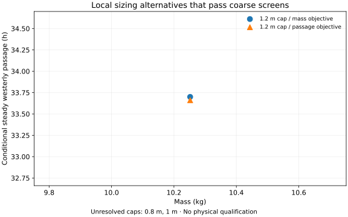

# IC-01: the candidate and its sizing results

**OOSEM:** Trades, optimization and analysis · [Current assessment](current-assessment.md)

**IC-01 is the working basis for my first physical boat.** I expect to refine it before construction. Its purpose is to carry sensing, guidance, sailing energy and independent recovery together, rather than size a sailing hull first and add those functions later. Its [allocation](../models/analyses/integrated-candidate.sysml) includes sensing/compute demand and recovery equipment in a fresh coupled evaluation. The [virtual acceptance requirement](current-assessment.md#integrated-simulation-evidence) combines those sizing results with representative mission and casualty simulations. It does not select catalog hardware or establish physical qualification.

The [navigation-rule replay](encounter-feasibility.md#navigation-assessments-in-the-ic-01-replay)
uses this configuration unchanged. It produces earlier aborts when encounter
assessments are missing, with no improvement in completion or accepted steering
choices. Its small energy reductions come from abandoned attempts, not greater
endurance. No new hardware load or sizing optimum is inferred from that study.

## Carry sensing and recovery in the same boat

The earlier 440 Wh reference could satisfy its nominal sailing screen, but left only about 4 Wh beyond the allocated voyage energy. It could not absorb the additional sensing loads I was investigating. IC-01 makes those functions explicit and carries an independent recovery system. Their mass and demand feed back into hull sizing and passage time.

| Quantity | Earlier sizing reference | IC-01 working candidate |
| --- | --- | --- |
| Overall swept length | 1.2 m | 1.2 m |
| Hull beam | 0.26 m | 0.42 m |
| Modeled mass | 10.3 kg | 20.1 kg |
| Main / separate recovery storage | 440 Wh / none | 1,300 Wh / 60 Wh |
| Conditional westerly passage | 33.9 h | 38.9 h |
| Main energy headroom after allocated reserve | 4 Wh | 102 Wh |
| Role | Earlier nominal sizing reference | Integrated capability allocation for refinement |

These are separate coupled configurations. The comparison shows how the allocated functions affect mass, energy and passage time; it does not isolate battery size as the cause or represent a measured hardware retrofit. IC-01 still needs a selected sensing installation, rig comparison, installation design and physical evidence. The [physical sensing shortlist](reference/sensing-configurations.md) identifies three primary layouts to investigate, with power, ranging and independent-recovery gaps that may change the next sizing result.

## Integrated candidate sizing

The [IC-01 calculation](../evidence/runs/2026-10-15-integrated-candidate/integrated-sizing.json) finds a balanced sailing solution for eight cases: two wind speeds, 5 and 8 m/s; sailing toward or away from the wind; and wind arriving from either side of the boat. In each case, the calculated forces and turning moments balance and the declared limits on loads, energy and geometry pass. These are steady sailing cases, not eight complete voyages.

The model predicts a westerly passage of about **39 hours**, with about **102 Wh** beyond the main pack's allocated voyage demand and reserve. A feasible result can be retained even if a later attempt to maximize speed reaches its iteration limit. I therefore use this as a working design, without claiming its speed or size is optimal.

| Quantity | IC-01 nominal result |
| --- | --- |
| Overall swept length / hull beam | 1.2 m / 0.42 m |
| Total modeled mass | 20.1 kg |
| Wing area | 0.4 m² |
| Main / independent recovery battery | 1,300 Wh / 60 Wh nameplate |
| Maximum sampled average / peak sailing bus load | 12.9 W / 15.6 W |
| Conditional westerly passage / energy exposure allowance | 38.9 h / 54.6 h |
| Main-pack departure / required energy | 936 Wh / 834 Wh |
| Main-pack headroom after allocated reserve | 102 Wh |

The energy allowance includes the existing 25% passage multiplier and six-hour delay, with no harvest credit. The 15 kg handling limit applies to individual modeled assemblies, not total vessel mass; those assembly screens pass. Structural, installation-volume and sampled static righting screens also pass under their provisional material and geometry assumptions. Resistance-domain checks are necessary bounds, not experimental validation of every hull within them. Neither these screens nor the larger energy margin establish real sensing, dynamic capsize recovery or full-course safety.

<details>
<summary>Earlier 440 Wh reference: detailed result and provenance</summary>

## Retained nominal sizing reference

The **1.2 m overall-length, 440 Wh reference** passes the nominal refined Gorge static screens on the selected Hood River bridge route. It has a 260 mm hull beam, weighs **10.313 kg**, predicts a **33.87-hour** conditional westerly passage, and retains **3.97 Wh** beyond the allocated voyage energy. This is a separate configuration from IC-01. It remains a preliminary design requiring sensitivity studies and physical evidence. Its structural margins use the provisional analysis basis; they do not qualify material properties, functional deformation limits or casualty flotation.

The [power and energy budgets](energy.md#current-candidate-budget) distinguish the two configurations and break the retained reference's demand into electronics, wind sensing, actuation, discharge losses, self-discharge and protected recovery reserve. Both identify the remaining installation evidence needs.

```sysml-report BlueDogSRRCurrentDocuments::Summary
```

[Earlier reference replay, mission outcomes and limitations](site-and-environment-evidence.md#configuration-specific-desktop-records)

</details>

## Search for alternatives, then choose a design

I compare alternatives under the 1.2 m overall-length limit, including the space swept by the wing and rudder. Separate searches seek lower mass and shorter passage time. That leaves the choice visible: I can compare any savings against recovery capability, construction effort and cost. The [sizing method](sizing.md) explains the variables and acceptance checks.

The archived search has not yet produced a useful spread of feasible alternatives. Its accepted results stayed close to the 1.2 m starting design; attempts at 1.0 and 0.8 m remain unresolved. That makes IC-01 a concrete basis for refinement, while leaving smaller designs an open question.

<details>
<summary>Archived search evidence and configuration limits</summary>

The bounded local study examines 1.2, 1.0 and 0.8 m overall-length caps. It retains feasible accepted iterates even if a later solver step fails. An unresolved search is not proof that a smaller boat is impossible. These are local monohull alternatives; they do not establish a global optimum or compare every hull architecture.

There is no minimum sailing-speed floor, 72-hour challenge deadline or daily energy-neutrality requirement. Stored energy is sized for a finite passage and protected recovery. The passage multiplier and delay allowance remain provisional design allocations in [the concept policy](../models/analyses/sizing/credibility.sysml).

In the archived search configuration, both coarse-feasible outputs remained effectively the same 1.2 m seed: their masses differ by less than 0.1 g and their conditional passage times by about 2.4 minutes. This bounded run has not yet produced a useful spread of design choices. The 1.0 and 0.8 m searches remain unresolved; infeasible terminal points are listed for diagnosis, not offered as alternatives.


These figures describe their archived configuration. Their feasibility verdicts do not apply to the current course.



```sysml-report BlueDogSRRFrontierDocuments::Summary
```

## What the finer replay establishes

```sysml-report BlueDogSRRFrontierDocuments::SeedReplay
```

In the archived seed replay, the retained 1.2 m seed balanced its operating cases, but the voyage-energy margin fell to −0.00556 as conditional passage changed from 33.66 to 33.74 hours. That seed is distinct from the 440 Wh candidate assessed above.

The sampled sealed-body recovery curves have pitch equilibria and positive restoring roll moments at all interior samples across four wing trims. That does not establish dynamic capsize recovery, pitch stability, structural integrity or recovery with damaged equipment. Unassisted self-righting can preserve qualification when safety capabilities remain available while inverted and upright control returns. Powered recovery to shore is a separate, disqualified outcome.

This replay applies to the retained seed, not automatically to every frontier alternative. It also does not include a calibrated weather-window completion probability. The environmental and traffic campaign must assess each selected candidate with the same scenario realizations before I compare mission outcomes.

</details>

## What needs to improve before selecting a boat

The useful next work is to replace IC-01's sensing and recovery allocations with credible installed equipment, test sensitivity to construction and foil assumptions, and compare eligible alternatives on the same chronological mission scenarios. Physical measurements of laminate stiffness, joints, actuator loads and wing behavior are still needed to establish model credibility.

Cost and construction effort need a bill of materials and process estimates. Recovery needs assessed shore approaches and casualty capabilities. Until those inputs exist, a mass-versus-time plot represents only part of the design decision.

The [current assessment](current-assessment.md) connects these findings to the requirements and remaining evidence. A solver pass does not qualify a vessel for an unattended trial.

[Archived run and source provenance](../evidence/runs/2026-10-13-srr-frontier/manifest.json) · [Generated model evidence](../models/evidence/srr-frontier.sysml)

**Next:** [Coupled sizing method](sizing.md) · [Series guide](index.md)
