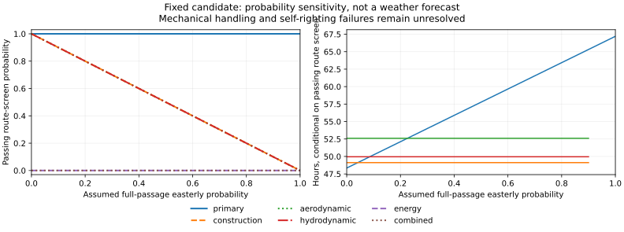

# Sizing Blue Dog for the Gorge

How small can I make the challenge vessel while keeping enough sailing performance, structural capacity and recovery capability? This is a [preliminary-design study](development-plan.md#virtual-design). Its inputs are the finite Gorge mission, chart-based course, manufacturing assumptions and provisional boat physics. Its output is a candidate to challenge with finer analysis and experiments before choosing dimensions for a build.

## What this search asks

The current search traces fixed-length feasibility stages toward 1.2 m, with the other 28 design variables and all 48 operating-state variables free. Length is fixed only within a stage; physical acceptance criteria remain unchanged. The selected weather-window profile requires progress on both legs in a westerly. Easterly performance is reported as a sensitivity. Safety, handling and structural screens remain mandatory in either wind direction.

The reference distance is 32.893 km per equivalent leg (65.786 km for the full reference circuit, including rounding), taken from the chart-derived route between the proposed gates. Actual sailing tracks include tacks and avoidance. There is no 72-hour deadline and no daily energy-balance constraint. The static solver checks instantaneous peak power; battery capacity and harvesting still need evaluation through the [chronological mission simulation](mission-simulation.md). That simulation currently uses its own conceptual vessel, so its completion counts do not qualify this sizing candidate.

## Reaching 1.2 m in the coarse model

The staged search found coarse-feasible candidates at **2.0, 1.8, 1.6, 1.4 and 1.2 m**. The earlier 2.009 m result was not a demonstrated size limit. Constrained feasibility correction made the first stages straightforward; the 1.4 m stage exhausted its iteration budget but met the existing acceptance tolerance. At 1.2 m, the retained checkpoint passed even though the final solver iterate continued restoring feasibility elsewhere. I stopped that extra work and recomputed every coarse check in a fresh model instance. The solver now stops on a feasible accepted iterate and preserves the best intermediate correction.

```sysml-report BlueDogContinuationDocuments::Summary
```

The 1.2 m point has maximum normalized equilibrium residual 5.67e-5 and minimum margin −4.66e-5, both within the unchanged 1e-4 numerical tolerance. Its estimated mass is **22.26 kg**, including **9.63 kg of ballast**, and the coarse persistent-westerly passage estimate is about **24 hours**. These are screening results, not a refined replay or a dynamic recovery demonstration.

There is a clear practical problem in this solution: its rudder is approximately **1.15 m chord by 0.08 m span**, with aspect ratio about **0.070**. The objective controls hull length, not the complete vessel's footprint, and the existing appendage model accepts this extreme geometry. We need credible appendage geometry and hydrodynamic applicability limits before treating this as a buildable boat. The battery also reaches its **50 Wh lower bound**; the static search has no voyage-energy constraint, so that capacity has not been shown to complete the challenge.

Next I will address appendage geometry and model coverage, connect candidate-specific energy demand to the mission simulation, then perform the finer operating and recovery replay. Flooded-wing cases remain failure sensitivities rather than mandatory search constraints. [Recorded continuation and provenance](../evidence/runs/2026-10-12-continuation/manifest.json) · [Model evidence](../models/evidence/sizing-continuation.sysml).

## Earlier 2.009 m reference and refined replay

The earlier free-length run started from the previously feasible geometry and re-evaluated it against the Bingen–Stevenson course. It retains a **2.009 m coarse-feasible candidate**. Length minimization reached a 0.804 m trial before its iteration limit, but that trial missed upstream progress, reserve volume, keel handling, wing drive and keel deflection screens and did not fully balance the operating equations. The subsequent feasibility-restoration phase also reached its evaluation limit. This establishes a candidate for further checks, not a minimum boat size or a design ready to build.

```sysml-report BlueDogEvidenceDocuments::CandidateBrief
```

The following reports retain the 2.009 m reference run; they do not describe the new 1.2 m point. The finer replay holds the candidate's geometry fixed and re-solves its operating controls across six engineering scenarios: primary, construction, aerodynamic, hydrodynamic, electrical and combined assumptions. These variations expose sensitivity; they are not measured uncertainty bounds.

<details>
<summary>Search outcome, scenario comparisons and limiting margins</summary>

```sysml-report BlueDogEvidenceDocuments::Summary
```

</details>

The sailing, structure and route screens use the selected challenge profile. The easterly passage column remains visible without becoming an extra challenge obligation. A diagnostic control solve that drops the peak-power check is identified separately. A route without positive progress has no completion time; its numerical penalty is not a predicted voyage duration.

The primary finer replay passes the selected westerly sailing, structure and route screens, with a conditional round-trip estimate of **21.4 hours**. Its easterly estimate is 41.2 hours, but upstream progress is only 0.249 m/s against the allocated 0.5 m/s target. These are persistent-wind route calculations, not chronological voyage or endurance predictions.

Primary, aerodynamic, hydrodynamic and electrical scenarios pass the selected static profile. Construction and combined sensitivity fail the operating and structural screens, with keel deflection among the limiting results. The construction assumptions therefore remain a priority for coupon and stiffness measurements.

A shorter course reduces passage time, but the current static search has no duration deadline or voyage-energy constraint. Its size-driving wind, current, structural and recovery screens therefore do not relax just because the route is shorter. The continuation result now demonstrates a smaller coarse-feasible point, while its unusual appendage geometry and unverified endurance still prevent a build decision.

## What a wind shift changes



This calculation keeps the candidate fixed and sweeps an assumed probability of a wholly easterly passage. It helps compare which engineering assumptions make wind shifts consequential. It does not estimate real mission-success probability or account for changing winds during a voyage. The [weather study](operating-constraints.md#gorge-weather-and-launch-windows) and mission simulation address those distinctions.

## What would justify a build decision

Sailing equilibrium is only one part of the decision. The [recovery assessment](structures-and-recovery.md) checks sealed, flooded and water-retaining wing states. Positive sampled roll moments cannot establish self-righting when pitch is unstable, and static equilibrium does not demonstrate a dynamic capsize recovery.

The [OpenVSP experiments](sail-trade.md#what-we-have-actually-run-in-openvsp) supply numerical wing trends for this study. Measured lift, drag, pitching moment and actuator loads remain important inputs, alongside printed/laminated construction mass and stiffness. Those measurements feed the [model-credibility loop](development-plan.md#model-credibility) before the analysis can support a build commitment.

[2.009 m replay candidate and exact values](../models/evidence/current-sizing.sysml) · [Run provenance](../evidence/runs/2026-10-12-bingen/manifest.json)

**Next:** [How the sizing search works](sizing.md).
