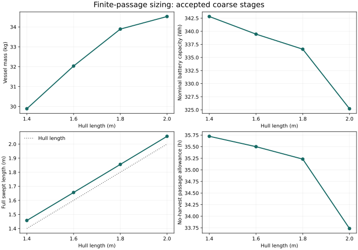
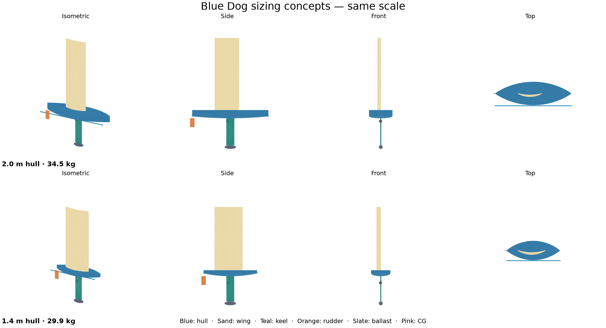

# Sizing Blue Dog for the Gorge

**Design phase:** Concept and preliminary design · PDR · [Development plan](development-plan.md)

The current search reaches a **1.4 m hull** with a plausible rudder shape and a battery sized for a finite passage. That is useful progress toward my 1.2 m hope, but it is still a heavy little boat: about **30 kg**, with a **1.46 m swept length**. Smaller trials remain unresolved, and the follow-up checks expose stiffness and pitch-stability problems that matter more than another decimal place of hull length.

This is a [preliminary-design study](development-plan.md#virtual-design). Its inputs are the Bingen–Stevenson challenge, chart-derived course, manufacturing assumptions and provisional boat physics. It informs the dimensions and experiments we should pursue next. The [sizing method](sizing.md) describes the calculations; the [mission simulation](mission-simulation.md) checks how a candidate behaves through changing weather and traffic.

The challenge now imposes a 1.2 m maximum overall length across normal operating configurations. The larger candidate discussed below is evidence from the preceding sizing baseline, not an eligible vessel. Its geometry and physics findings remain useful, but current acceptance requires a new constrained search and paired mission comparison. [The SRR review](srr-review.md) records that distinction.

## Making the smaller concept earn its dimensions

The search starts from the restored 2 m concept and reduces hull length in stages, leaving the other 28 design variables and 48 operating-state variables free. It retains the appendage geometry screens: underwater aspect ratio of at least 2, keel attachment within the hull, rudder stock no farther aft than the transom, and clearance around the rudder's steering disk. These are explicit provisional allocations, not measured performance limits.

This run adds two native SysML calculations. The finite-passage screen sizes the battery for 1.25 times the conditional westerly route time, plus six hours of delay and the protected recovery reserve, with no solar credit. The installation screen allocates space for battery and equipment inside the hull. Neither introduces a daily energy-balance requirement or a 72-hour deadline. Their assumptions and derivation links live in [the concept policy](../models/analyses/sizing/credibility.sysml).



```sysml-report BlueDogFinitePassageDocuments::Summary
```

Shortening the hull from 2.0 to 1.4 m removes roughly 4.6 kg, while nominal battery capacity rises from about 325 to 343 Wh. The smaller candidate takes longer in the conditional sailing calculation, so it needs more stored energy under the same passage policy. Hull length alone is therefore a poor proxy for portability.

The 1.4 m candidate has a rudder approximately **115 mm chord by 229 mm span**. Its full rotation-and-steering envelope is about **1.46 m long by 0.76 m wide**, with **2.59 m from keel bottom to wing top**. Those dimensions describe the upright operating geometry, not a packed transport arrangement. The volume screen leaves about 20 litres unallocated; local equipment fit, joints, access and printable segmentation still need a layout.

Both the 1.2 m exploration and the subsequent 1.3 m refinement were stopped without an accepted point at those lengths. Their checkpoints are retained. This does **not** establish a minimum feasible size. The accepted 1.4 m state meets the unchanged normalized numerical tolerance of 1e-4; several margins are essentially zero.

## Looking at the boat

Both candidates open at the same scale in the [blog's interactive comparison](https://davidingraham.github.io/research/?collection=sv-blue-dog&article=design-search-results#looking-at-the-boat). Orbit, zoom, switch viewpoints or download the GLB meshes. The waterline and center of gravity come from the native calculations. Rotation rings show the space swept by the wing and rudder.

```model-comparison
{"src":"https://davidingraham.github.io/sv-blue-dog/assets/concepts/candidates.json"}
```



The sketches use the solver's outer-envelope geometry. The deep keel and tall wing explain why a shorter hull is still a substantial object to handle. Equipment installation, joints and manufacturing segmentation remain to be designed.

## What actually limits this candidate

The tight nominal screens include keel, rudder and panel deflection; upstream progress; voyage energy; keel handling; and the resistance model's applicability boundary. The rudder is also almost exactly at the provisional aspect-ratio cutoff.

The fixed-design sensitivity checks help separate assumptions worth investigating:

- **Stiffness:** the declared lower-stiffness construction case produces deflection margins near −0.43. That is a material-property check at nominal loads, not a fully re-solved uncertain voyage. Laminate and joint measurements are a priority.
- **Energy:** increasing either the passage multiplier or the delay allocation consumes the nominal battery margin. The 35.7-hour no-harvest allowance is an allocation, not a prediction that every voyage will finish within it.
- **Packaging:** less generous battery density, equipment packing and usable hull volume still pass the aggregate volume check. Volume is not the immediate size driver in these probes.
- **Foil applicability:** increasing the minimum underwater aspect ratio from 2 to 3 rejects the current rudder. We need better low-aspect-ratio force and control evidence before deciding whether to change that allocation or the geometry.

## Following the candidate through a voyage

The [environmental mission replay](mission-simulation.md#current-sizing-candidate-replay) now re-solves both candidates with wind speed varying over wing height. For the 1.4 m hull at a 5 m/s reference wind, average water-relative VMG drops from 0.80 to 0.60 m/s upwind and from 1.19 to 0.66 m/s downwind. All tested operating cases still balance forces, but that does not establish route progress against the current or wave tolerance.

Four paired voyages compare uniform wind/calm water, wind shear/calm water, and wind shear/waves. Each calm-water arm completed one voyage. The wave-inclusive arm completed none: three trajectories exhausted the controller's safe choices and one left the available wind-performance range. Modeled significant wave heights reached 0.48–0.63 m. Wave-added resistance is still an uncalibrated sensitivity, so this is a reason to improve environmental evidence and guidance before shrinking the boat, not proof of a minimum feasible size. The [replay record](../evidence/runs/2026-10-13-surface-environment/summary.json) preserves the distinctions between controller stops and missing model coverage. The next [wave-averaged study](mission-simulation.md#wave-averaged-sailing-performance) holds the 1.4 m geometry fixed, computes linear vessel response, and re-solves mean sailing balance. Its small-wave performance cache is separate from the original resistance-only mission replay; unsupported Gorge seas must not inherit its small-wave predictions.

## Recovery is still an open design problem

Across 24 sealed-wing, free-pitch static samples, the roll moments point toward upright and every sample has a pitch equilibrium. **Eight equilibria are pitch-unstable.** Positive roll moments therefore do not demonstrate self-righting. This candidate needs a finer coupled recovery assessment before its dimensions become a build baseline; see the [structure and recovery method](structures-and-recovery.md).

My next step is to improve the evidence that drives the design: construction stiffness and joints, foil forces and rudder loads, coupled recovery, and mission performance over the weather range. Then I can repeat the same continuation with stronger assumptions. The 1.4 m result is a useful analysis baseline, not a commitment to build it.

[Current run and provenance](../evidence/runs/2026-10-12-finite-passage/manifest.json) · [Generated model evidence](../models/evidence/finite-passage-sizing.sysml) · [Earlier exploration](../evidence/runs/2026-10-12-finite-passage-exploration/manifest.json)

The older [2.009 m refined replay](../evidence/runs/2026-10-12-bingen/manifest.json) and [former 1.2 m result](../evidence/runs/2026-10-12-continuation/manifest.json) remain historical evidence. Their constraint sets differ, so their passes do not qualify this candidate.

**Next:** [How the sizing search works](sizing.md).
