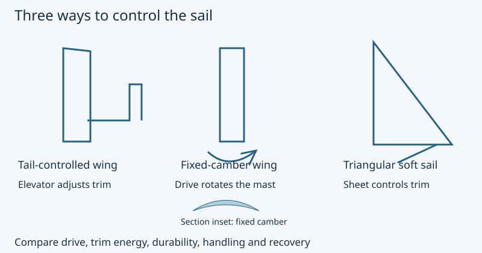

# Comparing sail architectures

**OOSEM:** Candidate physical architectures · [Maturity assessment](development-plan.md)

Which rig gives this boat a useful combination of drive, low trim power and recoverability? I am comparing three concepts during [preliminary design](development-plan.md#virtual-design), using the mission requirements, prior art and exploratory aerodynamic runs. The decision is still open: the fixed-camber wing gives me a concrete sizing experiment, while measurements must establish whether it deserves to become the selected rig.



*Three ways to trim a sail: elevator control, mast rotation and sheet tension.*

We compare control architecture separately from section camber. A tail-controlled wing and a directly rotated fixed-camber wing solve trim differently; either needs measured aerodynamic moments, actuator losses, structural loads and failure-state behavior. A soft sail remains a useful comparator rather than an assumed failure. The fixed-camber CAD wing is our sizing experiment, not a resolved winner of the trade.

I want to compare the rigs on the same terms. A promising lift curve is only part of the answer: the sail also has to survive unattended operation, use manageable trim power and let the boat recover from a capsize. A durability concern is worth investigating, but it is not a measured failure rate. I keep that distinction visible in the trade rather than hiding unknowns inside a weighted score.

The representative west-wind challenge puts the upstream return on a leeward course. That makes broad-reach/downwind performance important alongside windward efficiency. The [seasonal probability study](operating-constraints.md#gorge-weather-and-launch-windows) keeps easterly upriver performance as a separate sensitivity, especially for winter tests. It does not let us score any rig as a winner from the attached-flow VSPAERO grid: broadside flow and separated downwind operation still need evidence. Durability, controllability and recovery remain acceptance gates, not benefits traded away by a low weather frequency.

```sysml-report BlueDogSailTradeDocuments::Conclusion
```

The candidate definitions and gate logic live in the [trade model](../models/analyses/sail-trade.sysml). The [design decisions](../models/vehicle/decisions.sysml) explain the baseline used for sizing. [Source evidence](../models/vehicle/source-evidence.sysml) preserves the prior-art findings and their limits, including the square-sail precedent, Oshen PC13, tail control and non-backdrivable gearing.

The [mission development spirals](simulation-spirals.md#develop-the-trades-alongside-the-voyage) show how this open rig comparison supplies working candidates and how voyage-level consequences guide the next experiments.

## What changed my sizing assumptions

The useful result from VSP so far is a warning about the model, not a winning rig. Mesh choice affects the reference response, and heel changes the local flow in ways a single cosine factor misses. I therefore tightened operating angles and reduced the performance credited in primary sizing. Measurements are still needed to replace those judgments.


*Lift and pitching moment change as the reference-wing mesh is refined.*


*The projection error changes with wind direction: it overpredicts forward force at 45° and 90° and underpredicts it at 135° at substantial heel.*

## Obtain comparable evidence

I need comparable measurements of both-tack lift, drag and pitching moment over the intended trim range, including stall, broadside sailing and transitions. I also need electrical energy measured over the same move/hold/idle duty cycle. A gearbox that holds without motor current still has movement losses, controller demand and a retained-angle failure state.

For recovery, I will represent each body with its actual mass, center of gravity, geometry and flooding state. Free and locked rig angles, on both sides of a full roll, expose different failure cases. Pitch stability and dynamic release behavior need their own checks alongside sampled static righting moments. The [structures and recovery method](structures-and-recovery.md) describes that distinction.

This is where prototypes can resolve the uncertainties before I commit to geometry. Published [crescent-wing research](https://research.chalmers.se/publication/543872/file/543872_Fulltext.pdf) includes wind-tunnel comparisons, but its section geometry and test conditions differ from ours. It supports investigating the concept; it does not supply validated coefficients for our CAD. The [sizing workflow](sizing.md) therefore uses explicit conservative assumptions while other concepts remain open. Its numerical results do not complete the trade.

<details>
<summary>Full experiment gallery: geometry, sweeps, convergence, heel and reproduction</summary>

## What we have actually run in OpenVSP

The recorded work uses OpenVSP 3.54.0. We use a reference-wing study and a 200-point aspect-ratio/camber grid for finite-wing trends, a separate heel/incidence study to expose the limits of the boat model's projection, and representative mesh/wake checks within the restricted sizing domain. Figures are regenerated from immutable run records during each site build. Publishing them does not rerun the aerodynamic solver.

### Tested geometry

The reference wing is rectangular, with area 1 m², span 2 m, chord 0.5 m and aspect ratio 4. It uses the section extracted at the 150 mm span station of `SweptCrescentWing.STEP`. The section is reflected into aerodynamic coordinates and its chord-line tilt removed. This is a section experiment, not a replica of the swept CAD planform or a complete sail-and-hull installation.


The oblique screenshot rotates the geometry for display only. The aerodynamic runs use the saved model orientation. [Download the tested OpenVSP model](../evidence/vsp-geometry/reference-64.vsp3); the [capture manifest](../evidence/vsp-geometry/manifest.json) records its provenance and screenshot hashes.


The response grid holds area at 1 m² and changes aspect ratio through 2, 4, 6 and 8. Camber scales of 0.5, 1 and 1.5 retain the original thickness distribution. Each combination is run with forward and reversed chord coordinates; one additional zero-camber case at AR 4 provides a control. These are hypothetical section variants, not additional manufactured prototypes.


*Camber variants generated from the original CAD section while retaining its thickness distribution.*

### Alpha sweeps and mesh sensitivity

The reference sweeps cover −4° to 12° in 4° increments, with spanwise mesh parameters 16, 32 and 64 and corresponding chordwise tessellation `2 × mesh + 1`. These labels are tessellation settings, not total panel counts. The response grid uses mesh parameter 24 and covers −12° to 16° in 4° increments.

The original reference and response-grid sweeps use 5 m/s, air density 1.225 kg/m³, zero sideslip, Mach zero, and five wake iterations. Reynolds number is supplied as `5 × chord / 1.5e-5`; the reference value is approximately 167,000. Reference area, span and chord are set explicitly. Pitching moment is reported about midchord in the solver's axes.


Lift and pitching moment change with mesh refinement, so these curves should not be called mesh-independent. We check that sensitivity explicitly with mesh settings 24, 48 and 72 and wake counts 5, 15 and 30 at incidences −4°, 0°, 4° and 8°. The representative cases cover forward and reversed chord at zero spanwise inflow and forward chord at 20° spanwise inflow. This is 60 additional operating points, not a convergence certificate for every geometry in the response grid.


*Coefficient changes as mesh resolution and wake iterations increase.*

```sysml-report BlueDogEvidenceDocuments::AerodynamicChecks
```

All six final-increment checks pass the model's absolute coefficient-change screens. The coarse grid used for sizing still differs from the finest cases, as the second table shows; it is not mesh-independent. Passing means only that the last sampled increments are small enough for those screens. It does not validate separation, viscosity or the shedding-edge assumption. Markers are recorded samples; connecting lines do not imply additional solved points.

### Aspect ratio, camber and chord direction


*Alpha sweeps compare aspect ratios 2, 4, 6 and 8 at the original section camber.*


*Camber changes both sail forces and the moment the trim actuator must resist.*


*Induced drag plotted against lift for each aspect ratio.*

The drag plots show **induced drag only**, not total sail drag or boat performance. The reference output also contains a profile-drag estimate, but we have not validated it for this section and Reynolds-number range. It is deliberately excluded from these comparisons.


*Alpha sweeps with the chord facing forward and reversed.*

The direction comparison shows raw solver coordinates. Reversing the chord array is a geometric sensitivity experiment, not a validated opposite-tack polar. The optimization adapter separately transforms angle, lift and moment signs when representing reverse flow; these plots do not apply that transformation.

A direct VSPAERO experiment at aspect ratio 4.890 and camber scale 1.132 checks interpolation between grid samples. The comparison uses the same reference thickness, unit area, mesh and wake settings as the response grid. It does not test a thicker manufactured section or validate physical performance; the alpha range includes points outside the restricted sizing domain.


*Direct VSPAERO results compared with grid interpolation at the off-grid reference geometry.*

### What these results can establish

These runs support exploratory interpolation and sensitivity studies inside the sampled response grid. The plotted responses show the influence of camber and aspect ratio and the need to retain aerodynamic moments when sizing the trim actuator. They do not select a winning sail architecture or establish reliable performance bounds.

Primary sizing uses the [conservative aerodynamic policy](../models/analyses/aerodynamic-policy.sysml): reduced lift credit, increased drag, an independent pitching-moment allowance, nominal incidence limited to −4° through 8°, and sailing heel limited to ±20°. The geometry variables remain free. The [sizing results](results.md) report the current candidate and convergence outcome. Additional adverse aerodynamic assumptions are applied in replay. These factors are provisional engineering judgments, not measured confidence intervals or a demonstrated stall boundary; the [current results](results.md) must be read with that qualification.

VLM assumes attached, inviscid flow and a prescribed shedding edge. This CAD section has a rounded edge, making that shedding assumption particularly important. Increasing lift at the high-alpha endpoints does not demonstrate absence of stall. Broadside sailing, separation, real low-Re drag, both-tack transitions, gust response, mast interference and tail/elevator control are not validated here. No tail-controlled wing or soft-sail simulation is included in this dataset. The authoritative [aerodynamic decision and evidence gaps](../models/vehicle/decisions.sysml) retain those limits.

### Reproduce the figures

`uv run python -m tools.boat_analysis.evidence.aerodynamics` writes plots to `build/vsp-figures`. The standard publishing command generates the same assets for Pages without installing or running VSP. The plotter reads the archived records, verifies their hashes, and labels the figures with the solver settings and quantities shown.

To recapture the native geometry screenshots on Windows after installing the isolated VSP environment, run `uv run --project tools/boat_analysis/aerodynamics/vsp python -m tools.boat_analysis.aerodynamics.vsp.capture` from the repository root. This opens the graphics event loop, captures the archived geometry, and exits. New captures must be reviewed and their evidence manifest updated explicitly.

## Heel and incidence sweeps

The response grid holds spanwise inflow at zero. The boat force-balance model applies a cosine projection to upright lift, while the heel study resolves the changed flow direction in VSPAERO to test that approximation. The study motivates restricted operating angles and conservative sizing assumptions; it is not yet a full replacement polar for the optimizer.

The [SysML analysis case](../models/analyses/wing-heel.sysml) defines coverage and assumptions. This study uses the same fixed-camber rectangular reference wing at AR 4 and area 1 m², with 5 m/s horizontal apparent wind. Apparent-wind angles are 45°, 90° and 135° from the bow; signed heels are −40°, −20°, 0°, 20° and 40°. Each combination sweeps eight nominal upright incidences from −12° to 16°: **15 sweeps and 120 solved operating points**. Mesh parameter 24 and five wake iterations match the response-grid settings; this does not establish convergence at high spanwise inflow.

For each nominal incidence, mast trim is fixed relative to the boat while heel changes. The local angle of attack and spanwise inflow therefore change together. A nominal 8° point means the trim that produces 8° incidence upright, not a controller that maintains 8° at every heel. Across the full study the actual solver alpha spans approximately −19.5° to +23.5°, and spanwise angle reaches ±40°. These extremes extend beyond the original alpha grid and are especially vulnerable to separated-flow and stall errors; a converged algebraic solution would not establish their physical validity.

### Frames and loads

The right-handed world frame is **X aft, Y starboard, Z up**. Positive heel rotates about the aft axis and tilts the mast toward port. The wind velocity is horizontal, with direction `(cos(AWA), −sin(AWA), 0)`. Wing axes are chord X, span Y and section-normal Z. We transform wind into those axes using `R = Rx(heel) Rz(nominal incidence − AWA) Rx(90°)` and recover the solver angles from the transformed vector. At beam wind, the solver's spanwise angle is the negative of heel; at zero heel, every case recovers the original incidence and zero spanwise flow.

The direction and moment normalization follow the [VSPAERO solver conventions](https://github.com/OpenVSP/OpenVSP/blob/master/src/vsp_aero/Solver/VSP_Solver.C). Forces and moments are transformed back into world axes after solving. Forward force is `−Fx`; starboard and upward loads retain their signs. All plotted loads use **inviscid surface-integration results**, excluding the unvalidated profile-drag estimate. Moments are dimensionalized before rotation: roll/yaw coefficients use reference span, pitch uses reference chord.

The moment origin is the **wing-root midchord**, not the boat center of gravity. These are isolated-wing loads, not net vessel roll moments or a righting assessment. Positive and negative heel are both sampled; they are not a substitute for modeling the opposite sailing tack.


*With wind 45° from the bow, heel changes local incidence and spanwise inflow together.*


*At beam wind, the spanwise inflow angle is the negative of heel.*


*Wing forces and moments as heel changes with wind 135° from the bow.*

### Compare with the boat model's approximation

The heel-projection comparison near the start of this article holds nominal incidence at 8°. The dashed curve uses the upright inviscid lift and drag from this same study, multiplying lift by `cos(heel)` before resolving forward force. This isolates the projection approximation from profile-drag and discrepancy assumptions used elsewhere in the sizing model. The solid curve comes from the coupled local-alpha/spanwise-inflow solutions.


The cosine projection overpredicts forward force for the 45° and 90° wind cases and underpredicts it for the 135° case at substantial heel in this fixed-trim comparison. Heel therefore cannot be represented by one direction-independent loss factor. The optimizer retains that approximation provisionally, with the tighter angle limits and conservative assumptions described above. Replacing it requires consistent heel/wind/trim coverage across the aspect-ratio and camber grid, force/moment interfaces, and numerical and physical validation. A free-air uniform-flow study does not include the water surface, wave-induced motion, wind shear, mast/hull interference, stall or dynamic roll.

The [archived heel results](../evidence/runs/2026-10-11-heel/wing-heel-sweep.json) include actual solver alpha/beta, dimensional loads, model settings and source hashes; the [manifest](../evidence/runs/2026-10-11-heel/manifest.json) protects the record bytes. Re-run with `uv run --project tools/boat_analysis/aerodynamics/vsp python -m tools.boat_analysis.aerodynamics.vsp.heel_sweep`. Plotting and Pages builds use the archived evidence without launching VSP.


</details>

**Next:** [Follow the energy through the mission](energy.md).
