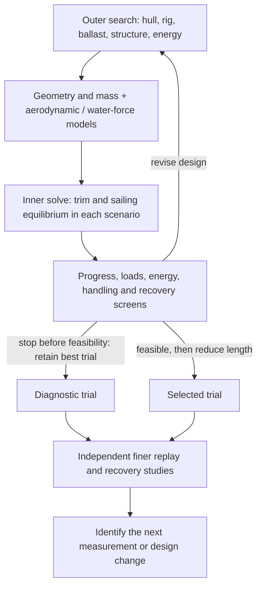

# Coupled sizing method

The design mission is the finite Gorge round trip. The static search enforces peak-power capability and a finite-passage battery allowance; daily energy balance and a completion deadline are not acceptance criteria. Each candidate can then drive the chronological mission simulation. The optimizer uses the passage screen, not a calibrated mission-success probability or an embedded Monte Carlo solve. Dynamic planing and speed-dependent failure exposure also need validated models; current results do not select between planing and displacement hulls.

How small can Blue Dog be and still make headway upriver? For [preliminary design](development-plan.md#virtual-design), I start with the route, wind and current assumptions, then vary the hull, wing, ballast and energy system together. I want to find which designs are worth developing and which assumptions I most need to test.


*Wing drive balances hull drag; the keel resists side force and ballast supplies restoring moment. Current converts speed through the water into progress over the ground.*



We trace a sequence of feasible designs toward the 1.2 m target. Each stage fixes only hull length and solves for the other 28 design variables and 48 operating-state variables. The preceding feasible design supplies the next starting point. The original free-length minimizer remains available for comparison. Numerical brackets describe model coverage and search limits. A bound hit requires investigation before claiming a minimum size.

The [concept credibility policy](../models/analyses/sizing/credibility.sysml) now screens underwater foil proportions and attachment geometry in both search and refined replay. Keel and rudder aspect ratios must be at least 2; this is a provisional screening allocation, not a validated accuracy boundary. The keel chord must fit beneath the hull, the rudder stock must stay at or forward of the transom (no unmodeled outrigger), and the keel and rudder's full steering disk must have at least 20 mm planform separation. The clearance remains provisional pending deflection and installation analysis. A different architecture can change these allocations with supporting geometry, mass and loads.

The rudder drive now uses the torque arm implied by the mid-chord stock and provisional quarter-chord force location: 25 percent of chord, replacing an unsupported 2-percent balance credit. This follows the attached-flow symmetric-section approximation ([NASA explanation](https://www1.grc.nasa.gov/beginners-guide-to-aeronautics/aerodynamic-center/)); it still needs measured hinge moments and off-design load cases.

These screens reject the archived 1.2 m candidate. Its numerical success remains historical evidence about the former model, not feasibility under today's constraints. Foil-model fidelity, chronological endurance evidence, detailed equipment fit, joints and bearings, fatigue/slamming and dynamic recovery remain open acceptance work. Hull length is not the complete vessel envelope; the current size objective still measures hull length. We have not allocated a maximum overall length or demonstrated a new minimum credible size.

The native [concept calculation](../models/libraries/marine/concept.sysml) couples storage to passage duration and candidate electrical demand. The nominal screening scenario credits no harvesting and uses 1.25 times the conditional westerly trip duration plus six hours of delay, at the largest operating bus load, with conversion losses and the modeled recovery reserve. The multiplier and delay are explicit engineering allowances, not weather statistics or a completion deadline. Solar collection is assessed separately on the chronological timeline. Changing battery capacity feeds back into mass, displacement, force balance and passage time.

Installed-volume screening subtracts hull material volume, then credits half the remaining void. Battery enclosure volume uses a provisional 200 Wh/litre and other equipment/actuator installation space uses 0.5 kg/litre. These allocations are sensitivity inputs, not selected hardware specifications. They prevent volume-free equipment but do not prove local fit, cable routing, access or watertight assembly. The geometry report separately records hull length, full wing/rudder swept extent and individual module dimensions; module bounds are not a verified packed transport arrangement or a print segmentation plan.

SysML owns the physical equations, named configurations, bounds, assumptions and acceptance criteria. Python evaluates geometric intersections and section properties, interpolates saved aerodynamic evidence and drives SciPy. Compiled array interfaces are confined to the runtime boundary. Reusable libraries have no dependency on Blue Dog requirements; application analyses connect them to the mission.

The model combines provisional attached-flow wing forces and moments, underwater appendage forces, hull resistance, static buoyancy, material accounting, laminate screens and actuator energy. Both tacks contribute to progress with weights that cancel crosswind drift. In the representative westerly challenge case, the downstream leg is windward and the upstream return is leeward; an easterly reverses them. River current helps the outbound leg and opposes the return in either case.

The [weather policy](../models/analyses/weather.sysml) separates a selected-weather-window challenge from eventual all-season capability. The default search requires the westerly route to pass; `--route-profile all-season` also requires easterly progress. Both profiles retain the operating, passage-energy, packaging, handling, structure and recovery screens, and both report easterly performance. This is a conditional design screen, not proof that a selected window will stay westerly.

The [seasonal observations and probability method](operating-constraints.md#gorge-weather-and-launch-windows) distinguish hourly wind frequency from whole-passage weather probability. We sweep the latter through the native model, reporting route-screen coverage separately from passage time conditional on passing. Failed or energy-unconstrained cases cannot disappear into an average. Until route and forecast evidence supports a distribution, the optimizer still minimizes length subject to its declared profile; no invented east-wind weight is hidden in its cost function.

The [aerodynamic policy](../models/analyses/aerodynamic-policy.sysml) makes the former adverse aerodynamic assumptions the primary sizing case. It limits nominal incidence and heel, reduces lift credit, increases drag, and assigns an independent pitching-moment allowance. These are engineering assumptions, not measured uncertainty bounds. All represented geometry, structure and energy variables remain adjustable, with length fixed only within each continuation stage; the restricted controls prevent the search from relying as heavily on high incidence and large heel.

VSPAERO supplies finite-wing trends within the archived grid. We retain the provisional upright-polar cosine projection in the force balance; the separate heel study demonstrates why this is a limitation. Published crescent-wing results do not match this CAD section closely enough to supply measured coefficients. Representative mesh/wake checks assess numerical sensitivity, while physical section polars, stall and moment measurements remain open evidence needs.

Feasibility restoration precedes the local size search. Derivatives respect interpolation-grid breakpoints. Small mesh reserves protect against numerical drift; they are separate from physical uncertainty. Continuation starts from the named appendage-screened archive and restores it against the current constraints before reducing length, targets 0.2 m length reductions, and halves unsuccessful steps down to 0.025 m. Each stage first seeks the closest feasible design with constrained SLSQP, then uses least-squares restoration if needed. Each method receives a budget of 60 iterations or residual evaluations respectively, with up to two extensions when violation norm improves by at least 5 percent. A failed stage also tries a wider-hull, reduced-wing/ballast starting guess; those changes are not constraints. A stage stops once an accepted iterate passes the unchanged feasibility tolerance; it does not continue polishing proximity to the seed. Separate records retain the smallest feasible design and best infeasible attempt, and restoration uses the best intermediate constrained correction rather than discarding it for a worse final iterate. No stage relaxes physical acceptance criteria. This is local feasibility tracing, not a proof that a failed length cannot work. Refined replay re-solves operating states with peak-power constraints, then identifies any diagnostic solve that removes that check. The finite energy and volume screens also run in refined replay; chronological mission evaluation remains necessary for actual weather and traffic histories. A failed local solve is not proof of physical impossibility.

<details>
<summary>Reproduce the search and refresh aerodynamic evidence</summary>

## Run the workflow

Use the package-free uv environment from the repository root. Native compiled execution uses Linux/GCC, including WSL. Keep Windows and Linux virtual environments separate.

```sh
uv sync --locked
uv run python -m tools.boat_analysis.cli install
uv run python -m tools.boat_analysis.cli validate
uv run python -m tools.boat_analysis.cli prepare
uv run python -m tools.boat_analysis.cli continue-sizing --target 1.2
uv run python -m tools.boat_analysis.mission.campaign --count 32 --candidate build/analysis/sizing-continuation.json
uv run python -m tools.boat_analysis.optimization.credibility build/analysis/sizing-continuation.json
# The original unconstrained-length search remains available:
uv run python -m tools.boat_analysis.cli solve
uv run python -m tools.boat_analysis.cli replay
uv run python -m tools.boat_analysis.cli recovery
uv run python -m tools.boat_analysis.cli pitch
uv run python -m tools.boat_analysis.cli audit
```

Continuation writes `build/analysis/sizing-continuation.json` and leaves the replay candidate untouched; a continuation result must be selected explicitly before refined replay. Preparation exports model inputs and compiles native calculations. Solving writes a candidate; replay and recovery are separate assessments. Outputs go to ignored `build/analysis`, not to authored documentation. Accepted records are archived without overwriting earlier runs and projected into named model instances for publication. The current run is identified on the [results page](results.md).

Replay holds the selected geometry fixed and re-solves controls for six hypotheses: the conservative primary case (stored as `nominal`), construction, additional aerodynamic degradation, hydrodynamic degradation, energy degradation, and their combination. These scenarios test sensitivity; they are neither probabilities nor demonstrated worst cases. An operating failure or pitch-unstable recovery sample remains visible even if the coarse sizing screen passed.

OpenVSP uses the separate package-free environment under `tools/boat_analysis/aerodynamics/vsp` because the pinned binary has its own Python ABI. Run its modules from the repository root with that uv project. The saved grid permits routine analysis without rerunning VSPAERO. Mesh convergence and a direct candidate comparison test numerical consistency; viscous drag, stall, broadside flow, thickness effects and dynamic sailing still need evidence.

The [results page](results.md) reports whether the current search reached feasibility and whether length minimization completed. A diagnostic trial remains useful for replay when a search stops before feasibility. The reusable geometry checks include analytic section properties, displaced-volume oracles, mass moments, force and torque invariance, and native/interpreted parity. Qualification remains broader than those software checks.

[Recorded outcomes](results.md) · [Sail concepts](sail-trade.md) · [Structures and recovery](structures-and-recovery.md)

## Refresh external wing evidence

The supported VSP installation is Windows with Python 3.13. From the repository root, use the separate locked environment:

```powershell
uv run --project tools/boat_analysis/aerodynamics/vsp python -m tools.boat_analysis.aerodynamics.vsp.install_vsp
uv run --project tools/boat_analysis/aerodynamics/vsp python -m tools.boat_analysis.aerodynamics.vsp.extract_sections
uv run --project tools/boat_analysis/aerodynamics/vsp python -m tools.boat_analysis.aerodynamics.vsp.reference_vsp --mesh 32
uv run --project tools/boat_analysis/aerodynamics/vsp python -m tools.boat_analysis.aerodynamics.vsp.polar_grid
uv run --project tools/boat_analysis/aerodynamics/vsp python -m tools.boat_analysis.aerodynamics.vsp.convergence
uv run --project tools/boat_analysis/aerodynamics/vsp python -m tools.boat_analysis.aerodynamics.vsp.check_candidate
```

Run the grid only when its CAD, coverage or solver settings change; it is substantially more expensive than document publication. New evidence is written under `build/analysis`. Regenerate native inputs after changing geometry evidence. Review results and provenance before archiving a new run and projecting it into the model; never overwrite an archived run in place.


</details>

**Next:** [Compare the sail concepts](sail-trade.md).

## Generating the concept geometry

The geometry exporter extracts oriented exterior surfaces from the same tetrahedra used for buoyancy and geometric metrics. Named hull, wing, keel, rudder and ballast components are exported in metres as GLB. A neutral-pose calculation supplies mass, center of gravity and the fixed-pitch upright waterline. Exported volume and bounds must agree with the analysis geometry; the mesh carries no invented internal equipment or manufacturing detail.

`uv run python -m tools.publishing.concepts --figures docs/figures` regenerates the archived starting and smallest accepted concepts, metadata and equal-scale fixed views. The Pages build also generates the interactive comparison. Each accepted continuation stage exports its own mesh and metadata outside the optimizer's evaluation loop. Source hashes identify the candidate and exporter; changing the geometry basis requires a new analysis record.
