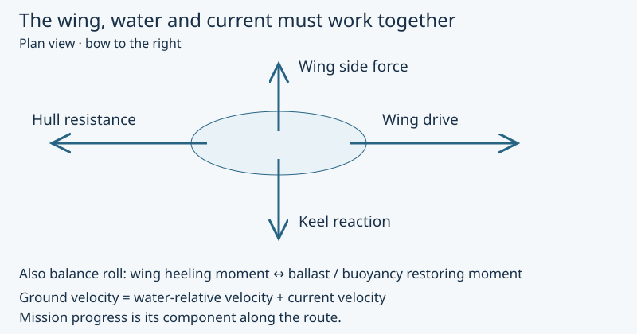
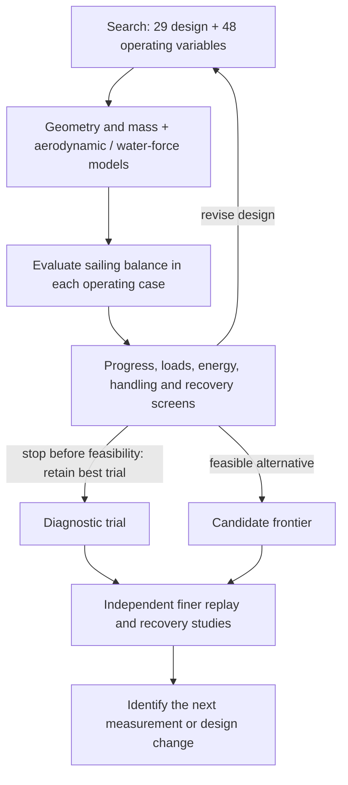

# Coupled sizing method

**OOSEM:** Trades, optimization and analysis · [Current assessment](current-assessment.md)

How much boat is needed to carry the equipment and finish the Gorge round trip? Hull, rig, ballast and battery cannot be sized independently: extra battery increases displacement, which changes speed and therefore the energy needed to finish. I solve those couplings before comparing candidate mass and passage time. The static calculation supplies a candidate to the chronological mission simulation; it does not estimate a probability of success.

The [integration candidate IC-01](../models/blue-dog.sysml) applies the same method to an explicit sensing and independent-recovery allocation. Added equipment demand and mass enter the coupled solve before the mission receives its performance envelope and energy accounts. A hull outside the resistance model's geometry domain cannot provide accepted sailing performance. The sizing checks and subsequent sailing and recovery scenarios must agree for the [integrated simulation assessment](current-assessment.md#integrated-simulation-evidence). The retained 440 Wh result remains a separately identified sizing reference.

IC-01 is the working basis for my first build. I use the search to challenge that allocation and find useful alternatives, rather than treating the smallest numerical answer as a construction decision.

The [physical sensing configurations](reference/sensing-configurations.md) now
give that search concrete installation questions. Camera coverage, compute,
protective windows and independent recovery observation must fit together.
Primary camera-ring loads already challenge the 8 W increment; provisional
mass subtotals leave unresolved recovery hardware within the shared 1.2 kg
allowance. I will use reconciled installation budgets and mounting geometry in
the next sizing comparison. Increasing hull detail before those quantities are
bounded could refine a boat that cannot carry its required safety functions.

## What the calculation means

A **sailing state** is one set of speed, heading, sail trim, leeway, rudder angle and heel for a specified wind and tack. The calculation seeks a state where drive balances resistance and the sideways forces and turning moments balance. A **screen** is a pass/fail check on that result: for example, whether it makes upstream progress, fits the available energy or keeps an assembly within its handling limit.

A **refined replay** holds the candidate's dimensions and equipment fixed, then recalculates its sailing states with finer numerical treatment and checks the limits again. For example, if the replay predicts a slower upstream return, the longer passage consumes more energy. A design that passed the first energy screen can then fail without any change to its battery. That is why I retain the replay result separately from the search result.

*Wing drive balances hull drag; the keel resists side force and ballast supplies restoring moment. Current converts speed through the water into progress over the ground.*

## Search objectives and geometry limits

The sizing search treats 1.2 m overall length as a challenge limit, including the modeled wing and rudder sweeps. At each selected overall-length cap, hull length and the other 28 design variables remain free alongside 48 operating-state variables. Separate mass and conditional passage-time objectives retain alternatives for comparison; they do not combine preferences into a handicap score. If the best result lies at a numerical search bound, I need to investigate that bound before drawing a physical design conclusion.

The search compares local monohull alternatives at 0.8, 1.0 and 1.2 m overall-length caps. Each promising result needs a finer replay at fixed geometry and the same chronological mission scenarios before it can inform selection. Cost and construction effort need separate estimates.

The [concept credibility policy](../models/blue-dog.sysml) screens underwater foil proportions and attachment geometry in both search and refined replay. Keel and rudder aspect ratios must be at least 2; this is a provisional screening allocation, not a validated accuracy boundary. The keel chord must fit beneath the hull, the rudder stock must stay at or forward of the transom (no unmodeled outrigger), and the keel and rudder's full steering disk must have at least 20 mm planform separation. The clearance remains provisional pending deflection and installation analysis. A different architecture can change these allocations with supporting geometry, mass and loads.

The rudder drive uses the torque arm implied by the mid-chord stock and provisional quarter-chord force location: 25 percent of chord. This follows the attached-flow symmetric-section approximation ([NASA explanation](https://www1.grc.nasa.gov/beginners-guide-to-aeronautics/aerodynamic-center/)); it still needs measured hinge moments and off-design load cases.

Foil-model fidelity, chronological endurance evidence, detailed equipment fit, joints and bearings, fatigue/slamming and dynamic recovery remain open work. The overall-length constraint includes the hull and swept appendages. The current candidate and its evidence are described in the [results](results.md); a minimum credible size has not been demonstrated.

## Couple storage, mass and passage time

The native [concept calculation](../models/libraries/analysis.sysml) couples storage to passage duration and candidate electrical demand. The nominal screening scenario credits no harvesting and uses 1.25 times the conditional westerly trip duration plus six hours of delay, at the largest operating bus load, with conversion losses and the modeled recovery reserve. The multiplier and delay are explicit engineering allowances, not weather statistics or a completion deadline. Solar collection is assessed separately on the chronological timeline. Changing battery capacity feeds back into mass, displacement, force balance and passage time.

Installed-volume screening subtracts hull material volume, then credits half the remaining void. Battery enclosure volume uses a provisional 200 Wh/litre and other equipment/actuator installation space uses 0.5 kg/litre. These allocations are sensitivity inputs, not selected hardware specifications. They prevent volume-free equipment but do not prove local fit, cable routing, access or watertight assembly. The geometry report separately records hull length, full wing/rudder swept extent and individual module dimensions; module bounds are not a verified packed transport arrangement or a print segmentation plan.

The [modeling reference](methods/modeling.md) explains how the equations, assumptions and acceptance criteria remain connected to each result. Numerical search and geometric calculations use those same declared inputs.

## Sailing and environmental assumptions

The model combines provisional attached-flow wing forces and moments, underwater appendage forces, hull resistance, static buoyancy, material accounting, laminate screens and actuator energy. Both tacks contribute to progress with weights that cancel crosswind drift. In the representative westerly challenge case, the downstream leg is windward and the upstream return is leeward; an easterly reverses them. River current helps the outbound leg and opposes the return in either case.

The [weather policy](../models/blue-dog.sysml) separates a selected-weather-window challenge from eventual all-season capability. The current frontier search requires the westerly route to pass and also reports easterly performance. The all-season profile available in the diagnostic sizing tools additionally requires easterly progress. Both profiles retain the operating, passage-energy, packaging, handling, structure and recovery screens. This is a conditional design screen, not proof that a selected window will stay westerly.

The [seasonal observations and probability method](operating-constraints.md#gorge-weather-and-launch-windows) distinguish hourly wind frequency from whole-passage weather probability. The study sweeps the latter through the native model, reporting route-screen coverage separately from passage time conditional on passing. Failed or energy-unconstrained cases cannot disappear into an average. The current frontier search minimizes mass and conditional passage time in separate runs at each overall-length cap. Weather probabilities are not hidden weights in either objective.

The [aerodynamic policy](../models/blue-dog.sysml) applies conservative assumptions to the primary sizing case. It limits nominal incidence and heel, reduces lift credit, increases drag, and assigns an independent pitching-moment allowance. These are engineering assumptions, not measured uncertainty bounds. All represented geometry, structure and energy variables remain adjustable within the overall-length cap. The restricted controls prevent the search from relying as heavily on high incidence and large heel.

VSPAERO supplies finite-wing trends within the archived grid. The calculation retains the provisional upright-polar cosine projection in the force balance; the separate heel study demonstrates why this is a limitation. Published crescent-wing results do not match this CAD section closely enough to supply measured coefficients. Representative mesh/wake checks assess numerical sensitivity, while physical section polars, stall and moment measurements remain open evidence needs.

The [surface-environment replay](mission-simulation.md#wind-at-wing-height-and-waves-along-the-route) checks fixed candidates with height-resolved wind loads and directional wave sensitivities before another size reduction. The archived sizing pass remains a uniform-flow, calm-water result. The [wave-averaged operating solver](mission-simulation.md#wave-averaged-sailing-performance) closes mean sailing balance at fixed geometry using calculated heave, roll and pitch response. A new size optimum should wait for review of response coverage, damping and wave-force assumptions.

## Check a result before accepting it

A numerical search first seeks a feasible design, then improves its declared objective. A finer replay holds geometry fixed and re-solves operating states, including peak power, finite energy and installed volume. Small numerical reserves protect against mesh drift; they are distinct from physical uncertainty. Failed solves retain diagnostic trials because they can reveal a binding constraint or a poor initial guess. They do not prove that a smaller boat is physically impossible.

The older length-minimization search and fixed-hull-length continuation remain diagnostic tools. Their stage sizes, restoration methods and iteration budgets are described in the [workflow reference](reference/sizing-workflow.md#diagnostic-continuation); they are not the objectives of the current frontier comparison.

[Search commands, diagnostic continuation and geometry exports](reference/sizing-workflow.md) document the executable workflow.

**Next:** [Comparing sail architectures](sail-trade.md) · [Series guide](index.md)
