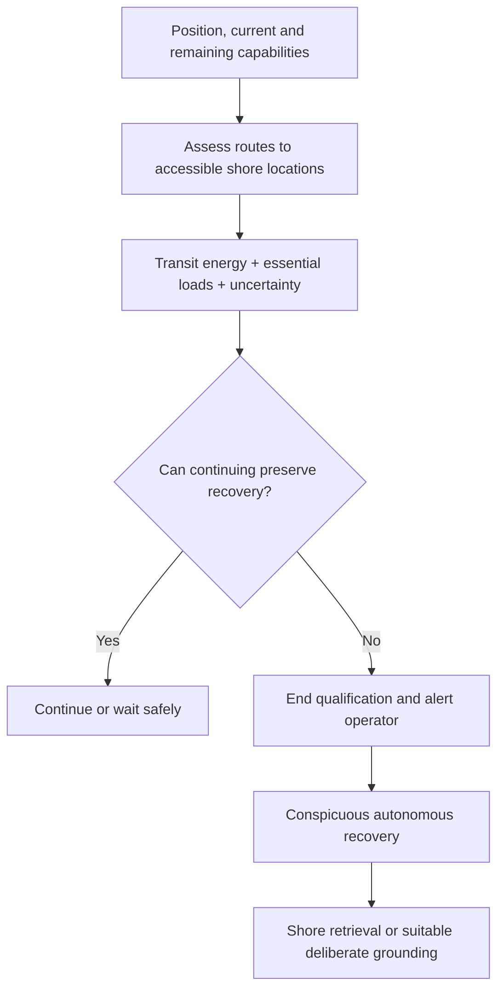
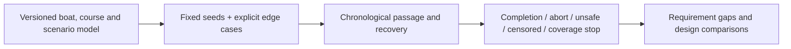

# Blue Dog system requirements review

**Design phase:** Mission and requirements · SRR · [Development plan](development-plan.md)

This review asks whether the mission and requirements are clear enough to develop the boat. The model changes are being integrated; **SRR is open**. The [technical appendix](srr-appendix.md) separates evidence, limitations and proposed actions. Your review determines the disposition.

## 1 · A small boat with a definite job

Build an autonomous sailboat that completes the Gorge round trip and can recover to shore when continuing is unsafe. I want to learn digital engineering while building something I can transport, manufacture and test myself.

Hawaii remains a future mission. This review concerns the finite Gorge challenge.


The testbed informs construction and control experiments; it is not the challenge-vessel design.

## 2 · The course is the mission backbone


Launch and retrieval at Bingen Point are outside the scored passage. Gate placement, bridge transit and shore recovery approaches need a reviewed course configuration. Current notices belong in launch readiness.

[Course definition](../models/missions/course.sysml) · [Mission simulation](mission-simulation.md)

## 3 · Qualification has a clear boundary

```sysml-view SRR_Qualification::scope direction=BT statements=true
package SRR_Qualification {
    private import StandardViewDefinitions::*;
    private import DiagramLayout::*;
    view scope : GeneralView {
        filter @SysML::RequirementUsage;
        expose GorgeChallenge::transGorgeChallenge;
        expose GorgeChallenge::courseCompletion;
        expose GorgeChallenge::overallLength;
        expose GorgeChallenge::unassistedAttempt;
        expose GorgeChallenge::sailingPropulsion;
        expose GorgeChallenge::unattachedPassage;
        metadata Layout about GorgeChallenge::transGorgeChallenge { x = 0; y = 0; }
        metadata Layout about GorgeChallenge::courseCompletion { x = 320; y = 0; }
        metadata Layout about GorgeChallenge::overallLength { x = 640; y = 0; }
        metadata Layout about GorgeChallenge::unassistedAttempt { x = 0; y = 400; }
        metadata Layout about GorgeChallenge::sailingPropulsion { x = 320; y = 400; }
        metadata Layout about GorgeChallenge::unattachedPassage { x = 640; y = 400; }
    }
}
```

Safe waiting is allowed. Refuge, grounding, anchoring, intervention or recovery propulsion ends the attempt; a later attempt starts again at the departure gate.

## 4 · Safety takes priority over finishing

```sysml-view SRR_Safety::scope direction=BT statements=true
package SRR_Safety {
    private import StandardViewDefinitions::*;
    private import DiagramLayout::*;
    view scope : GeneralView {
        filter @SysML::RequirementUsage;
        expose GorgeChallenge::transGorgeChallenge;
        expose GorgeChallenge::navigationRules;
        expose GorgeChallenge::trafficCoexistence;
        expose GorgeChallenge::trafficNonInterference;
        expose GorgeChallenge::safetyCapabilityAbort;
        expose GorgeChallenge::autonomousShoreRecovery;
        metadata Layout about GorgeChallenge::transGorgeChallenge { x = 0; y = 0; }
        metadata Layout about GorgeChallenge::navigationRules { x = 320; y = 0; }
        metadata Layout about GorgeChallenge::trafficCoexistence { x = 640; y = 0; }
        metadata Layout about GorgeChallenge::trafficNonInterference { x = 0; y = 400; }
        metadata Layout about GorgeChallenge::safetyCapabilityAbort { x = 320; y = 400; }
        metadata Layout about GorgeChallenge::autonomousShoreRecovery { x = 640; y = 400; }
    }
}
```

A failed component need not end the attempt if a demonstrated backup preserves the required function. Loss of the function requires an onboard decision; contact with the operator is not a prerequisite.

## 5 · No littering drives casualty recovery

```sysml-view SRR_Recovery::scope direction=BT statements=true
package SRR_Recovery {
    private import StandardViewDefinitions::*;
    private import DiagramLayout::*;
    view scope : GeneralView {
        filter @SysML::RequirementUsage;
        expose GorgeChallenge::transGorgeChallenge;
        expose GorgeChallenge::noLittering;
        expose GorgeChallenge::casualtyFlotation;
        expose GorgeChallenge::majorComponentRetention;
        expose GorgeChallenge::capsizeRecovery;
        metadata Layout about GorgeChallenge::transGorgeChallenge { x = 0; y = 0; }
        metadata Layout about GorgeChallenge::noLittering { x = 320; y = 0; }
        metadata Layout about GorgeChallenge::casualtyFlotation { x = 640; y = 0; }
        metadata Layout about GorgeChallenge::majorComponentRetention { x = 0; y = 400; }
        metadata Layout about GorgeChallenge::capsizeRecovery { x = 320; y = 400; }
    }
}
```

The requirement is recovery after capsize. Self-righting is one possible solution; inverted powered recovery is another. Neither has been physically demonstrated for the eventual boat. The present monohull sizing study screens self-righting as a vehicle design allocation; the challenge itself permits another demonstrated recovery solution.

## 6 · Recovery follows the course



The implementation now models route-dependent reserve and powered approach. Real pickup sites, final shore capture and impaired-sensing risk remain open evidence items.

## 7 · Monitoring does not steer the boat

The boat makes mission and weather decisions onboard. The operator watches position, mode and health, and can intervene to end qualification.

Autonomous weather polling is allowed; manual data pushes are not. Communications loss alone does not end a safe attempt. Critical alerts are queued during outages.

[Observation and outage requirements](../models/missions/transgorge.sysml) · [Communications implementation requirements](requirements/requirements-safety.md)

## 8 · Define exposure before claiming capability

```sysml-report BlueDogSRRDocuments::EnvironmentProposal
```

These are **review proposals**, not measured extremes or accepted launch limits. The fetch sensitivity exposed a mismatch in the old wave allocation. Current, wakes and storm recovery require further evidence before acceptance.

Darkness is included. Fog matters when it compromises a required safety capability. Calm is a possible waiting state, not an automatic mission failure.

[Environmental basis and limitations](../models/analyses/environment-review.sysml)

## 9 · Reproducible scenarios challenge the requirements



Keep the same realizations across candidates. Record the scenario generator and inputs as well as seeds. Synthetic completion fractions do not establish real-world reliability.

[Simulation methods](mission-simulation.md)

## 10 · Choose a boat from a frontier

Sweep overall-length caps while leaving hull length and the remaining parameters free. Retain alternatives showing the trade between mission outcomes, passage time, mass, recovery margin, cost and construction effort.

There is no handicap score and no fixed sailing-speed floor. The reliability target is provisional. The design team chooses the preferred balance and records its rationale.

A retained candidate fits the 1.2 m envelope and passes coarse checks, but its finer replay misses the voyage-energy allocation. Local searches do not establish a minimum feasible size or a calibrated mission probability.

```sysml-report BlueDogSRRFrontierDocuments::SeedReplay
```

[Alternatives, scope and unresolved searches](results.md)

## 11 · Keep construction practical

Individual printed parts fit a 250 × 250 × 250 mm build volume; joined assemblies may be larger and bought components need not be printed. One person handles transport, assembly, launch and retrieval, using simple aids and removable components.

The next experiments should inform structural mass, seams, wing behavior, actuator loads and casualty recovery. Their results feed the model before detailed design release.

[Manufacturing requirements](requirements/requirements-practicality.md) · [Structure and recovery methods](structures-and-recovery.md)

## 12 · Three kinds of evidence

| Evidence | What it can establish now | What it cannot establish |
| --- | --- | --- |
| Native model and regression checks | Consistent criteria and implemented behavior in supplied cases | Physical vessel performance |
| Mission and sizing studies | Conditional predictions and sensitivity | Calibrated mission probability outside their validity |
| Physical tests | Measured behavior for the tested configuration | Automatic transfer to a different boat or environment |

[Verification plans](../models/missions/verification.sysml) remain inconclusive until supported by the required evidence.

## 13 · Actions before accepting the baseline

Resolve the course and recovery-site assessment; review environmental allocations and encounter criteria; finish propagating decisions into sizing and all verification consumers; and rerun the published evidence against the final configuration.

The absence of a backup recovery detector is a design choice requiring residual-risk analysis. Failure likelihood, traffic exposure, consequences and common causes all matter; low probability has not been established.

[Review action detail](srr-appendix.md#review-actions)

## 14 · Your SRR disposition

The available decisions are **proceed**, **proceed with limitations**, or **iterate**. No decision is recorded yet.

A limited release can authorize concept development and focused experiments. It does not authorize an unattended challenge trial or certify the current numerical design.

Review the baseline and proposed allocations, add actions, and identify the limits of any approval. I will implement the resulting actions and return the changed evidence for review.

[Technical appendix](srr-appendix.md) · [Development plan](development-plan.md)
