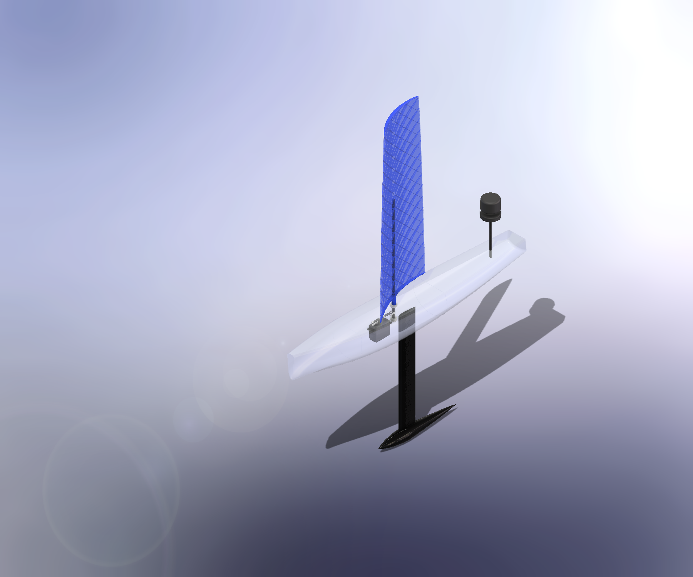
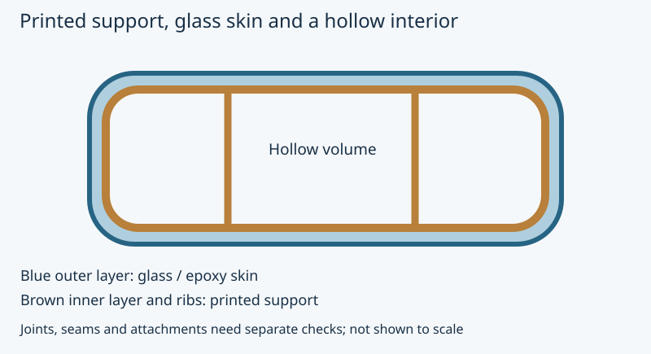
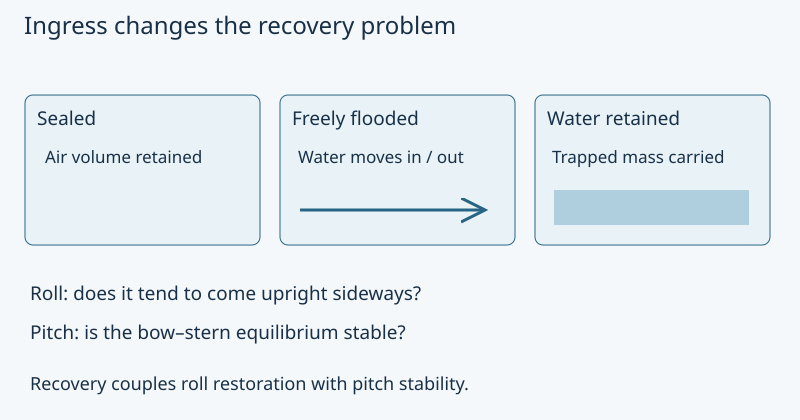

# Manufacturing, structure and recovery

**OOSEM:** Candidate physical architectures · [Maturity assessment](current-assessment.md)

Can I manufacture this boat within its mass budget, and recover safely after an upset? I use the candidate geometry, printed construction, glass laminate and flooding assumptions to connect [sizing](current-assessment.md#virtual-design) with [detailed design](current-assessment.md#detailed-design). Coupon and recovery experiments will decide how much confidence those calculations deserve.

The original CAD work made construction part of the sizing problem. Printed walls and ribs, wet glass/epoxy, seams and finish contribute to mass. That design is historical; my first complete build will be a refined IC-01-scale boat. Component fixtures and coupons can answer construction questions before I commit to its geometry.



The [weather-window mission](operating-constraints.md#gorge-weather-and-launch-windows) changes which sailing performance I emphasize, not the need to withstand loads or recover from a capsize. I keep those screens as hard constraints. Winter trials also need material, sealing and recovery evidence applicable to their temperature and weather conditions.



*Glass and epoxy form the outer skin around printed walls and ribs. The mass model includes both; the bending model credits the glass laminate.*

I initially used 10 GPa stiffness and 50 MPa strength to explore the laminate sizing. Those remain unverified study inputs, not material acceptance floors. Coupon evidence establishes the properties I can credit; geometry and reinforcement must then satisfy the applicable loads and validated functional deformation limits. The [design-basis record](methods/modeling.md#requirements-versus-design-assumptions) separates these inputs from requirements, including the preliminary pressure, freeboard, reserve-buoyancy and launch screens.

The current stiffness calculation uses finite laminate sections from inward offsets of the actual geometry. The calculation credits the glass laminate for bending while treating printed support, joints and attachments as separate evidence obligations.

```sysml-view Page_structures_and_recovery_0::StrengthRelationships direction=BT
package Page_structures_and_recovery_0 {
    private import StandardViewDefinitions::*;
    private import DiagramLayout::*;
    view StrengthRelationships : GeneralView {
        filter @SysML::RequirementUsage;
        expose BlueDogStructure::structuralIntegrity;
        expose BlueDogStructure::bendingStrength;
        expose BlueDogStructure::panelStrength;
        expose BlueDogStructure::rootProofLoad;
        metadata Layout about BlueDogStructure::structuralIntegrity { x = 400; y = 0; }
        metadata Layout about BlueDogStructure::bendingStrength { x = 0; y = 240; }
        metadata Layout about BlueDogStructure::panelStrength { x = 400; y = 240; }
        metadata Layout about BlueDogStructure::rootProofLoad { x = 800; y = 240; }
    }
}
```

```sysml-view Page_structures_and_recovery_1::StiffnessRelationships direction=BT
package Page_structures_and_recovery_1 {
    private import StandardViewDefinitions::*;
    private import DiagramLayout::*;
    view StiffnessRelationships : GeneralView {
        filter @SysML::RequirementUsage;
        expose BlueDogStructure::structuralIntegrity;
        expose BlueDogStructure::appendageDeflection;
        expose BlueDogStructure::hullDeflection;
        expose BlueDogStructure::panelDeflection;
        metadata Layout about BlueDogStructure::structuralIntegrity { x = 400; y = 0; }
        metadata Layout about BlueDogStructure::appendageDeflection { x = 0; y = 240; }
        metadata Layout about BlueDogStructure::hullDeflection { x = 400; y = 240; }
        metadata Layout about BlueDogStructure::panelDeflection { x = 800; y = 240; }
    }
}
```



*Water ingress changes the wing’s buoyancy and carried mass. Recovery depends on both roll restoration and pitch stability.*

The sizing search uses a coarse fixed-pitch recovery screen alongside sailing, structure and energy constraints. I then solve displaced volume and its centroid at a specified attitude, balance heave and pitch, and inspect full-roll restoring curves for several mast positions at the selected geometry. Positive roll moments do not establish a dynamic recovery path, particularly on a pitch-unstable branch. Sealed, freely flooded and retained-water cases answer different questions and remain separate. Restricting sailing heel in the aerodynamic policy does not restrict the full-roll recovery assessment or relax its requirements.

The smaller finite-passage candidates are checked separately from the older full-curve study. Their current sealed-wing probe samples six roll angles at four locked mast positions and records pitch stability as well as restoring direction. The [current sizing results](results.md) distinguish IC-01 from the earlier reference. Material stiffness remains an unmeasured input; the published static passes do not replace coupon and assembly tests. Positive roll restoration alone has not established self-righting.

## Archived 2.009 m ingress study

The following archived 2.009 m reference study covers sealed, freely flooded and retained-water states in fresh and salt water. It contains pitch-unstable equilibria and adverse flooded-wing restoring samples. These are historical sensitivity results, not a replay of the smaller candidate; sealed-wing results cannot establish ingress tolerance.

```sysml-report BlueDogEvidenceDocuments::Recovery
```

<details>
<summary>Archived full recovery curves for the 2.009 m reference</summary>


</details>

Unassisted self-righting and powered recovery answer different needs. A boat that rights itself and restores the required safety capabilities without intervention may continue qualifying. IC-01 also allocates inverted powered recovery for a casualty that cannot do so; using that path ends qualification. Neither sampled static righting moments nor a simulated shore approach demonstrates either physical capability.

The model owns material assumptions, numerical allocations, practical handling constraints and their rationale. Wet coupons, assembly proof tests, ingress/drainage and dynamic releases must replace those assumptions with evidence before qualification.

[Sizing method](sizing.md) · [Recorded numerical evidence](results.md)

**Next:** [Comparing recovery propulsion](recovery-propulsion.md) · [Series guide](index.md)
